**BÁO CÁO TIẾN ĐỘ TUẦN 2**

**Đề tài: Website có tính sẵn sàng cao với Application Load Balancer và EC2 Auto Scaling**

**Môn học:** Điện toán đám mây

**Lớp học:** CLCO332779_05UTExMC

**GVHD:** TS. Huỳnh Xuân Phụng

**Thời gian:** Tuần 2 (tính từ ngày 12/10/2026)

**Git:** [https://github.com/tranvannghia240806-hub/baocaocloud_24110287_24110282](https://github.com/tranvannghia240806-hub/baocaocloud_24110287_24110282)

**Sản phẩm tuần 2 trên GitHub:**

- Báo cáo tuần 2 (docx): [docs/Bao_cao_tuan_2.docx](https://github.com/tranvannghia240806-hub/baocaocloud_24110287_24110282/blob/175e873/docs/Bao_cao_tuan_2.docx)
- Bảng phân công và worklog tuần 2: [docs/Bang_phan_cong_va_worklog_tuan_2.docx](https://github.com/tranvannghia240806-hub/baocaocloud_24110287_24110282/blob/175e873/docs/Bang_phan_cong_va_worklog_tuan_2.docx)
- Sơ đồ kiến trúc: [docs/architecture.png](https://github.com/tranvannghia240806-hub/baocaocloud_24110287_24110282/blob/175e873/docs/architecture.png)
- User data của Launch Template: [scripts/user-data.sh](https://github.com/tranvannghia240806-hub/baocaocloud_24110287_24110282/blob/175e873/scripts/user-data.sh)
- Ảnh minh chứng (19 ảnh): [docs/images/tuan2/](https://github.com/tranvannghia240806-hub/baocaocloud_24110287_24110282/tree/main/docs/images/tuan2)
- Commit "Tuan 2" (17/10/2026): [175e873](https://github.com/tranvannghia240806-hub/baocaocloud_24110287_24110282/commit/175e873)


| **MSSV** | **Họ và tên**        | **Chức vụ** |
|----------|----------------------|-------------|
| 24110287 | Trần Văn Nghĩa       | Nhóm trưởng |
| 24110282 | Kiên Nguyễn Xuân Lưu | Thành viên  |

# 1. Mục tiêu tuần 2

Theo kế hoạch của giảng viên, tuần 2 gồm: triển khai các chức năng lõi trên AWS và kiểm thử từng thành phần. Nhóm triển khai Launch Template, Target Group, Application Load Balancer và Auto Scaling Group (min 1 - max 4, t3.micro) kèm Target Tracking Policy và thời gian warm-up, sau đó kiểm thử từng thành phần.

Kết quả mong đợi cuối tuần: website chạy trên EC2 phía sau ALB, trải trên 2 Availability Zone; ASG tự thay thế instance lỗi; Target Tracking Policy (CPU 50%) và warm-up được cấu hình, sẵn sàng cho việc đo đạc scale-out/scale-in ở tuần 3.

# 2. Phân công công việc

| **Thành viên**           | **Công việc tuần 2**                                                                                                                                                                                                                                      |
|--------------------------|-----------------------------------------------------------------------------------------------------------------------------------------------------------------------------------------------------------------------------------------------------------|
| **Trần Văn Nghĩa**       | Viết user data và tạo Launch Template; tạo Auto Scaling Group gắn Target Group, bật ELB health check; cấu hình Target Tracking Policy (CPU 50%) và thời gian warm-up; quan sát hoạt động của Target Tracking (scale-in tự động); tổng hợp báo cáo tuần 2. |
| **Kiên Nguyễn Xuân Lưu** | Kiểm tra nền tảng tuần 1; tạo Target Group và Application Load Balancer; kiểm thử ALB, cân bằng tải 2 AZ, chặn truy cập trực tiếp vào EC2 và tự phục hồi; thu thập ảnh minh chứng; theo dõi CloudWatch (Activity, Alarms); dọn dẹp tài nguyên cuối buổi.  |

| **Ngày**     | **Trần Văn Nghĩa**                                                                                                                                                          | **Giờ** | **Kiên Nguyễn Xuân Lưu**                                                                                                                                                                            | **Giờ** |
|--------------|-----------------------------------------------------------------------------------------------------------------------------------------------------------------------------|---------|-----------------------------------------------------------------------------------------------------------------------------------------------------------------------------------------------------|---------|
| **Ngày 1**   | Đọc yêu cầu tuần 2; viết user data (web server hiển thị Instance ID, AZ và endpoint tạo tải CPU); tạo Launch Template HA-Web-LT (t3.micro, LabInstanceProfile, IMDSv2, tag) | 2h      | Kiểm tra nền tảng tuần 1 sau End Lab (VPC, subnet, IGW, Security Group); bật auto-assign public IPv4; tạo Target Group HA-Web-TG (health check path /, threshold 2/2, deregistration delay 30 giây) | 2h      |
| **Ngày 2**   | Chạy thử Launch Template; kiểm tra trang web và endpoint tạo tải CPU                                                                                                        | 2h      | Tạo Application Load Balancer HA-Web-ALB (internet-facing, 2 AZ, HA-Web-ALB-SG, listener HTTP:80)                                                                                                   | 2h      |
| **Ngày 3**   | Tạo Auto Scaling Group HA-Web-ASG (min 1 - max 4), gắn Target Group, bật ELB health check; cấu hình Target Tracking Policy (CPU 50%) và warm-up 120 giây                    | 2h      | Kiểm thử ALB: target healthy, mở website qua DNS, cân bằng tải 2 AZ (tạm đặt desired = 2)                                                                                                           | 2h      |
| **Ngày 4**   | Kiểm tra 2 CloudWatch alarm của policy; tăng desired thủ công và quan sát policy Target Tracking tự giảm số instance (scale-in)                                             | 2h      | Kiểm tra Security Group (truy cập trực tiếp EC2 bị chặn); kiểm thử tự phục hồi (terminate instance); chụp ảnh minh chứng, ghi Activity history và Alarms                                            | 2h      |
| **Ngày 5**   | Tổng hợp ảnh, worklog, số giờ; viết báo cáo tiến độ tuần 2; review phần thành viên đã làm                                                                                   | 2h      | Dọn dẹp tài nguyên (ASG = 0, xóa ALB); tổng hợp phần công việc cá nhân; ghi lại vấn đề gặp phải; commit tài liệu lên Git                                                                            | 2h      |
| **Tổng kết** |                                                                                                                                                                             | **10h** |                                                                                                                                                                                                     | **10h** |

# 3. Kiến trúc triển khai

Kiến trúc giữ nguyên thiết kế tuần 1. Từ tuần 2, các thành phần viền đứt màu cam (ALB, EC2, Auto Scaling Group, CloudWatch) được triển khai thực tế trên nền VPC và Security Group đã dựng.

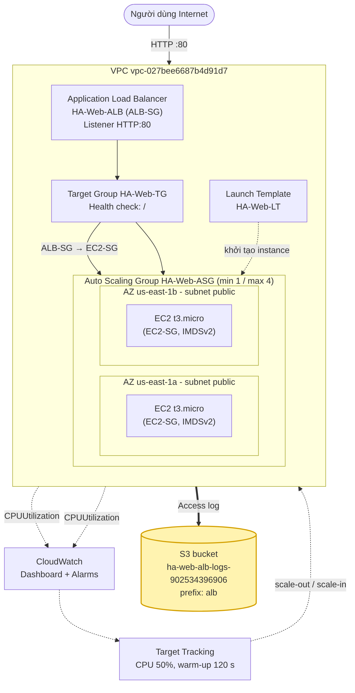

*Hình 1. Sơ đồ kiến trúc tổng thể*

# 4. Cấu hình đã triển khai

## 4.1. Launch Template HA-Web-LT

| **Thông số**             | **Giá trị**                                                                   |
|--------------------------|-------------------------------------------------------------------------------|
| **AMI / Loại instance**  | Amazon Linux 2023 / t3.micro                                                  |
| **Key pair**             | Không dùng (không cần SSH)                                                    |
| **Security Group**       | HA-Web-EC2-SG                                                                 |
| **IAM instance profile** | LabInstanceProfile (có sẵn, không tạo mới)                                    |
| **Metadata**             | IMDSv2 (token required)                                                       |
| **Tag**                  | Project = HAWeb; Owner = MSSV (áp dụng cho Instances và Volumes)              |
| **User data**            | Cài Apache, hiển thị Instance ID và AZ; endpoint /cgi-bin/load.sh tạo tải CPU |

Nội dung user data:

```bash
#!/bin/bash
dnf install -y httpd
systemctl enable --now httpd
TOKEN=$(curl -s -X PUT "http://169.254.169.254/latest/api/token" \
  -H "X-aws-ec2-metadata-token-ttl-seconds: 300")
IID=$(curl -s -H "X-aws-ec2-metadata-token: $TOKEN" \
  http://169.254.169.254/latest/meta-data/instance-id)
AZ=$(curl -s -H "X-aws-ec2-metadata-token: $TOKEN" \
  http://169.254.169.254/latest/meta-data/placement/availability-zone)
echo "<h1>HA Web</h1><p>Instance: $IID</p><p>AZ: $AZ</p>" \
  > /var/www/html/index.html
# Endpoint tao tai CPU de thu scale-out (moi request ~1 giay CPU)
mkdir -p /var/www/cgi-bin
printf '#!/bin/bash\necho "Content-Type: text/plain"\necho ""\n' \
  > /var/www/cgi-bin/load.sh
printf 'end=$((SECONDS+1))\nwhile [ $SECONDS -lt $end ]; do :; done\necho ok\n' \
  >> /var/www/cgi-bin/load.sh
chmod +x /var/www/cgi-bin/load.sh
```

## 4.2. Target Group HA-Web-TG

| **Thông số**             | **Giá trị**                                                                          |
|--------------------------|--------------------------------------------------------------------------------------|
| **Target type / VPC**    | Instances / HA-Web-vpc                                                               |
| **Protocol / Port**      | HTTP / 80                                                                            |
| **Health check**         | Path /; healthy threshold 2, unhealthy threshold 2; interval 10 giây, timeout 5 giây |
| **Deregistration delay** | 30 giây (giảm từ mặc định 300 để scale-in nhanh hơn)                                 |
| **Target**               | Do ASG tự đăng ký, không đăng ký thủ công                                            |

## 4.3. Application Load Balancer HA-Web-ALB

| **Thông số**         | **Giá trị**                                             |
|----------------------|---------------------------------------------------------|
| **Scheme / IP type** | Internet-facing / IPv4                                  |
| **VPC / Subnet**     | HA-Web-vpc / 2 public subnet ở us-east-1a và us-east-1b |
| **Security Group**   | HA-Web-ALB-SG (HTTP 80 từ Internet)                     |
| **Listener**         | HTTP:80 → forward tới HA-Web-TG                         |

## 4.4. Auto Scaling Group HA-Web-ASG

| **Thông số**                          | **Giá trị**                                               |
|---------------------------------------|-----------------------------------------------------------|
| **Launch template**                   | HA-Web-LT                                                 |
| **VPC / Subnet**                      | HA-Web-vpc / 2 public subnet ở 2 AZ                       |
| **Load balancing**                    | Gắn vào Target Group HA-Web-TG; bật ELB health check      |
| **Health check grace period**         | 120 giây                                                  |
| **Số instance (min / desired / max)** | 1 / 1 / 4 (max không vượt 4 để giữ giới hạn 9 EC2/region) |
| **Group metrics**                     | Bật thu thập metric của nhóm trong CloudWatch             |
| **Tag**                               | Project = HAWeb; Owner = MSSV (bật Tag new instances)     |

## 4.5. Target Tracking Policy và thời gian warm-up

| **Thông số**         | **Giá trị**                                        |
|----------------------|----------------------------------------------------|
| **Tên policy**       | HA-Web-CPU-50                                      |
| **Metric**           | Average CPU utilization (ASGAverageCPUUtilization) |
| **Target value**     | 50%                                                |
| **Instance warm-up** | 120 giây                                           |

- Target Tracking hoạt động như bộ điều nhiệt: ASG tự thêm hoặc bớt instance để giữ CPU trung bình của nhóm gần mức 50%. ASG tự tạo hai CloudWatch alarm cho policy này.

- AlarmHigh (dùng để scale-out): CPUUtilization \> 50 trong 3 datapoint liên tiếp (3 phút). AlarmLow (dùng để scale-in): CPUUtilization \< 45 trong 15 datapoint liên tiếp (15 phút). Scale-out phản ứng nhanh còn scale-in thận trọng hơn để tránh tăng giảm liên tục.

- Instance warm-up (120 giây): khoảng thời gian một instance mới được coi là đang khởi động. Trong thời gian này, số liệu CPU của instance đó chưa được tính vào trung bình của nhóm, tránh việc scale-out thừa khi instance còn đang cài web server. Giá trị 120 giây được chọn dựa trên thời gian cài Apache và vượt health check; sẽ điều chỉnh theo số liệu đo thực tế ở tuần 3.

- Health check grace period (120 giây) khác với warm-up: đây là thời gian ASG chưa đánh giá health check của instance mới, tránh việc thay thế nhầm instance còn đang khởi động.

# 5. Kiểm thử từng thành phần

| **\#** | **Thành phần**    | **Kết quả mong đợi**                                        | **Kết quả thực tế**                                                                                                   | **Đạt / Không** |
|--------|-------------------|-------------------------------------------------------------|-----------------------------------------------------------------------------------------------------------------------|-----------------|
| 1      | Launch Template   | Đúng AMI, instance type, SG, instance profile, user data    | HA-Web-LT (phiên bản 1): Amazon Linux 2023, t3.micro, HA-Web-EC2-SG, LabInstanceProfile, IMDSv2, user data cài Apache | Đạt             |
| 2      | ASG tạo instance  | Activity báo Successful; EC2 có tag Project/Owner           | Activity ghi Launching a new EC2 instance (Successful); instance có tag Project, Owner và aws:autoscaling:groupName   | Đạt             |
| 3      | Target Group      | Target ở trạng thái healthy                                 | Hai target ở us-east-1a và us-east-1b đều Healthy                                                                     | Đạt             |
| 4      | ALB               | Mở `http://<ALB-DNS>` thấy Instance ID và AZ                | Trang HA Web hiển thị Instance ID và AZ của instance đang phục vụ                                                     | Đạt             |
| 5      | Cân bằng tải 2 AZ | Desired = 2: thấy 2 Instance ID ở 2 AZ khác nhau            | Lúc 15:20 trả về i-003a9c14cca72ff76 (us-east-1b) và i-0da00de5c4ee446f6 (us-east-1a)                                 | Đạt             |
| 6      | Security Group    | Truy cập trực tiếp public IP của EC2 qua cổng 80 bị timeout | Truy cập 3.86.254.61 báo ERR_CONNECTION_TIMED_OUT lúc 15:23                                                           | Đạt             |
| 7      | Tự phục hồi       | Terminate 1 instance, ASG tự tạo instance mới               | Terminate lúc 16:50:07; ASG khởi tạo i-0f378207638f9beed lúc 16:50:10, hoàn tất 16:50:17                              | Đạt             |
| 8      | Target Tracking   | Policy 50%, warm-up 120 giây; có 2 alarm AlarmHigh/AlarmLow | Policy HA-Web-CPU-50 (50, warm-up 120 giây); 2 alarm: AlarmHigh (CPU \> 50, 3 phút) và AlarmLow (CPU \< 45, 15 phút)  | Đạt             |

## Quan sát Target Tracking thực tế (scale-in)

Khi tăng Desired từ 1 lên 2 một cách thủ công (website không có tải nên CPU thấp), policy HA-Web-CPU-50 do alarm AlarmLow kích hoạt đã tự giảm số instance về 1. Giờ ghi theo múi giờ +07:00 trong Activity history.

| **Lần** | **Tăng Desired 1 → 2 (thủ công)** | **Policy giảm Desired 2 → 1 (AlarmLow)** | **Khoảng cách** |
|---------|-----------------------------------|------------------------------------------|-----------------|
| 1       | 15:16:19                          | 15:22:19 (hoàn tất 15:23:32)             | Khoảng 6 phút   |
| 2       | 17:01:26                          | 17:07:17 (hoàn tất 17:08:30)             | Khoảng 6 phút   |

*Scale-out bằng tải thật (ab / hey / locust) và đo đạc thời gian scale-out chưa thực hiện ở tuần 2, dành cho tuần 3.*

# 6. Kết quả triển khai thực tế (tuần 2)

## 6.1. Launch Template

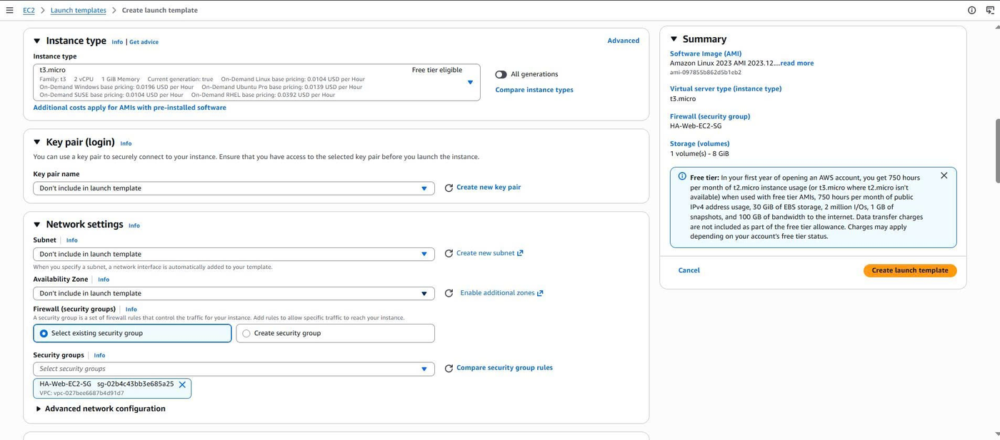

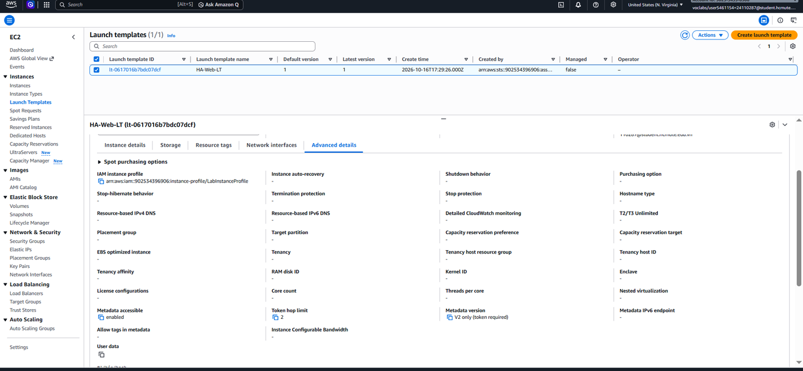

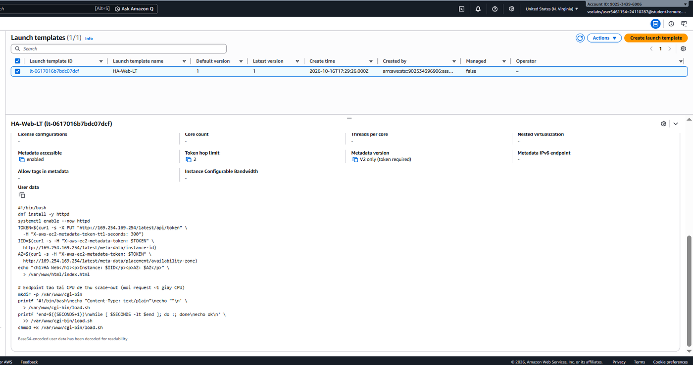

*Hình 2. Launch Template HA-Web-LT*

Launch Template HA-Web-LT (phiên bản 1) dùng Amazon Linux 2023, t3.micro, Security Group HA-Web-EC2-SG, LabInstanceProfile, IMDSv2 (V2 only) và user data cài Apache, hiển thị Instance ID và AZ.

## 6.2. Target Group

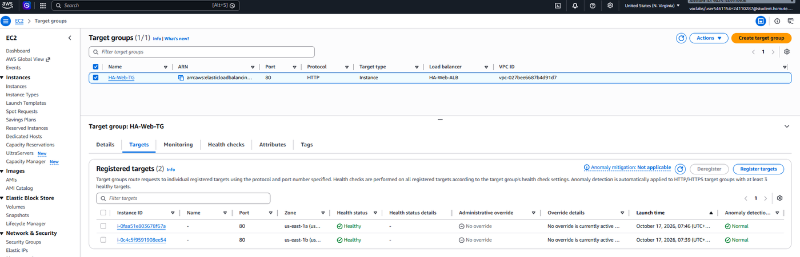

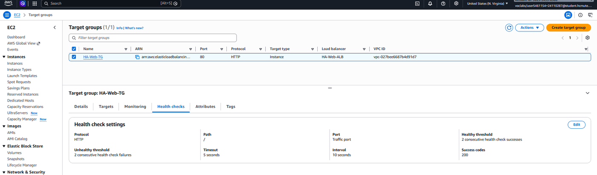

*Hình 3. Target Group HA-Web-TG*

Target Group có 2 target ở us-east-1a và us-east-1b, cả hai Healthy; health check dùng HTTP path /, healthy và unhealthy threshold 2, interval 10 giây, timeout 5 giây.

## 6.3. Application Load Balancer

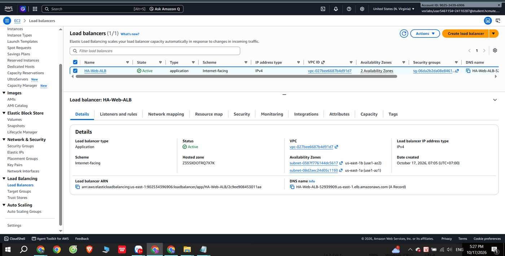

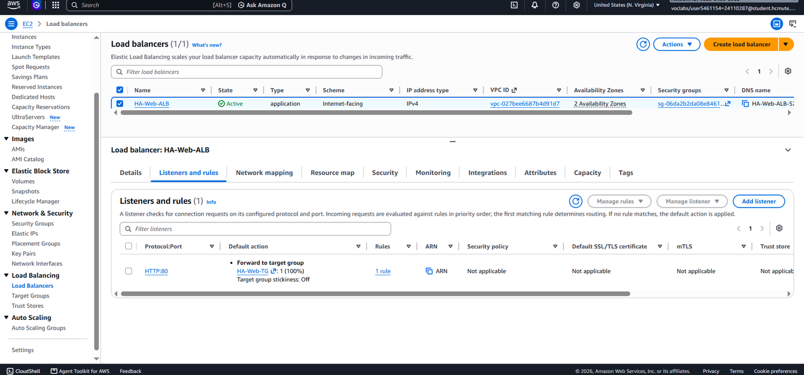

*Hình 4. Application Load Balancer HA-Web-ALB*

ALB HA-Web-ALB (Application, internet-facing, IPv4) ở trạng thái Active trên 2 AZ; listener HTTP:80 chuyển tiếp 100% tới HA-Web-TG.

## 6.4. Auto Scaling Group

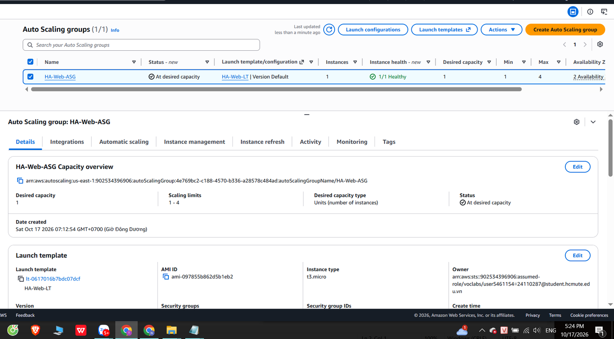

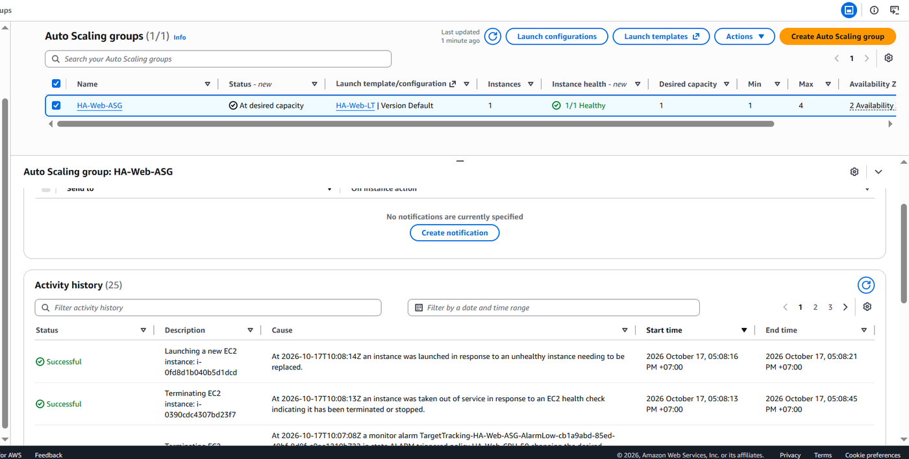

*Hình 5. Auto Scaling Group HA-Web-ASG*

ASG HA-Web-ASG có Desired 1, giới hạn 1 - 4, trạng thái At desired capacity, 1/1 Healthy; Activity history ghi lại các lần khởi tạo, thay thế và giảm số instance.

## 6.5. Website qua ALB và cân bằng tải 2 AZ

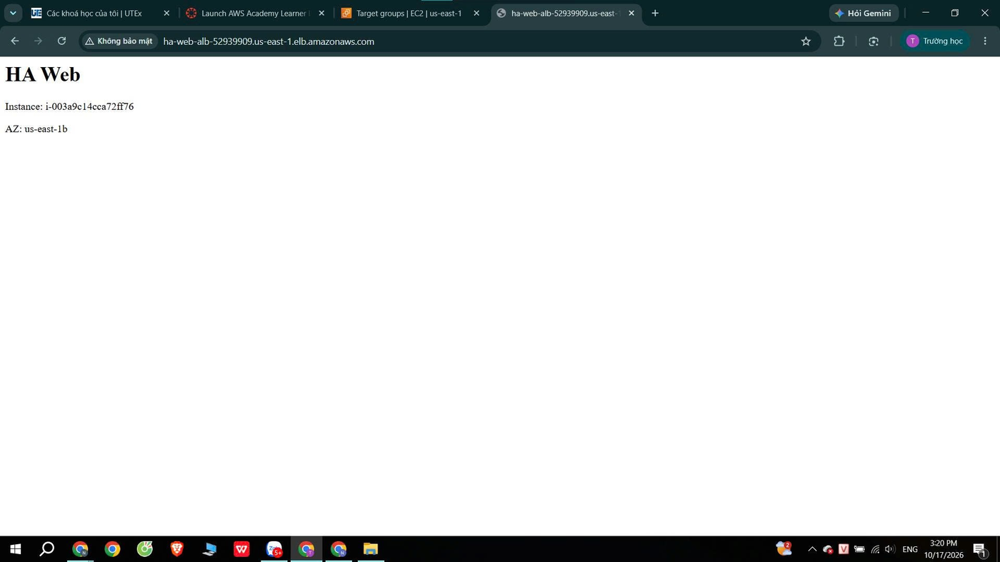

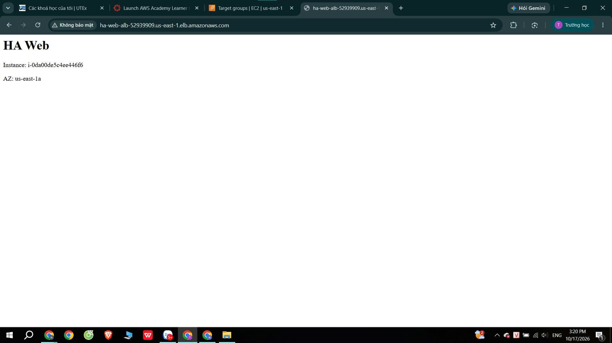

*Hình 6. Trang web phản hồi từ hai instance ở hai AZ khác nhau*

Khi Desired = 2, cùng một DNS của ALB trả về hai instance khác nhau: i-003a9c14cca72ff76 (us-east-1b) và i-0da00de5c4ee446f6 (us-east-1a), chứng tỏ ALB phân phối lưu lượng giữa 2 AZ.

## 6.6. Chặn truy cập trực tiếp vào EC2

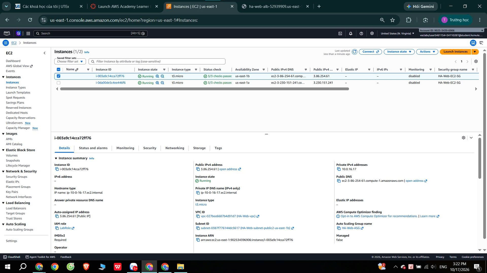

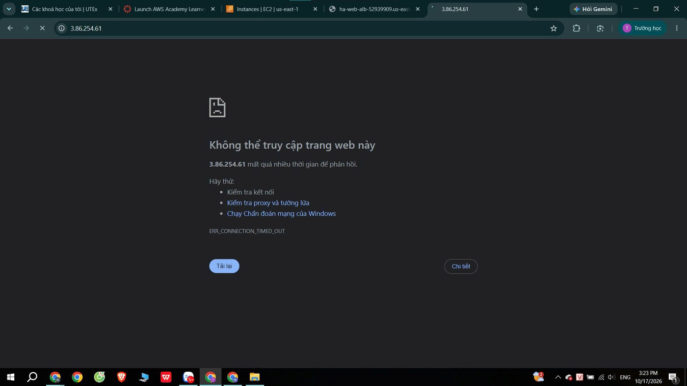

*Hình 7. Security Group chặn truy cập trực tiếp*

Truy cập trực tiếp vào Public IP 3.86.254.61 của instance bị timeout (ERR_CONNECTION_TIMED_OUT), trong khi truy cập qua ALB thành công; EC2-SG chỉ cho phép HTTP từ ALB-SG.

## 6.7. Tự phục hồi

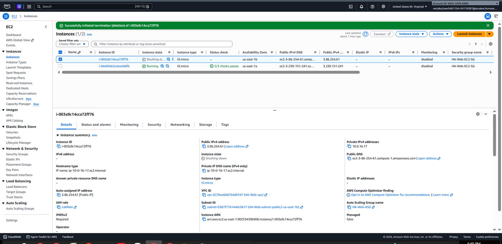

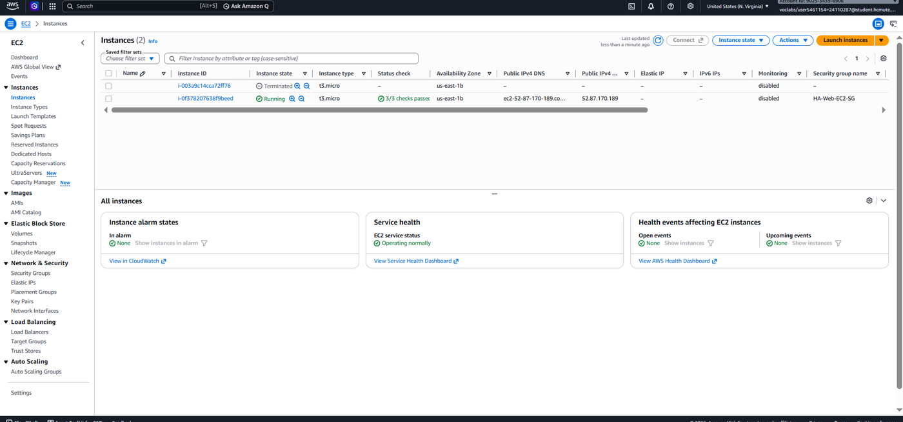

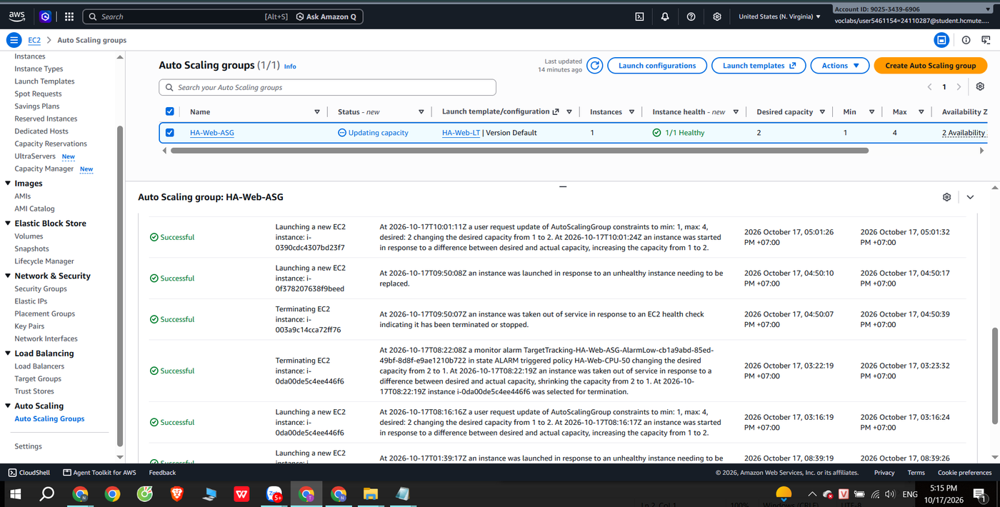

*Hình 8. Tự phục hồi của Auto Scaling Group*

Sau khi terminate instance i-003a9c14cca72ff76 lúc 16:50:07, ASG phát hiện và khởi tạo instance thay thế i-0f378207638f9beed lúc 16:50:10 (hoàn tất 16:50:17); instance mới Running, 3/3 status checks passed.

## 6.8. Target Tracking Policy và CloudWatch alarm

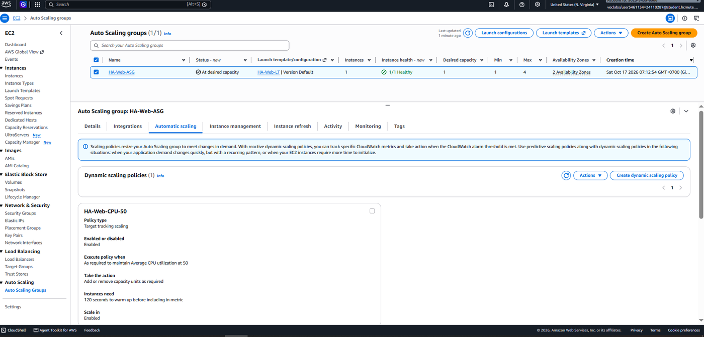

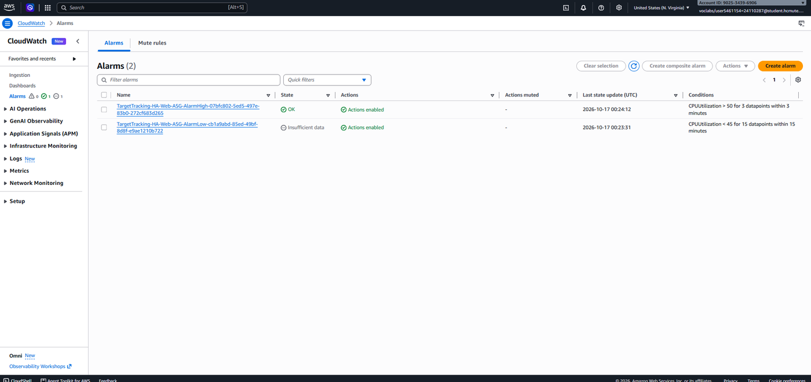

*Hình 9. Target Tracking Policy và alarm*

Policy HA-Web-CPU-50 (Target tracking, Average CPU utilization 50, warm-up 120 giây) và hai CloudWatch alarm tương ứng: AlarmHigh (CPU \> 50 trong 3 datapoint) và AlarmLow (CPU \< 45 trong 15 datapoint).

## 6.9. Tag tài nguyên

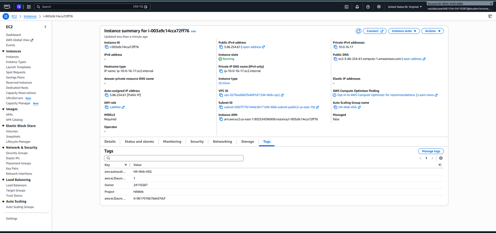

*Hình 10. Tag của instance do ASG tạo*

Instance do ASG tạo có tag Project = HAWeb, Owner = 24110287, cùng tag tự động aws:autoscaling:groupName = HA-Web-ASG và thông tin Launch Template.

# 7. Quy ước và quản lý chi phí

| **Hạng mục**          | **Nội dung**                                                                                                    |
|-----------------------|-----------------------------------------------------------------------------------------------------------------|
| **Region / IAM**      | us-east-1; dùng LabRole/LabInstanceProfile, không tạo IAM user/role                                             |
| **Giới hạn EC2**      | t3.micro; ASG max 4 (≤ 9 instance và ≤ 32 vCPU mỗi region)                                                      |
| **Tag**               | Project = HAWeb; Owner = MSSV cho mọi tài nguyên mới                                                            |
| **Dọn dẹp cuối buổi** | Đặt ASG min = 0, desired = 0 và xóa ALB (ALB và EC2 tính tiền theo giờ); giữ Launch Template, Target Group, ASG |
| **Bắt đầu buổi mới**  | Kiểm tra tài nguyên tuần 1 còn đủ sau End Lab; tạo lại ALB, gắn HA-Web-TG; đặt min = 1                          |

# 8. Ghi chú sử dụng AI

| **Phần công việc**                          | **Mức độ hỗ trợ của AI**                                                      |
|---------------------------------------------|-------------------------------------------------------------------------------|
| **user data và cấu hình Launch Template**   | Dùng Claude tham khảo; nhóm đã đọc, chỉnh sửa và tự cấu hình trên Learner Lab |
| **cấu hình Target Tracking, bảng kiểm thử** | AI gợi ý, nhóm tự triển khai, kiểm thử và giải thích được cấu hình            |

Mọi tài nguyên đều được nhóm triển khai và chạy thật trên AWS Learner Lab.

# 9. Khó khăn và vấn đề gặp phải

- Instance bị ELB health check loại liên tục: ASG tạo instance rồi thay thế sau khoảng 4 phút, lặp lại nhiều lần (Activity ghi “ELB system health check failure”, target báo Unhealthy - Health checks failed). Nguyên nhân là subnet chưa bật auto-assign public IPv4 nên instance không có public IP, không ra Internet để cài httpd, không có web server ở cổng 80. Cách phát hiện: cột Public IPv4 của instance trống. Cách xử lý: bật auto-assign public IPv4 cho cả 2 subnet, terminate các instance cũ để ASG tạo lại; sau đó target Healthy và website truy cập được qua ALB.

- Số instance tự giảm về 1 sau khi tăng Desired thủ công lên 2: do Target Tracking Policy và alarm AlarmLow (CPU thấp vì website không có tải). Vì vậy nhóm chụp ảnh cân bằng tải 2 AZ và ảnh chặn truy cập trực tiếp ngay trong vài phút sau khi tăng Desired.

- Khi kiểm tra bằng trình duyệt, nhiều lần liên tiếp chỉ ra cùng một instance, và lệnh curl trong CloudShell chỉ ra us-east-1b vì lúc đó nhóm chỉ có 1 instance. Sau khi có 2 instance Healthy ở 2 AZ thì ALB trả về cả hai.

# 10. Kế hoạch tuần 3

- Tích hợp và giám sát bằng CloudWatch: dashboard CPU, số instance, request count, healthy host

- Kịch bản tải bằng ab / hey / locust; đo thời gian scale-out, scale-in và thời gian warm-up

- Bảo mật: rà soát Security Group, IMDSv2; cân nhắc HTTPS nếu thời gian cho phép

- Tự động hóa/IaC bằng CloudFormation (nếu có thời gian); mô phỏng sự cố 1 AZ

- Thực hiện thêm các nhiệm vụ do giảng viên giao sau khi nhận báo cáo tuần 2

# Checklist tuần 2

> ☑ Launch Template HA-Web-LT (user data, LabInstanceProfile, tag).
>
> ☑ Target Group HA-Web-TG với health check.
>
> ☑ ALB HA-Web-ALB hoạt động, mở được website qua DNS.
>
> ☑ ASG HA-Web-ASG (min 1 - max 4) với Target Tracking 50% và warm-up 120 giây.
>
> ☑ Kiểm thử: cân bằng tải 2 AZ, chặn truy cập trực tiếp, tự phục hồi.
>
> ☑ Chụp đủ ảnh minh chứng (Account ID, Region, thời gian).
>
> ☑ Dọn dẹp tài nguyên cuối buổi (ASG = 0, xóa ALB).
>
> ☑ Commit tài liệu và user data lên Git.
