**TRƯỜNG ĐẠI HỌC SƯ PHẠM KỸ THUẬT TP. HỒ CHÍ MINH**

**KHOA CÔNG NGHỆ THÔNG TIN**

**BÁO CÁO TIẾN ĐỘ TUẦN 3**

**Đề tài: Website có tính sẵn sàng cao với Application Load Balancer và EC2 Auto Scaling**

**Môn học:** Điện toán đám mây

**Lớp học:** CLCO332779_05UTExMC

**GVHD:** TS. Huỳnh Xuân Phụng

**Thời gian:** Tuần 3 (tính từ ngày 19/10/2026)

**Git:** [https://github.com/tranvannghia240806-hub/baocaocloud_24110287_24110282](https://github.com/tranvannghia240806-hub/baocaocloud_24110287_24110282)

**Sản phẩm tuần 3 trên GitHub:**

Link file (blob):

1.  [README.md](https://github.com/tranvannghia240806-hub/baocaocloud_24110287_24110282/blob/main/README.md)

2.  [docs/Bao_cao_tuan_3.docx](https://github.com/tranvannghia240806-hub/baocaocloud_24110287_24110282/blob/main/docs/Bao_cao_tuan_3.docx)

3.  [docs/Bang_phan_cong_va_worklog_tuan_3.docx](https://github.com/tranvannghia240806-hub/baocaocloud_24110287_24110282/blob/main/docs/Bang_phan_cong_va_worklog_tuan_3.docx)

4.  [docs/architecture.png](https://github.com/tranvannghia240806-hub/baocaocloud_24110287_24110282/blob/main/docs/architecture.png)

5.  [scripts/load-test.sh](https://github.com/tranvannghia240806-hub/baocaocloud_24110287_24110282/blob/main/scripts/load-test.sh)

6.  [infra/ha-web-cfn.yaml](https://github.com/tranvannghia240806-hub/baocaocloud_24110287_24110282/blob/main/infra/ha-web-cfn.yaml)

7.  [docs/data/tuan3/scaling_log_lan1.csv](https://github.com/tranvannghia240806-hub/baocaocloud_24110287_24110282/blob/main/docs/data/tuan3/scaling_log_lan1.csv)

8.  [docs/data/tuan3/scaling_log_lan1_scalein.csv](https://github.com/tranvannghia240806-hub/baocaocloud_24110287_24110282/blob/main/docs/data/tuan3/scaling_log_lan1_scalein.csv)

9.  [docs/data/tuan3/scaling_log_lan2.csv](https://github.com/tranvannghia240806-hub/baocaocloud_24110287_24110282/blob/main/docs/data/tuan3/scaling_log_lan2.csv)

10. [docs/data/tuan3/ab_lan2.txt](https://github.com/tranvannghia240806-hub/baocaocloud_24110287_24110282/blob/main/docs/data/tuan3/ab_lan2.txt)

11. [docs/data/tuan3/loi_502_lan2.txt](https://github.com/tranvannghia240806-hub/baocaocloud_24110287_24110282/blob/main/docs/data/tuan3/loi_502_lan2.txt)

Link commit:

**\[ĐIỀN: dán link và mô tả từng commit tuần 3, ví dụ: abc1234 - "Them script tao tai load-test.sh va log scaling" (ngày)\]**

Ảnh minh chứng nằm trong thư mục [docs/images/tuan3/](https://github.com/tranvannghia240806-hub/baocaocloud_24110287_24110282/tree/main/docs/images/tuan3); ảnh được chèn trực tiếp ở mục 6 (đường dẫn tương đối `images/tuan3/`).

| **MSSV** | **Họ và tên**        | **Chức vụ** |
|----------|----------------------|-------------|
| 24110287 | Trần Văn Nghĩa       | Nhóm trưởng |
| 24110282 | Kiên Nguyễn Xuân Lưu | Thành viên  |

# 1. Mục tiêu tuần 3

Theo kế hoạch của giảng viên, tuần 3 gồm: tích hợp, bảo mật, giám sát (CloudWatch), tự động hóa/IaC nếu có. Nhóm giữ đúng phạm vi này, không làm vượt sang nội dung tuần 4.

Theo nhận xét của giảng viên ở báo cáo tuần 2, nhóm bổ sung ba nội dung vào tuần 3:

- Tạo tải thật bằng script gọi lặp lại endpoint, ghi nhận thời gian từ lúc CPU vượt ngưỡng đến khi instance mới sẵn sàng (Healthy), đồng thời đo scale-in.

- Bật ALB access log ra S3 ngay từ tuần 3 để tuần 4 có dữ liệu phân tích.

- Viết commit message nêu rõ nội dung thay đổi, không chỉ ghi số tuần.

Kết quả mong đợi cuối tuần: có số liệu đo thật về scale-out/scale-in và thời gian warm-up; dashboard và alarm CloudWatch hoạt động; Security Group, IMDSv2 được rà soát; hệ thống dựng lại được bằng template CloudFormation; ALB access log được lưu trên S3.

# 2. Phân công công việc

**\[Điều chỉnh bảng phân công và số giờ theo thực tế trước khi nộp\]**

| **Thành viên**           | **Công việc tuần 3**                                                                                                                                                                                                                                                                                     |
|--------------------------|----------------------------------------------------------------------------------------------------------------------------------------------------------------------------------------------------------------------------------------------------------------------------------------------------------|
| **Trần Văn Nghĩa**       | Viết và hoàn thiện script tạo tải load-test.sh; kiểm tra endpoint /cgi-bin/load.sh; chạy tải lần 1 và ghi mốc thời gian scale-out/scale-in; chạy tải lần 2 bằng ab; rà soát bảo mật (Security Group, IMDSv2, quyền IAM); tạo và kiểm thử template CloudFormation; tổng hợp báo cáo tuần 3.               |
| **Kiên Nguyễn Xuân Lưu** | Dựng lại hệ thống đầu buổi (ALB, ASG 1/1/4) và kiểm tra tích hợp; tạo S3 bucket và bật ALB access log; tạo dashboard và alarm CloudWatch; theo dõi Activity history, Alarms trong lúc tải; kiểm tra truy cập trực tiếp EC2 bị chặn; thu thập ảnh minh chứng; dọn dẹp cuối buổi; commit tài liệu lên Git. |

| **Ngày**     | **Trần Văn Nghĩa**                                                            | **Giờ** | **Kiên Nguyễn Xuân Lưu**                                                                                                | **Giờ** |
|--------------|-------------------------------------------------------------------------------|---------|-------------------------------------------------------------------------------------------------------------------------|---------|
| **Ngày 1**   | Hoàn thiện script load-test.sh; kiểm tra endpoint load.sh trên instance thật  | 2h      | Start Lab, kiểm tra nền tảng (auto-assign public IPv4); tạo lại ALB, đặt ASG 1/1/4; tạo S3 bucket và bật ALB access log | 2h      |
| **Ngày 2**   | Chạy tải lần 1 bằng script; ghi mốc T0–T9; chụp CPU và Activity scale-out     | 2h      | Theo dõi Alarms, Targets, Activity scale-in; kiểm tra file access log xuất hiện trong S3                                | 2h      |
| **Ngày 3**   | Chạy tải lần 2 bằng ab để đối chiếu và lấy dữ liệu cho dashboard              | 2h      | Tạo dashboard HA-Web-Dashboard và 3 alarm bổ sung                                                                       | 2h      |
| **Ngày 4**   | Rà soát Security Group, IMDSv2, IAM; kiểm tra Git không có thông tin nhạy cảm | 2h      | Kiểm tra truy cập trực tiếp EC2 bị chặn; (tùy chọn) mô phỏng sự cố 1 AZ                                                 | 2h      |
| **Ngày 5**   | Tạo stack CloudFormation, kiểm thử, xóa stack; viết báo cáo tuần 3            | 2h      | Dọn dẹp tài nguyên; tổng hợp ảnh, worklog; commit tài liệu lên Git                                                      | 2h      |
| **Tổng kết** |                                                                               | 10h     |                                                                                                                         | 10h     |

# 3. Kiến trúc triển khai

Kiến trúc giữ nguyên thiết kế tuần 1 và tuần 2. Tuần 3 bổ sung S3 bucket nhận ALB access log, và template CloudFormation để dựng lại ALB, Target Group, ASG, Target Tracking Policy.


*Hình 1. Sơ đồ kiến trúc tổng thể*

# 4. Cấu hình đã triển khai

## 4.1. Dựng lại hệ thống

| **Thông số**              | **Giá trị**                                                                                                                                         |
|---------------------------|-----------------------------------------------------------------------------------------------------------------------------------------------------|
| **ALB**                   | HA-Web-ALB (internet-facing, IPv4, 2 AZ, HA-Web-ALB-SG, listener HTTP:80 → HA-Web-TG), tạo lúc 22:37 ngày 23/10/2026, xóa lúc 10:56 ngày 24/10/2026 |
| **DNS ALB**               | HA-Web-ALB-892106701.us-east-1.elb.amazonaws.com (dùng cho cả hai lần tải)                                                                          |
| **ASG**                   | HA-Web-ASG đặt min 1 / desired 1 / max 4 lúc 07:27:42 ngày 24/10/2026; ELB health check; grace period 120 giây                                      |
| **Launch Template**       | HA-Web-LT (phiên bản Default, tạo từ tuần 2)                                                                                                        |
| **Kiểm tra bắt buộc**     | Auto-assign public IPv4 của 2 subnet = Yes (lỗi đã gặp ở tuần 2)                                                                                    |
| **Thời gian đến Healthy** | Instance i-0c87186aa563a148d (us-east-1b) khởi tạo lúc 07:27:49; target Healthy được xác nhận trong ảnh chụp lúc 07:30                              |

## 4.2. Script tạo tải scripts/load-test.sh

| **Thông số**       | **Giá trị**                                                                                                                                                                                                                                                                                                            |
|--------------------|------------------------------------------------------------------------------------------------------------------------------------------------------------------------------------------------------------------------------------------------------------------------------------------------------------------------|
| **Môi trường**     | AWS CloudShell (bash, curl, AWS CLI), Region us-east-1                                                                                                                                                                                                                                                                 |
| **Endpoint**       | /cgi-bin/load.sh qua DNS của ALB (mỗi request chạy vòng lặp khoảng 0,4–1 giây)                                                                                                                                                                                                                                         |
| **Cách tạo tải**   | Nhiều worker chạy song song, mỗi worker gọi lặp lại endpoint đến hết thời gian tải                                                                                                                                                                                                                                     |
| **Lần 1 (script)** | 20 worker; tải 600 giây; theo dõi thêm 1200 giây sau khi dừng tải để quan sát scale-in                                                                                                                                                                                                                                 |
| **Lần 2 (ab)**     | ab -t 900 -s 60 -c 20 (tải 900 giây); script load-test.sh chạy ở chế độ chỉ theo dõi (không tạo tải) trong tab CloudShell thứ hai                                                                                                                                                                                      |
| **Dữ liệu ghi**    | Cứ khoảng 15–18 giây ghi một dòng CSV: giờ, desired, in-service, healthy target, CPU trung bình của ASG (giờ +07:00)                                                                                                                                                                                                   |
| **Tóm tắt cuối**   | Giờ CPU \> 50 % lần đầu, giờ desired tăng, giờ healthy tăng (instance mới sẵn sàng), số instance lớn nhất, giờ in-service giảm; tổng request, số request khác 200, thời gian phản hồi                                                                                                                                  |
| **Độ chính xác**   | Mốc từ script có độ phân giải khoảng 15–18 giây; CPU của ASG chỉ có datapoint mỗi 5 phút (kiểm tra trên CloudWatch Metrics, period 1 phút vẫn chỉ thấy điểm tại 10:10, 10:15, 10:20, 10:25, 10:30), nên T1 không chính xác hơn khung 5 phút. Giờ chính xác đối chiếu với Activity history của ASG và CloudWatch Alarms |

Lệnh chạy lần 1 và lần 2:

```bash
./load-test.sh <ALB-DNS> 600 20 1200
ab -t 900 -s 60 -c 20 http://<ALB-DNS>/cgi-bin/load.sh
./load-test.sh <ALB-DNS> 0 0 1200 # chi theo doi, khong tao tai
```

## 4.3. Target Tracking Policy và thời gian warm-up

| **Thông số**              | **Giá trị**                                                                                                                                                                                                                                                |
|---------------------------|------------------------------------------------------------------------------------------------------------------------------------------------------------------------------------------------------------------------------------------------------------|
| **Tên policy**            | HA-Web-CPU-50 (giữ nguyên từ tuần 2)                                                                                                                                                                                                                       |
| **Metric / Target value** | Average CPU utilization (ASGAverageCPUUtilization) / 50%                                                                                                                                                                                                   |
| **Instance warm-up**      | 120 giây (cấu hình ở tuần 2, được đối chiếu với số đo thực tế ở mục 5)                                                                                                                                                                                     |
| **Alarm tự tạo**          | AlarmHigh: CPU \> 50, 3 datapoint trong 3 phút. AlarmLow: 15 datapoint trong 15 phút, ngưỡng quan sát được là 35 hoặc 37,5 tùy thời điểm (báo cáo tuần 2 ghi 45); alarm do Auto Scaling quản lý, nhóm không chỉnh tay và chưa xác định quy luật đổi ngưỡng |

## 4.4. CloudWatch: dashboard và alarm bổ sung

| **Widget (HA-Web-Dashboard)** | **Metric**                                                      | **Thống kê**                                                                |
|-------------------------------|-----------------------------------------------------------------|-----------------------------------------------------------------------------|
| **CPU trung bình ASG**        | AWS/EC2 · CPUUtilization (theo HA-Web-ASG)                      | Average, period 1 phút (số liệu CPU của ASG thực tế chỉ có điểm mỗi 5 phút) |
| **Số instance**               | AWS/AutoScaling · GroupDesiredCapacity, GroupInServiceInstances | Average, 1 phút                                                             |
| **Số request**                | AWS/ApplicationELB · RequestCount                               | Sum, 1 phút                                                                 |
| **Healthy host**              | AWS/ApplicationELB · HealthyHostCount, UnHealthyHostCount       | Average, 1 phút                                                             |
| **Độ trễ**                    | AWS/ApplicationELB · TargetResponseTime                         | Average, 1 phút                                                             |

| **Alarm bổ sung**         | **Điều kiện**                                                                         | **Mục đích**                      |
|---------------------------|---------------------------------------------------------------------------------------|-----------------------------------|
| **HA-Web-ASG-AtMax**      | GroupInServiceInstances ≥ 4 (Average, 1 phút; 1/1 datapoint; dữ liệu thiếu = missing) | Cảnh báo ASG chạm trần 4 instance |
| **HA-Web-UnhealthyHosts** | UnHealthyHostCount ≥ 1 (2/2 datapoint trong 2 phút)                                   | Phát hiện target lỗi              |
| **HA-Web-HighLatency**    | TargetResponseTime \> 2 giây (2/2 datapoint trong 2 phút)                             | Phát hiện chậm khi quá tải        |

Số liệu của ALB gắn với mã định danh riêng của từng ALB; ALB được tạo lại mỗi buổi nên widget và alarm của ALB phải trỏ về ALB đang chạy. Số liệu theo ASG không bị ảnh hưởng. Trong tuần 3 nhóm dùng một ALB duy nhất (tạo 23/10, xóa 24/10) cho cả hai lần tải, nên dashboard hiển thị liên tục cả hai đợt.

## 4.5. ALB access log ra S3

| **Thông số**               | **Giá trị**                                                                                                                              |
|----------------------------|------------------------------------------------------------------------------------------------------------------------------------------|
| **S3 bucket**              | ha-web-alb-logs-902534396906, us-east-1, tạo lúc 22:14 ngày 23/10/2026, Block all public access = On                                     |
| **Prefix**                 | alb (log lưu tại alb/AWSLogs/902534396906/elasticloadbalancing/us-east-1/năm/tháng/ngày/)                                                |
| **Quyền ghi**              | Bucket policy cho phép tài khoản dịch vụ ELB của us-east-1 ghi vào alb/AWSLogs/902534396906/\* (đã lưu thành công)                       |
| **Cấu hình trên ALB**      | Attributes → Logging → Access logs (legacy) bật, S3 location ha-web-alb-logs-902534396906/alb/; Connection logs và Health check logs tắt |
| **Chu kỳ ghi / định dạng** | Khoảng 5 phút một file (ví dụ các file lúc 07:35, 07:40, 07:45, 07:50), nén .log.gz                                                      |
| **Mục đích**               | Dữ liệu phân tích ở tuần 4: số request, mã trạng thái, thời gian xử lý theo target và theo thời gian                                     |

## 4.6. Bảo mật

| **Hạng mục**         | **Thiết kế**                                                                                        |
|----------------------|-----------------------------------------------------------------------------------------------------|
| **HA-Web-ALB-SG**    | Chỉ mở HTTP 80 từ Internet                                                                          |
| **HA-Web-EC2-SG**    | HTTP 80 chỉ từ HA-Web-ALB-SG; không mở SSH (22)                                                     |
| **IMDSv2**           | Bắt buộc (token required), hop limit 2 trong Launch Template                                        |
| **Quyền IAM**        | LabInstanceProfile có sẵn (instance hiển thị IAM role LabRole), không tạo IAM user/role             |
| **Tag**              | Project = HAWeb; Owner = 24110287 cho instance, volume, ALB, Target Group                           |
| **Bí mật trong Git** | Không commit Access Key, Secret Key, Session Token; không commit file log ALB thô (chứa địa chỉ IP) |
| **Hạn chế**          | Chưa triển khai HTTPS (cần tên miền và chứng chỉ ACM); WAF là hướng mở rộng                         |

## 4.7. Tự động hóa bằng CloudFormation (infra/ha-web-cfn.yaml)

| **Thông số**            | **Giá trị**                                                                                                                                      |
|-------------------------|--------------------------------------------------------------------------------------------------------------------------------------------------|
| **Tài nguyên tạo ra**   | Target Group HA-Web-CFN-TG, ALB HA-Web-CFN-ALB, Listener HTTP:80, ASG HA-Web-CFN-ASG (1/1/4), Target Tracking Policy (CPU 50%, warm-up 120 giây) |
| **Tài nguyên dùng lại** | VPC, 2 subnet, HA-Web-ALB-SG, Launch Template HA-Web-LT (lt-0617016b7bdc07dcf, truyền bằng tham số)                                              |
| **Tham số**             | ID mạng và Security Group, LaunchTemplateId và phiên bản, Min/Desired/Max (Max tối đa 4), CpuTarget, WarmupSeconds, AccessLogBucket (tùy chọn)   |
| **IAM**                 | Template không tạo IAM; instance dùng LabInstanceProfile gắn sẵn trong Launch Template                                                           |
| **Hạn chế**             | Launch Template chưa nằm trong template vì user data còn có thể chỉnh sửa; đây là hướng mở rộng                                                  |

# 5. Kiểm thử

| **\#** | **Thành phần**            | **Kết quả mong đợi**                                                                | **Kết quả thực tế**                                                                                                                                                                                                                                                                                                            | **Đạt / Không**                   |
|--------|---------------------------|-------------------------------------------------------------------------------------|--------------------------------------------------------------------------------------------------------------------------------------------------------------------------------------------------------------------------------------------------------------------------------------------------------------------------------|-----------------------------------|
| 1      | Dựng lại hệ thống         | ALB Active; target Healthy; website hiện Instance ID và AZ                          | ALB Active; target i-0c87186aa563a148d Healthy (xác nhận lúc 07:30); trang chủ hiện đúng Instance ID và AZ us-east-1b                                                                                                                                                                                                          | Đạt                               |
| 2      | Endpoint /cgi-bin/load.sh | HTTP 200, nội dung ok, khoảng 1 giây                                                | HTTP 200, nội dung ok; real 0,447 giây và 1,008 giây ở hai lần chạy                                                                                                                                                                                                                                                            | Đạt                               |
| 3      | Tải thật và scale-out     | CPU vượt 50%, AlarmHigh kích hoạt, ASG tăng desired, instance mới Healthy           | Cả hai lần: AlarmHigh kích hoạt, ASG tăng 1 → 2 rồi 2 → 4, đủ 4 instance Healthy (chi tiết ở bảng dòng thời gian)                                                                                                                                                                                                              | Đạt                               |
| 4      | Scale-in                  | Sau khi dừng tải, AlarmLow kích hoạt, ASG giảm về 1 instance                        | Lần 1: AlarmLow 08:16:02, ASG về 1 instance lúc 08:18:47. Lần 2: không đo                                                                                                                                                                                                                                                      | Đạt (lần 1)                       |
| 5      | Dashboard CloudWatch      | Hiển thị CPU, số instance, RequestCount, healthy host, độ trễ                       | Đủ 5 widget, thấy cả hai đợt tải                                                                                                                                                                                                                                                                                               | Đạt                               |
| 6      | Alarm bổ sung             | 3 alarm ở trạng thái OK, chuyển ALARM khi điều kiện xảy ra                          | AtMax chuyển In alarm lúc 10:25:52 khi đủ 4 instance; UnhealthyHosts và HighLatency giữ trạng thái OK                                                                                                                                                                                                                          | Đạt                               |
| 7      | ALB access log            | File log .gz xuất hiện trong S3 sau vài phút có traffic                             | 46 file .log.gz, 12 059 dòng log sau đợt tải lần 1; file đầu tiên của buổi 24/10 lúc 07:35                                                                                                                                                                                                                                     | Đạt                               |
| 8      | Bảo mật                   | EC2-SG chỉ nhận từ ALB-SG; IMDSv2 Required; truy cập trực tiếp public IP bị timeout | EC2-SG: 1 rule HTTP 80 nguồn ALB-SG, không có cổng 22; IMDSv2 Required; truy cập trực tiếp public IP bị timeout (trình duyệt và curl); curl tới IMDS không token trả 401, có token trả 200; qua ALB vào được git grep tìm khóa truy cập không in kết quả nào (chạy lúc 20:54 trên bản repo cục bộ, sẽ chạy lại trước khi push) | Đạt                               |
| 9      | CloudFormation            | Stack CREATE_COMPLETE; website chạy qua DNS ở Outputs; xóa stack dọn sạch           | Stack HA-Web-CFN-Stack CREATE_COMPLETE sau 2 phút 30 giây (20:59:17 → 21:01:47), 5 tài nguyên; website qua DNS ở Outputs hiển thị Instance i-0469467cb05ac9f26, AZ us-east-1a (21:04); ASG HA-Web-CFN-ASG 1/1/4, 1/1 Healthy; lúc 21:10 ALB, Target Group và ASG của stack đã không còn sau khi xóa stack                      | Đạt                               |
| 10     | Sự cố 1 AZ (tùy chọn)     | Terminate instance ở 1 AZ, website vẫn phục vụ từ AZ còn lại, ASG thay thế          | Chưa thực hiện bước terminate. Lúc 20:17 có 2 instance Healthy ở 2 AZ (i-0399d18d5afe337e3 ở us-east-1a, i-04b55d185dec1de88 ở us-east-1b); vòng lặp curl 20:16:08–20:17:47 cho 99/99 mã 200 (mốc cơ sở trước khi mô phỏng sự cố)                                                                                              | Chưa hoàn tất (làm tiếp ở tuần 4) |

## Dòng thời gian scale-out và scale-in

Giờ ghi theo múi giờ +07:00 (khớp Activity history), ngày 24/10/2026. Lần 1 lấy mốc từ log script và console; lần 2 lấy T0 từ thời điểm tạo file ab_lan2.txt (lệnh stat) và các mốc còn lại từ console và log script. Mốc lấy từ script có sai số khoảng 15–18 giây.

| **Mốc** | **Sự kiện**                                      | **Lần 1 (script)**                           | **Lần 2 (ab)**                                                                                                                                                                  |
|---------|--------------------------------------------------|----------------------------------------------|---------------------------------------------------------------------------------------------------------------------------------------------------------------------------------|
| **T0**  | Bắt đầu tạo tải                                  | 07:48:39                                     | 10:15:38                                                                                                                                                                        |
| **T1**  | CPU trung bình vượt 50%                          | khoảng 07:51:08 (mẫu đầu tiên \> 50%: 87,6%) | không sau 10:18:35 (mẫu đầu của script đã là 62,5%) ; CloudWatch chỉ trả datapoint 5 phút: 10:15 = 77,35%, 10:20 = 98,94%, nên T1 chỉ xác định được trong khoảng 10:15–10:18:35 |
| **T2**  | AlarmHigh chuyển sang ALARM                      | 07:54:55                                     | 10:19:55                                                                                                                                                                        |
| **T3**  | ASG tăng desired (instance mới bắt đầu khởi tạo) | 07:54:59                                     | 10:20:05                                                                                                                                                                        |
| **T4**  | Instance mới Healthy (sẵn sàng)                  | khoảng 07:55:59                              | khoảng 10:21:15                                                                                                                                                                 |
|         | Desired 2 → 4 (AlarmHigh lần hai)                | 07:57:55                                     | 10:22:55                                                                                                                                                                        |
| **T5**  | Đủ 4 instance Healthy                            | khoảng 07:59:17                              | khoảng 10:24:12                                                                                                                                                                 |
| **T6**  | Dừng tải                                         | 07:58:39                                     | 10:30:39                                                                                                                                                                        |
|         | AlarmHigh trở về OK                              | 08:01:55                                     | 10:32:55                                                                                                                                                                        |
| **T7**  | AlarmLow chuyển sang ALARM                       | 08:16:02                                     | không đo                                                                                                                                                                        |
| **T8**  | Scale-in đầu tiên (4 → 3)                        | 08:16:14                                     | không đo                                                                                                                                                                        |
| **T9**  | Về 1 instance (kết thúc lần giảm 2 → 1)          | 08:18:47                                     | không đo                                                                                                                                                                        |

| **Khoảng thời gian**                               | **Lần 1 (script)**               | **Lần 2 (ab)**                                                                                                 | **So với cấu hình**         |
|----------------------------------------------------|----------------------------------|----------------------------------------------------------------------------------------------------------------|-----------------------------|
| Từ bắt đầu tải đến AlarmHigh (T0 → T2)             | 6 phút 16 giây                   | 4 phút 17 giây                                                                                                 | AlarmHigh cần 3 datapoint   |
| Từ vượt ngưỡng đến instance mới sẵn sàng (T1 → T4) | khoảng 4 phút 51 giây (cận trên) | không xác định chính xác (T1 trong khoảng 10:15–10:18:35, nên khoảng này từ 2 phút 40 giây đến 5 phút 37 giây) | Giảng viên yêu cầu ghi nhận |
| Từ ASG tăng desired đến Healthy (T3 → T4)          | khoảng 1 phút                    | khoảng 1 phút 10 giây                                                                                          | So với warm-up 120 giây     |
| Từ desired 2 → 4 đến đủ 4 Healthy                  | khoảng 1 phút 19 giây            | khoảng 1 phút 7 giây                                                                                           | So với warm-up 120 giây     |
| Từ bắt đầu tải đến đủ 4 instance Healthy           | khoảng 10 phút 38 giây           | khoảng 8 phút 34 giây                                                                                          |                             |
| Từ dừng tải đến về 1 instance (T6 → T9)            | 20 phút 8 giây                   | không đo                                                                                                       | AlarmLow cần 15 phút        |
| Từ dừng tải đến AlarmLow (T6 → T7)                 | 17 phút 23 giây                  | không đo                                                                                                       | AlarmLow cần 15 datapoint   |

| **Chỉ số tải**                          | **Lần 1 (script)**                                                                          | **Lần 2 (ab)**                    |
|-----------------------------------------|---------------------------------------------------------------------------------------------|-----------------------------------|
| **Tổng số request / số request lỗi**    | 11 994 / 0 (script); log ALB cùng khoảng thời gian: 11 998 request, 11 997 mã 200, 1 mã 400 | 18 006 / 5 (non-2xx, ab ghi nhận) |
| **Thời gian phản hồi trung bình**       | 0,89 giây (lớn nhất 1,19 giây)                                                              | 1000,5 ms (lớn nhất 1166 ms)      |
| **Requests per second**                 | Không áp dụng                                                                               | 19,99                             |
| **Thời gian phục vụ 50% / 95% request** | Không áp dụng                                                                               | 1000 ms / 1005 ms                 |

## Nhận xét

- Warm-up: khoảng từ lúc ASG tăng desired đến lúc instance mới Healthy là khoảng 1 phút (lần 1) và 1 phút 10 giây (lần 2), ngắn hơn giá trị warm-up 120 giây đã cấu hình. Trong Activity history, các instance mới ở trạng thái "Waiting for instance warmup" trước khi hoàn tất. Nhóm mới có hai lần đo nên chưa kết luận cần đổi warm-up; thời điểm instance Healthy cũng khác với thời điểm instance được tính vào chỉ số CPU trung bình.

- Mức độ phản ứng: cả hai lần ASG tăng theo hai bước (1 → 2, rồi 2 → 4) và đạt trần 4 instance. Lần 1 dừng tải (07:58:39) trước khi đủ 4 instance Healthy (khoảng 07:59:17) nên chưa quan sát được CPU khi đủ 4 instance. Lần 2 có khoảng 6 phút 27 giây với đủ 4 instance (10:24:12 đến 10:30:39), CPU trung bình vẫn khoảng 98–99% (theo log script), alarm AtMax chuyển In alarm lúc 10:25:52.

- Scale-in (lần 1): AlarmLow chuyển In alarm 17 phút 23 giây sau khi dừng tải (CPU dưới 1% từ khoảng 08:01), 12 giây sau đó ASG bắt đầu giảm. ASG giảm từng một instance (4 → 3 → 2 → 1) trong 2 phút 33 giây, instance cuối cùng được giữ lại là instance ban đầu i-0c87186aa563a148d. Nhóm chỉ ghi quan sát, không suy diễn nguyên nhân thời gian chờ ngoài điều kiện 15 datapoint của AlarmLow. Lần 2 không theo dõi scale-in; ASG được đặt về 0 để dọn dẹp trước 10:56.

- Chất lượng dịch vụ: lần 1 không có request lỗi trong 11 994 request của script; log ALB trong cùng khoảng thời gian không có mã 5xx. Lần 2 có 5 request non-2xx trong 18 006 request (khoảng 0,03%). Cả 5 request lỗi đều là mã 502 do ALB trả (log ALB, cột target_status_code là "-", nghĩa là không ghi nhận mã từ target), xảy ra lúc 10:16:48, 10:20:16, 10:24:04, 10:28:28 và 10:29:22. Đối chiếu với sự kiện scale-out: 10:20:16 cách lúc ASG tăng desired 1 → 2 (10:20:05) 11 giây và 10:24:04 cách mốc đủ 4 instance Healthy (khoảng 10:24:12) 8 giây; 10:16:48 xảy ra trước AlarmHigh, còn 10:28:28 và 10:29:22 xảy ra khi đã đủ 4 instance. Chỉ 2 trong 5 lỗi nằm gần sự kiện scale-out nên nhóm chưa xác định nguyên nhân và không kết luận lỗi do scale-out.

- Hạn chế của kịch bản tải: thời gian mỗi request luôn khoảng 1000 ms ngay cả khi CPU đạt 98–99%. Từ đó suy ra vòng lặp trong load.sh kết thúc theo đồng hồ thực chứ không theo thời gian CPU, nên kịch bản đủ để kích hoạt Target Tracking nhưng không đo được mức suy giảm chất lượng phục vụ khi quá tải. Chỉ số TargetResponseTime trên dashboard chỉ đạt khoảng 85 ms, thấp hơn nhiều so với 1000 ms do ab đo; nhóm chưa kiểm chứng nguyên nhân (một dòng log ALB cho thấy thời gian xử lý của target 0,005 giây trong khi curl cùng lúc đo 0,447 giây). Do đó độ trễ trong báo cáo lấy từ ab, và alarm HighLatency (\> 2 giây) không được kích hoạt.

# 6. Kết quả triển khai thực tế (tuần 3)

## 6.1. Dựng lại hệ thống

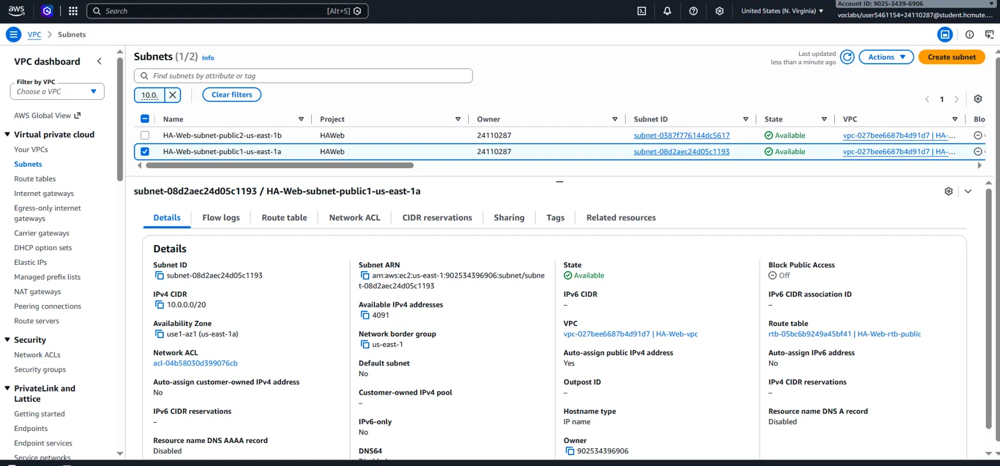

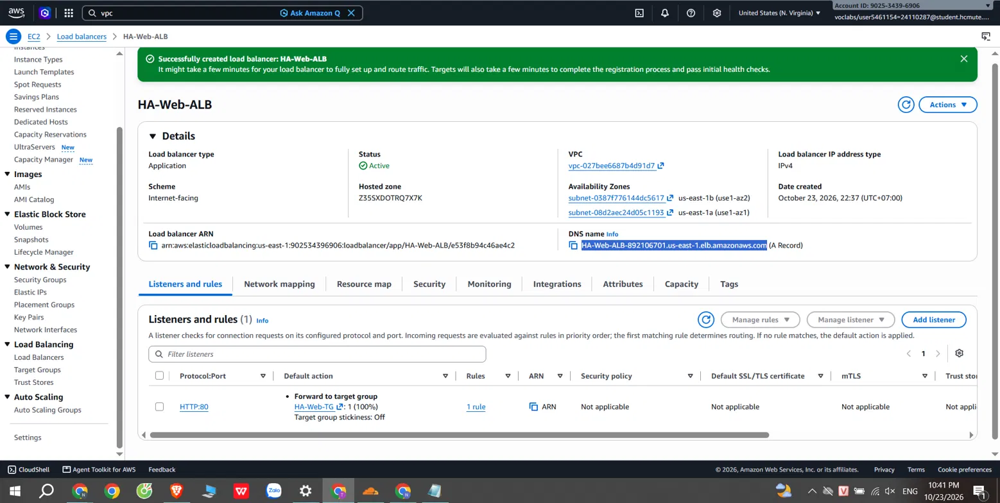

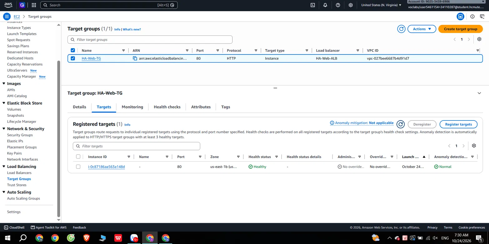

*Hình 2. Dựng lại hệ thống đầu buổi*

ALB HA-Web-ALB ở trạng thái Active với hai AZ us-east-1a và us-east-1b, DNS HA-Web-ALB-892106701.us-east-1.elb.amazonaws.com, listener HTTP:80 chuyển 100% tới HA-Web-TG. Subnet public1 có Auto-assign public IPv4 = Yes. ASG đặt 1/1/4 lúc 07:27:42, target i-0c87186aa563a148d (us-east-1b) Healthy khi chụp ảnh lúc 07:30.

## 6.2. Website và endpoint tạo tải

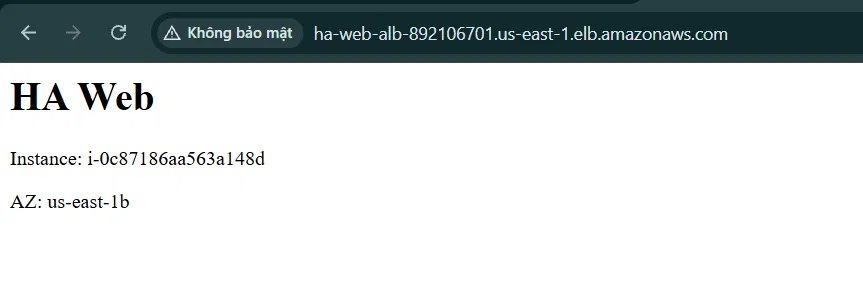

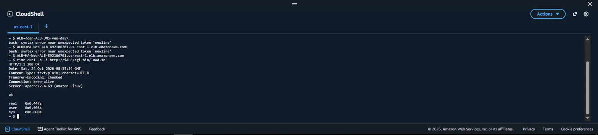

*Hình 3. Website qua ALB và endpoint /cgi-bin/load.sh*

Trang chủ hiển thị Instance i-0c87186aa563a148d và AZ us-east-1b. Lệnh curl tới /cgi-bin/load.sh trả HTTP/1.1 200 OK và nội dung ok; thời gian real đo được là 0,447 giây ở lần đầu và 1,008 giây ở lần chạy lại (07:44), nghĩa là mỗi request mất khoảng 0,4–1 giây.

## 6.3. Tạo tải bằng script

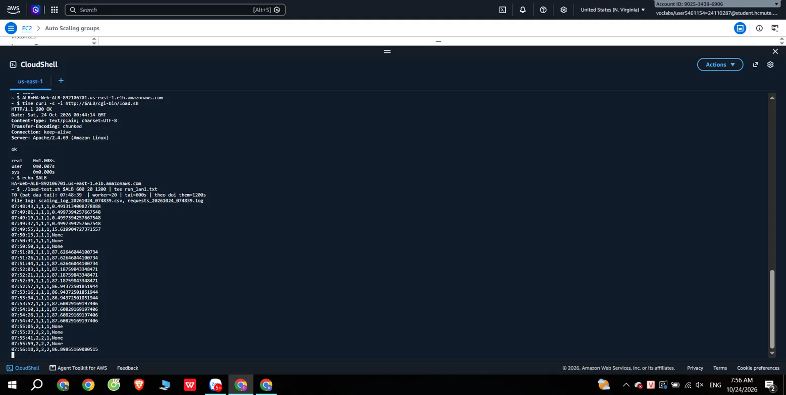

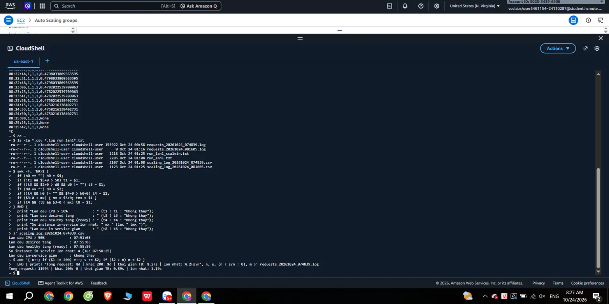

*Hình 4. Chạy script load-test.sh (lần 1)*

Script chạy lần 1 với 20 worker, tải 600 giây. Script dừng lúc 08:08:17 trước khi in tóm tắt (nguyên nhân chưa xác định), nên nhóm chạy lại chế độ theo dõi (file scaling_log_lan1_scalein.csv, đến 08:25) và dựng lại tóm tắt từ file CSV bằng đúng lệnh awk của script: CPU \> 50% lần đầu 07:51:08; desired tăng 07:55:05 (mẫu của script, Activity ghi 07:54:59); healthy tăng 07:55:59; in-service lớn nhất là 4 (07:58:25). Tổng 11 994 request, 0 request khác 200, thời gian trung bình 0,89 giây, lớn nhất 1,19 giây.

## 6.4. Scale-out

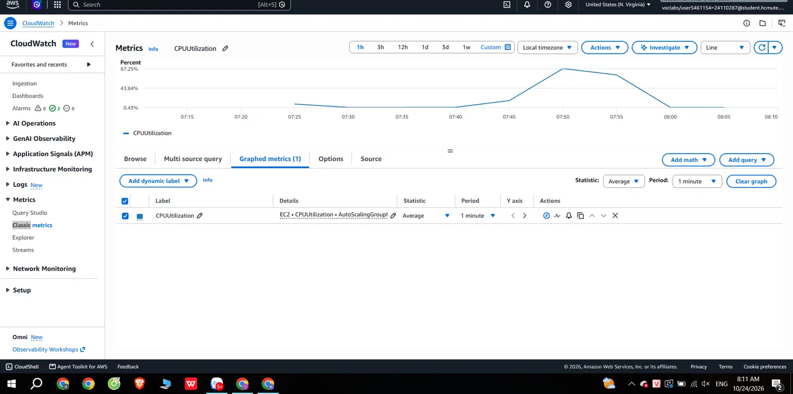

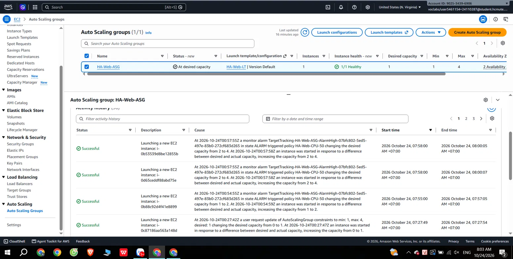

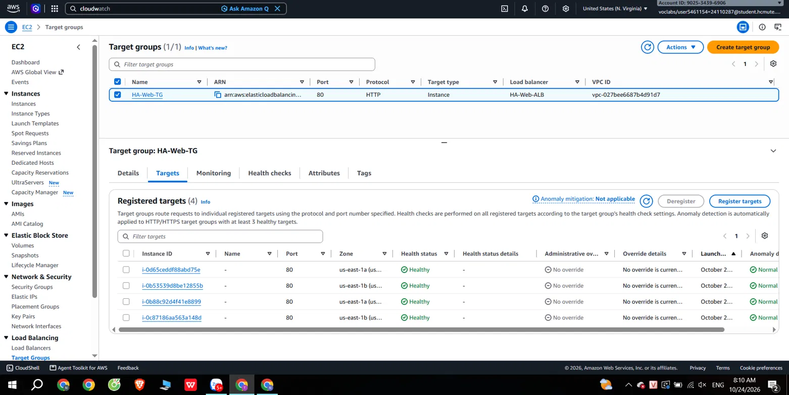

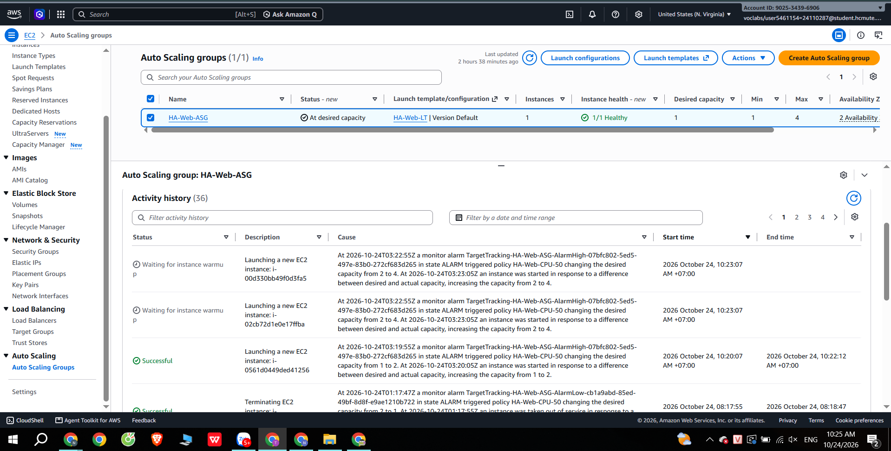

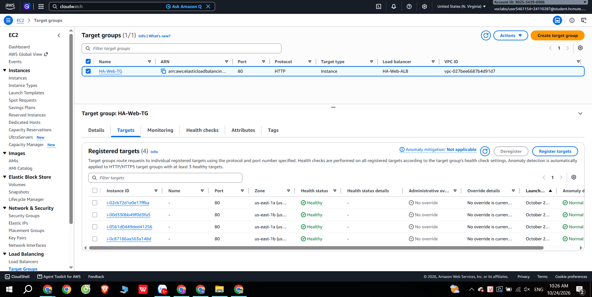

*Hình 5. Scale-out của Auto Scaling Group khi có tải*

Lần 1: CPU tăng từ khoảng 07:45 và đạt khoảng 87%; AlarmHigh kích hoạt 07:54:55 và ASG tăng 1 → 2 (07:54:59), rồi 2 → 4 (07:57:55). Lúc 08:10 target group có 4 instance Healthy, hai instance ở us-east-1a và hai ở us-east-1b. Lần 2: AlarmHigh kích hoạt 10:19:55, ASG tăng 1 → 2 (10:20:05) rồi 2 → 4 (10:22:55), đủ 4 instance Healthy lúc khoảng 10:24:12 (ảnh Targets lúc 10:26 cũng thể hiện hai instance mỗi AZ).

## 6.5. Scale-in

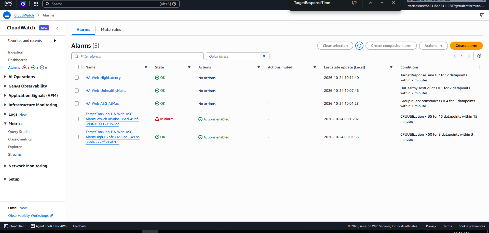

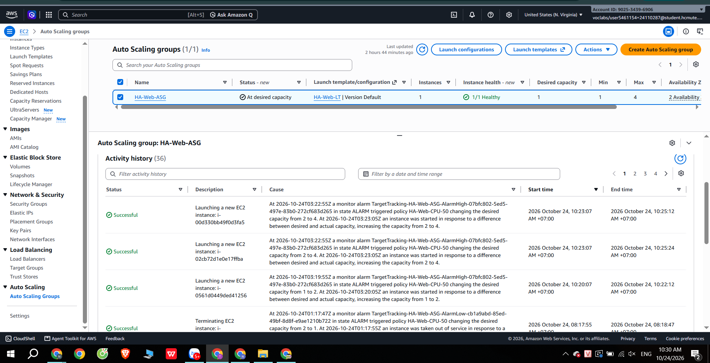

*Hình 6. Scale-in sau khi dừng tải (lần 1)*

AlarmLow chuyển In alarm lúc 08:16:02. ASG giảm 4 → 3 lúc 08:16:14 (xong 08:17:07), 3 → 2 lúc 08:16:55 (xong 08:17:47), 2 → 1 lúc 08:17:55 (xong 08:18:47). Lúc 08:19 target group chỉ còn instance i-0c87186aa563a148d (us-east-1b) ở trạng thái Healthy.

## 6.6. Tải lần 2 bằng ab

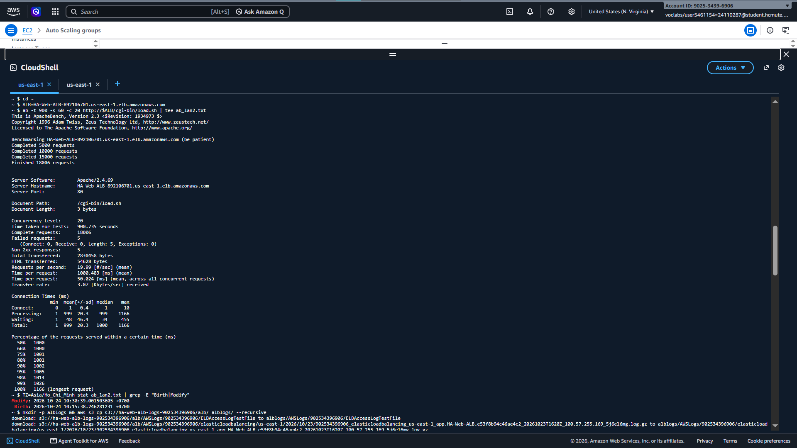

*Hình 7. Kết quả ab (lần 2)*

ab chạy 900,735 giây (bắt đầu 10:15:38, kết thúc 10:30:39 theo lệnh stat của file ab_lan2.txt) với 20 kết nối đồng thời: 18 006 request hoàn thành, 5 request non-2xx, 19,99 request/giây, thời gian trung bình mỗi request 1000,5 ms; 50% request xong trong 1000 ms, 95% trong 1005 ms, lớn nhất 1166 ms. Cả 5 request lỗi là mã 502 do ALB trả, lúc 10:16:48, 10:20:16, 10:24:04, 10:28:28 và 10:29:22 (chi tiết ở mục 5, nhận xét chất lượng dịch vụ).

## 6.7. Dashboard CloudWatch và alarm

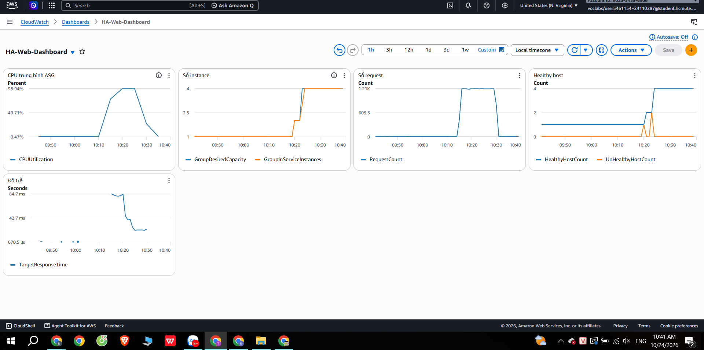

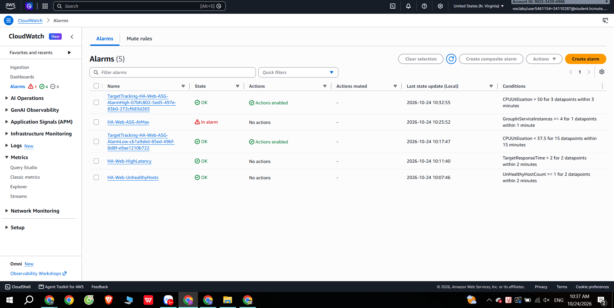

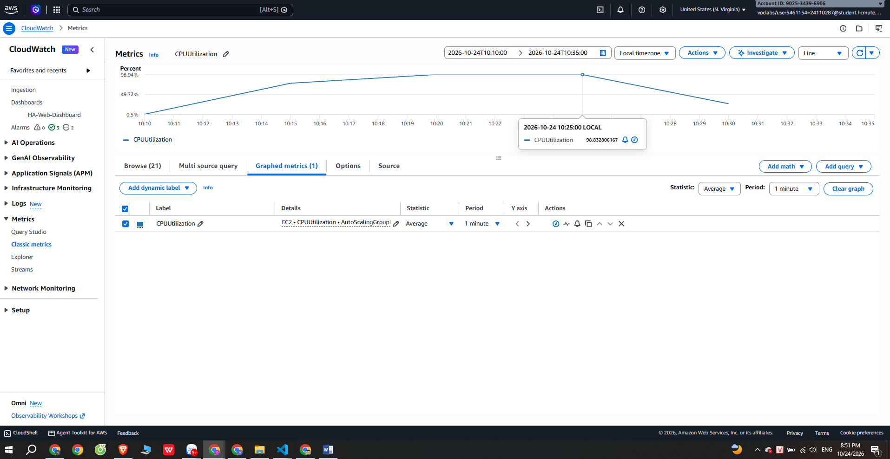

*Hình 8. Dashboard HA-Web-Dashboard và danh sách alarm*

Dashboard cho thấy hai đợt tải (07:48–07:58 và 10:15–10:30): số request khoảng 1,2 nghìn mỗi phút, CPU đỉnh khoảng 87% (lần 1) và 98,94% (lần 2), số instance lên 4, HealthyHostCount lên 4. UnHealthyHostCount có nhảy lên trong lúc instance mới khởi động (khoảng 07:55 và 10:20–10:24) nhưng alarm UnhealthyHosts không kích hoạt. Lúc 10:37: AtMax In alarm từ 10:25:52; AlarmHigh OK từ 10:32:55 (In alarm từ 10:19:55); AlarmLow OK từ 10:17:47; HighLatency và UnhealthyHosts OK.

## 6.8. ALB access log ra S3

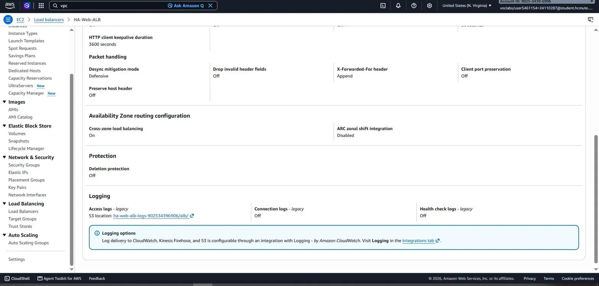

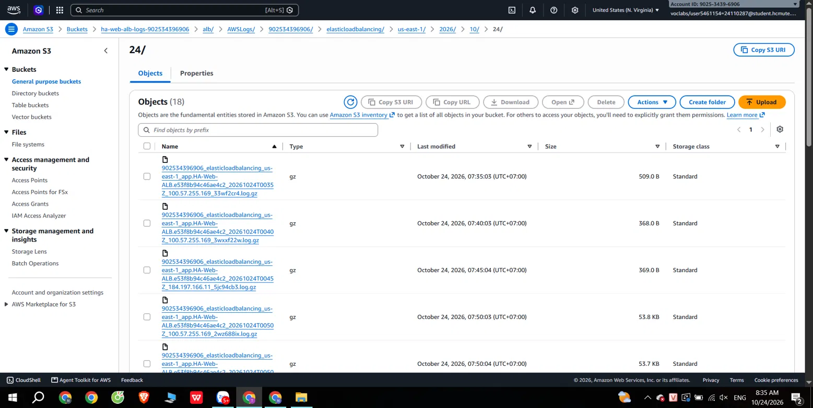

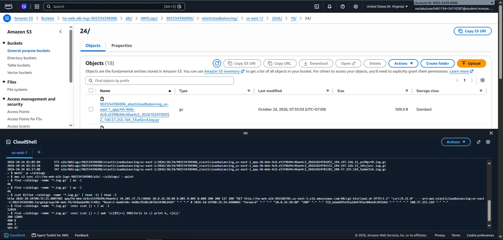

*Hình 9. ALB access log được lưu trên S3*

Sau đợt tải lần 1, bucket có 46 file .log.gz (18 file trong thư mục ngày 24/ theo giờ UTC), tổng 12 059 dòng log: 12 001 mã 200, 8 mã 400, 3 mã 404, 47 mã 503. Cả 47 mã 503 xảy ra từ 23:18 ngày 23/10 đến 06:53 ngày 24/10 (giờ Việt Nam), tức lúc ALB đã tạo nhưng ASG chưa có instance; không có mã 503 nào trong ngày 24/10 theo giờ UTC (đến khoảng 08:20 giờ Việt Nam). Trong cửa sổ tải lần 1 (07:48:39–08:00:00) log ghi 11 998 request (11 997 mã 200, 1 mã 400 từ IP ngoài), lệch 4 request so với 11 994 của script; nhóm chưa xác định nguồn của 3 request mã 200 chênh lệch. **\[ĐIỀN: số file và số dòng log sau lần 2 nếu đã đồng bộ lại\]**

## 6.9. Bảo mật

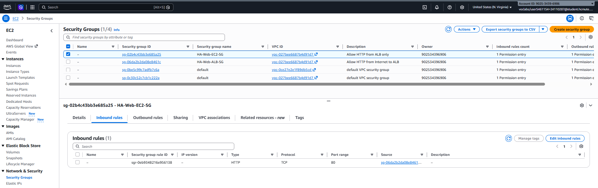

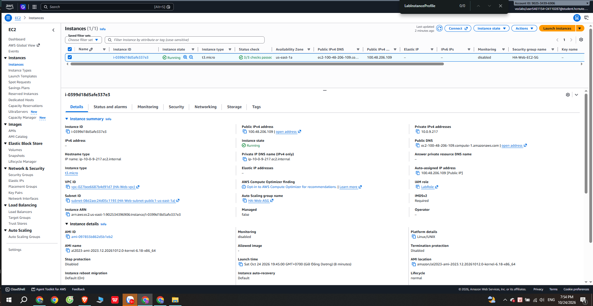

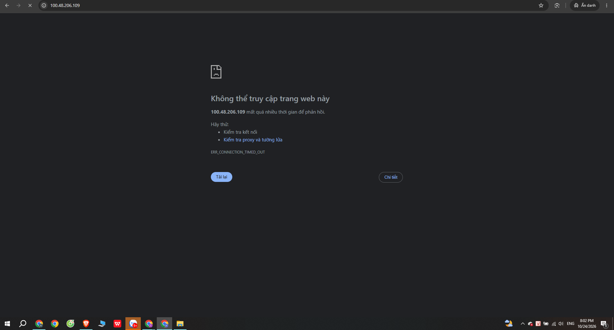

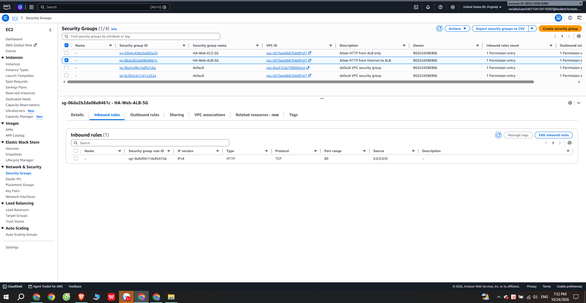

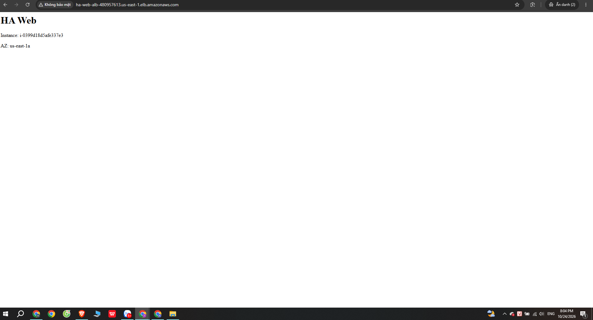

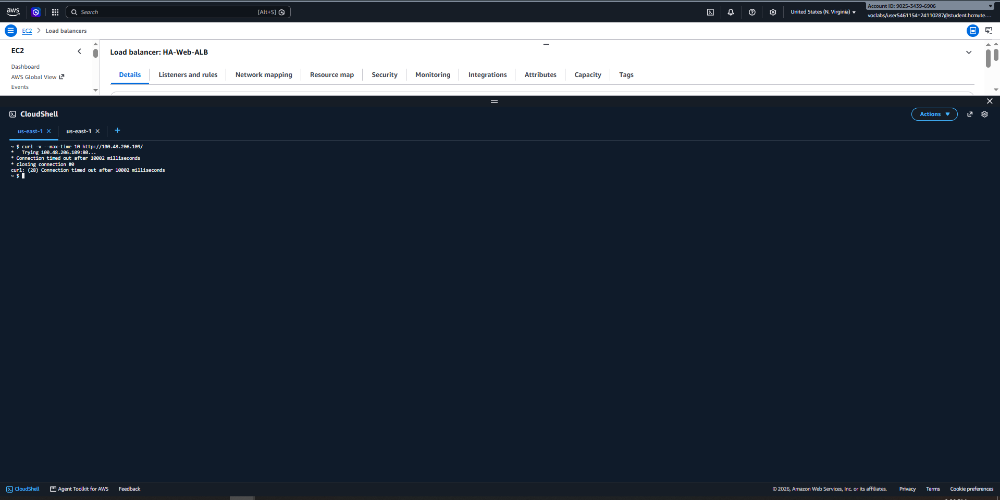

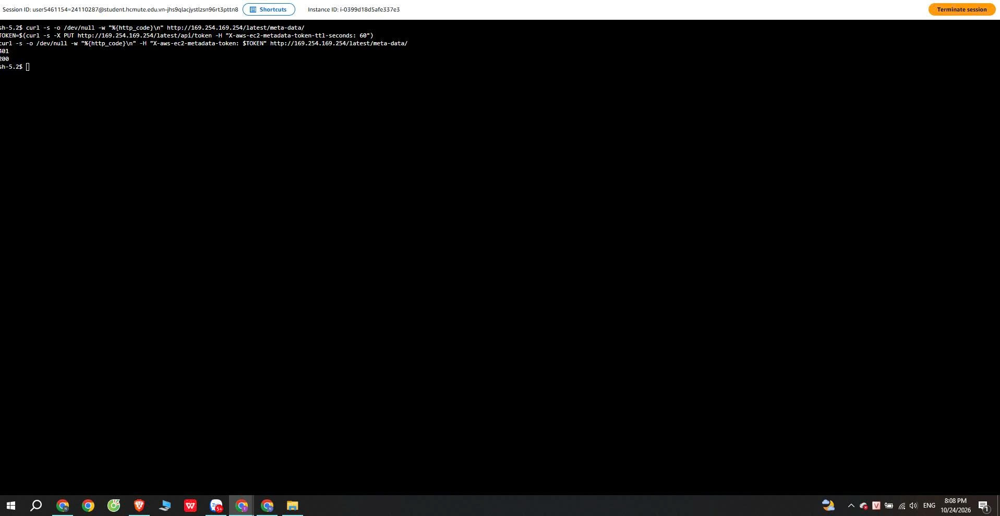

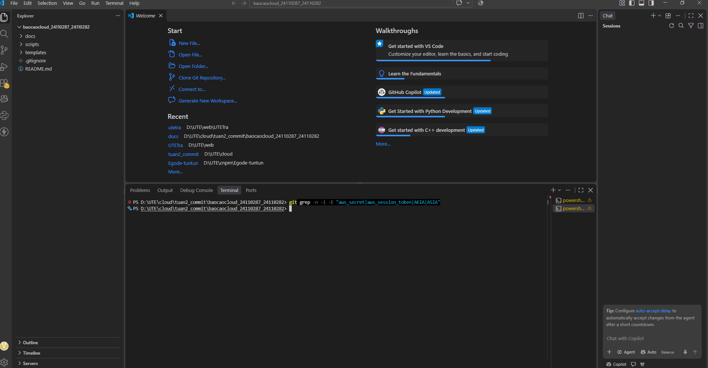

*Hình 10. Rà soát bảo mật*

Rà soát lúc 19:52–19:54 ngày 24/10/2026: HA-Web-EC2-SG có 1 rule inbound (HTTP, TCP 80, nguồn là security group sg-06da2b2da08e8461…, tức HA-Web-ALB-SG) và không có cổng 22; HA-Web-ALB-SG có 1 rule inbound (HTTP, TCP 80, nguồn 0.0.0.0/0). Instance i-0399d18d5afe337e3 (us-east-1a, t3.micro, khởi tạo 19:45) dùng security group HA-Web-EC2-SG, có IMDSv2 = Required và IAM role LabRole (qua LabInstanceProfile gắn trong Launch Template). Lúc 20:02 ngày 24/10, truy cập trực tiếp http://100.48.206.109 bằng trình duyệt ẩn danh báo ERR_CONNECTION_TIMED_OUT; lệnh curl --max-time 10 từ CloudShell tới cùng địa chỉ cũng báo Connection timed out sau 10002 ms (curl exit code 28). Lúc 20:08, trong phiên Session Manager trên instance i-0399d18d5afe337e3, lệnh curl tới http://169.254.169.254/latest/meta-data/ không kèm token trả mã 401; sau khi lấy token bằng PUT /latest/api/token (TTL 60 giây) rồi gửi kèm header X-aws-ec2-metadata-token, cùng đường dẫn trả mã 200, đúng với IMDSv2 = Required. Lúc 20:04, truy cập qua DNS của ALB buổi này (ha-web-alb-480957613.us-east-1.elb.amazonaws.com) hiển thị Instance i-0399d18d5afe337e3, AZ us-east-1a, tức cùng instance vừa bị chặn khi truy cập trực tiếp. Lúc 20:54, lệnh git grep -n -i -E "aws_secret\|aws_session_token\|AKIA\|ASIA" trong thư mục repo cục bộ không in kết quả nào, tức không tìm thấy khóa truy cập; lệnh này sẽ được chạy lại sau khi thêm file tuần 3 và trước khi push.. Quan sát thêm từ log ALB: ngay trong vài giờ sau khi tạo, ALB nhận request dò quét từ nhiều IP bên ngoài (ví dụ đường dẫn /druid/index.html hoặc request rỗng) và trả mã 400/404; các request này chỉ đi qua cổng 80 của ALB.

## 6.10. CloudFormation

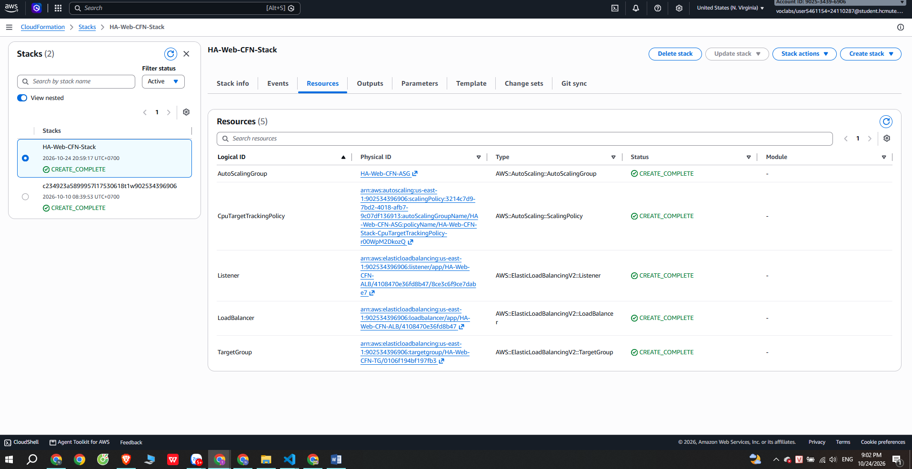

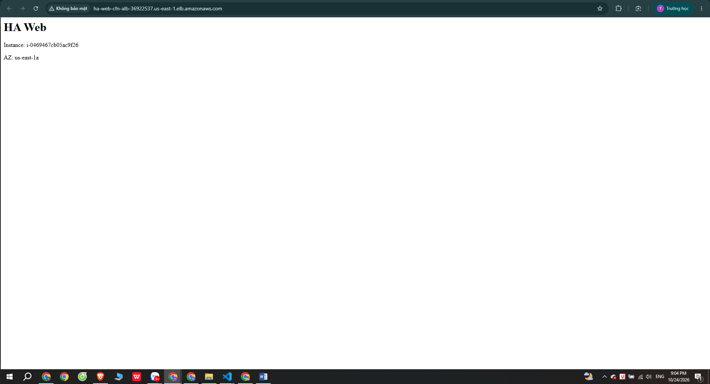

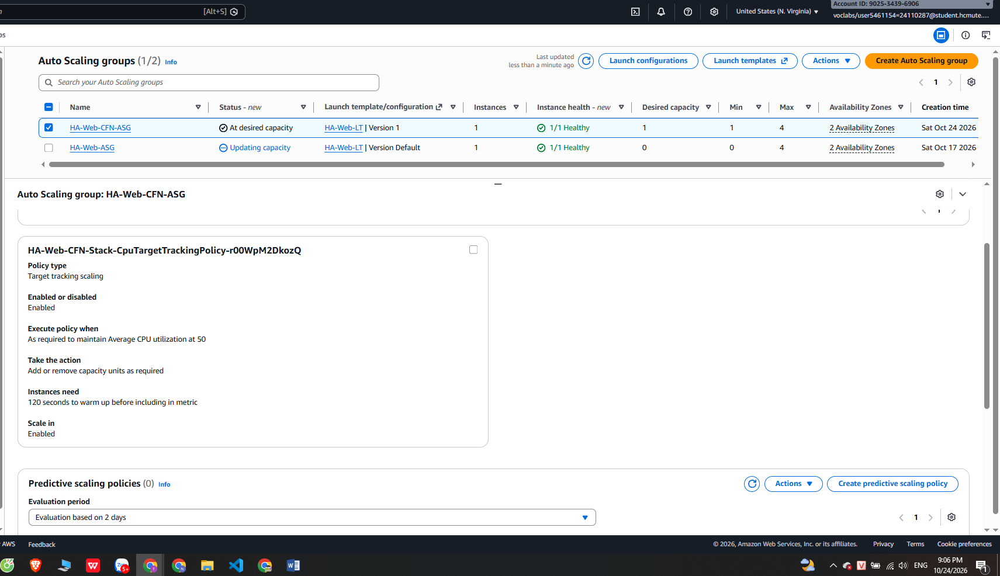

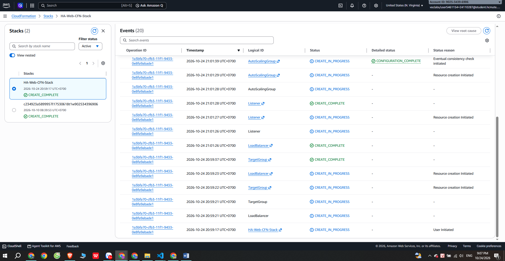

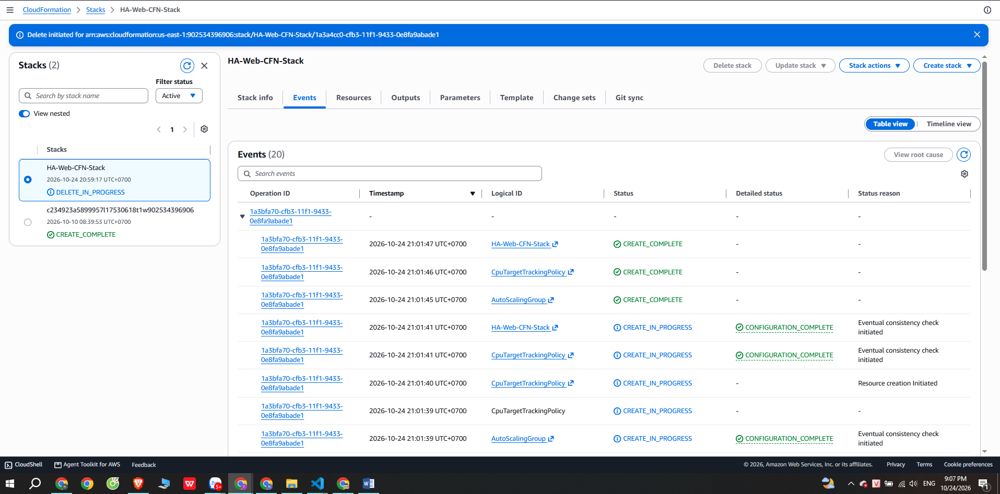

*Hình 11. Stack CloudFormation HA-Web-CFN-Stack*

Stack HA-Web-CFN-Stack (template infra/ha-web-cfn.yaml, Launch Template phiên bản 1, AccessLogBucket = ha-web-alb-logs-902534396906) bắt đầu lúc 20:59:17 và CREATE_COMPLETE lúc 21:01:47, tổng 2 phút 30 giây, không gặp lỗi. Thời gian từng tài nguyên theo tab Events: Target Group 20:59:22–20:59:37; ALB 20:59:21–21:01:26 (lâu nhất, khoảng 2 phút 5 giây); Listener 21:01:26–21:01:28; ASG 21:01:28–21:01:45; Target Tracking Policy 21:01:39–21:01:46. Lúc 21:04, truy cập DNS lấy từ Outputs (ha-web-cfn-alb-36922537.us-east-1.elb.amazonaws.com) hiển thị Instance i-0469467cb05ac9f26, AZ us-east-1a. Lúc 21:06, HA-Web-CFN-ASG ở mức 1/1/4 và 1/1 Healthy; policy Target tracking duy trì Average CPU utilization ở 50, warm-up 120 giây, scale-in bật. Nhóm bắt đầu xóa stack lúc 21:07; lúc 21:10 danh sách Load Balancers trống, Target Group chỉ còn HA-Web-TG và ASG chỉ còn HA-Web-ASG (0/0/4). Nhóm chưa ghi lại giờ DELETE_COMPLETE chính xác.

## 6.11. Kiểm thử sự cố 1 AZ (mốc cơ sở)

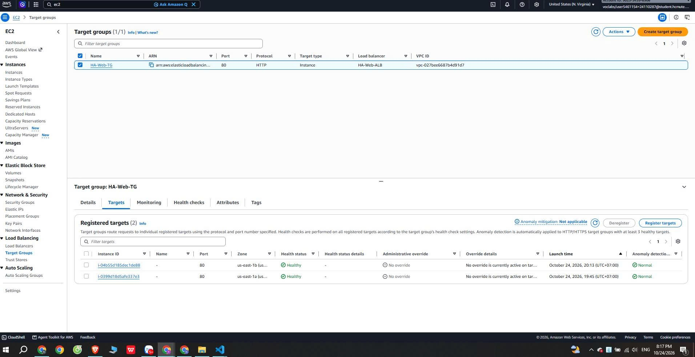

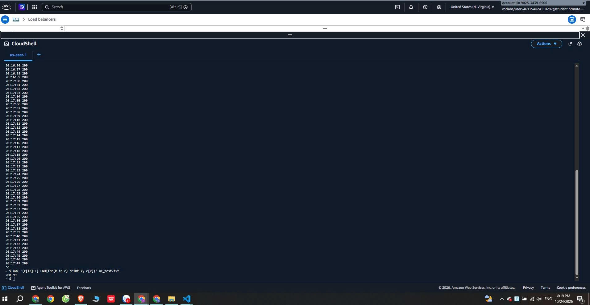

*Hình 13. Mốc cơ sở trước khi mô phỏng sự cố 1 AZ*

Lúc 20:16, ASG HA-Web-ASG (min 1, max 4) có 2 instance, trạng thái At desired capacity, 2/2 Healthy. Lúc 20:17, Target Group có 2 target Healthy: i-0399d18d5afe337e3 (us-east-1a, khởi tạo 19:45) và i-04b55d185dec1de88 (us-east-1b, khởi tạo 20:13). Vòng lặp curl tới DNS ALB (ha-web-alb-480957613) mỗi giây từ 20:16:08 đến 20:17:47 ghi 99 dòng, toàn bộ mã 200. Nhóm chưa terminate instance nào ở bước này nên đây chỉ là mốc cơ sở; việc terminate một instance và quan sát ASG thay thế được chuyển sang tuần 4.

# 7. Quy ước và quản lý chi phí

| **Hạng mục**                    | **Nội dung**                                                                                                                             |
|---------------------------------|------------------------------------------------------------------------------------------------------------------------------------------|
| **Region / IAM**                | us-east-1; dùng LabRole/LabInstanceProfile, không tạo IAM user/role                                                                      |
| **Giới hạn EC2**                | t3.micro; ASG max 4 (≤ 9 instance và ≤ 32 vCPU mỗi region); số instance tối đa thực tế trong tuần 3 là 4                                 |
| **Tag**                         | Project = HAWeb; Owner = MSSV cho mọi tài nguyên mới                                                                                     |
| **Dọn dẹp cuối buổi 24/10**     | ASG đặt min 0, desired 0, max 4 và xóa ALB lúc 10:56; giữ Launch Template, Target Group, ASG, S3 bucket log; kết thúc phiên bằng End Lab |
| **Thời gian chạy ALB**          | Từ 22:37 ngày 23/10 đến 10:56 ngày 24/10, khoảng 12 giờ 19 phút (qua đêm, trong đó ASG 0 instance đến 07:27)                             |
| **Thời gian chạy EC2 t3.micro** | **\[ĐIỀN: tổng instance-giờ tính từ Activity history\]**                                                           |
| **Credit Learner Lab**          | Trang Lab lúc 11:02 ngày 24/10 hiển thị đã dùng 0,6 USD trên 50 USD (số tích lũy của toàn Lab, không riêng tuần 3)                       |
| **Lưu ý**                       | Reset Learner Lab xóa toàn bộ tài nguyên, kể cả S3 bucket; cần tải log về trước khi Reset                                                |

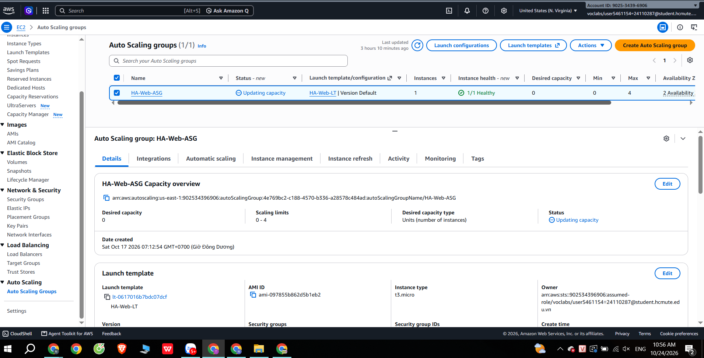

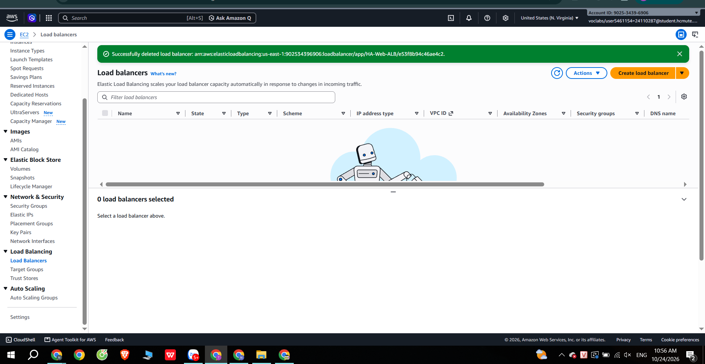

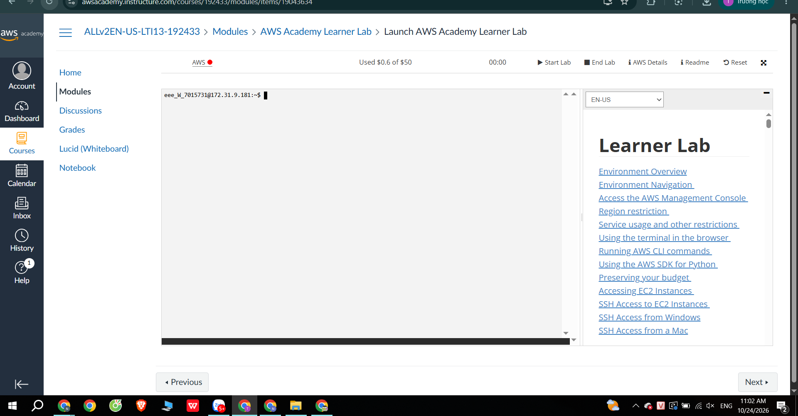

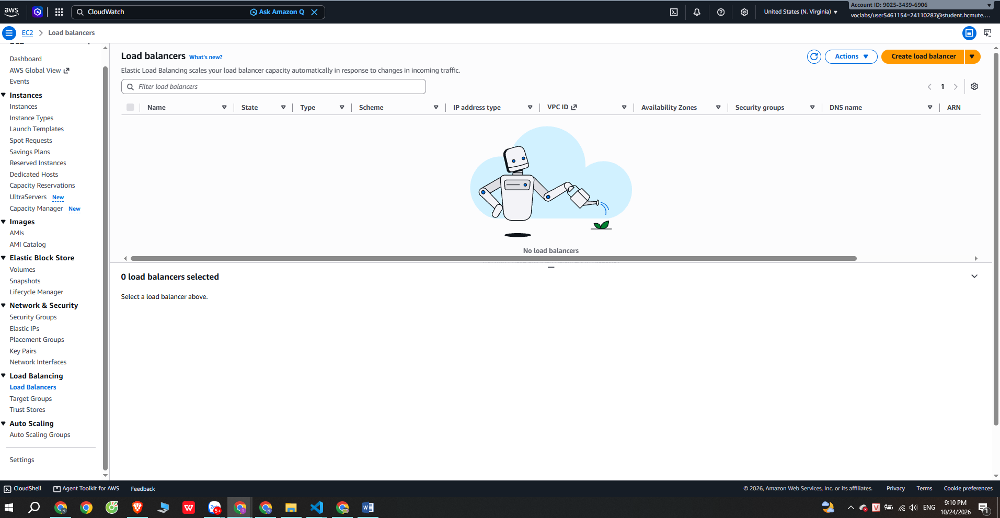

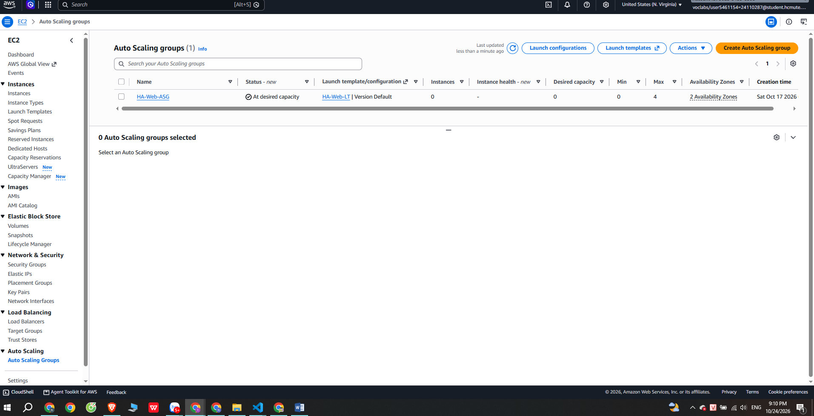

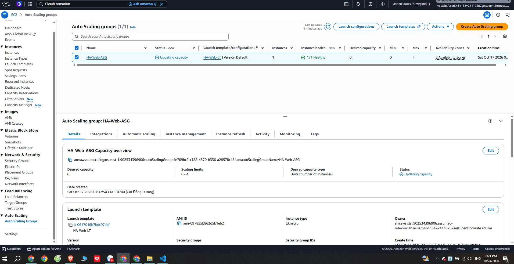

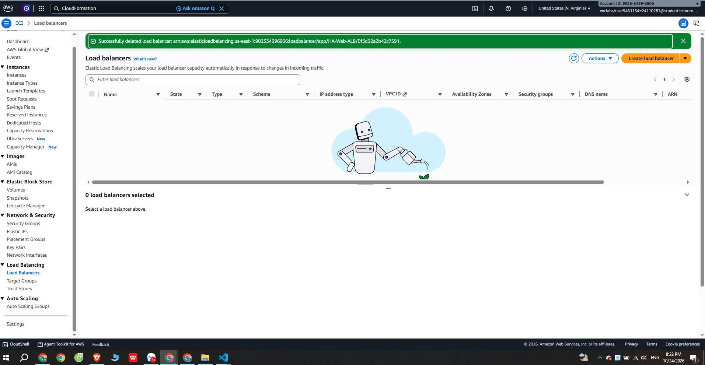

*Hình 12. Dọn dẹp tài nguyên và credit đã dùng (buổi 24/10)*

Lúc 10:56 ASG được đặt về desired 0 (trạng thái Updating capacity khi instance còn đang kết thúc) và ALB HA-Web-ALB đã được xóa. Buổi Ngày 4 (24/10): lúc 20:21 ASG được đặt desired 0 (thấy Updating capacity, còn 1 instance đang kết thúc) và lúc 20:22 ALB HA-Web-ALB (buổi này) báo Successfully deleted. Buổi Ngày 5 (24/10): stack HA-Web-CFN-Stack được xóa từ 21:07; lúc 21:10 không còn load balancer nào và ASG chỉ còn HA-Web-ASG ở mức 0/0/4 (ảnh 4 và 5).

# 8. Ghi chú sử dụng AI

| **Phần công việc**                                             | **Mức độ hỗ trợ của AI**                                                                               |
|----------------------------------------------------------------|--------------------------------------------------------------------------------------------------------|
| **Script load-test.sh và template CloudFormation**             | Dùng Claude soạn; nhóm đã đọc, chỉnh sửa, tự chạy thử trên Learner Lab và giải thích được từng phần    |
| **Cấu hình dashboard, alarm, access log, rà soát bảo mật**     | AI gợi ý các bước; nhóm tự thực hiện trên AWS và chụp minh chứng                                       |
| **Đối chiếu và phân tích số liệu (CSV, log ALB, ảnh console)** | AI hỗ trợ tính các khoảng thời gian và gợi ý lệnh kiểm tra; nhóm tự chạy lệnh và đối chiếu với console |
| **Khung báo cáo tuần 3**                                       | AI soạn khung theo mẫu tuần 2; nhóm điền số liệu đo thật và nhận xét                                   |

Mọi tài nguyên đều được nhóm triển khai và chạy thật trên AWS Learner Lab; số liệu trong báo cáo là số liệu đo thực tế.

# 9. Khó khăn và vấn đề gặp phải

- CloudShell dừng lúc 08:08:17 khi script lần 1 chưa kết thúc (nguyên nhân chưa xác định), nên script không in tóm tắt. Nhóm chạy lại ở chế độ theo dõi và dựng lại tóm tắt từ file CSV bằng cùng lệnh awk.

- Ở lần 2, script theo dõi được khởi động lúc 10:18:33, trễ khoảng 3 phút so với lúc ab bắt đầu (10:15:38), nên tóm tắt tự động của lần này không dùng được. Nhóm lấy T0 từ lệnh stat của file ab_lan2.txt; mốc T1 của lần 2 phải đối chiếu thêm với dữ liệu CloudWatch.

- ALB được tạo từ tối 23/10 trong khi ASG chưa có instance nên nhận 47 mã 503 trước khi bắt đầu tải; các lỗi này nằm ngoài cửa sổ tải và đã được tách riêng khi thống kê.

- Số liệu hai nguồn lệch nhau: script ghi 11 994 request, log ALB ghi 11 998 request trong cùng cửa sổ; chỉ xác định được 1 request là mã 400 từ IP ngoài.

- Ngưỡng AlarmLow do Auto Scaling quản lý thay đổi giữa 35 và 37,5 so với 45 ghi ở tuần 2; nhóm ghi nhận số quan sát, chưa xác định quy luật.

- **\[ĐIỀN: vấn đề khác phát sinh ở Ngày 4 và Ngày 5, nguyên nhân và cách xử lý\]**

- Tag Editor và IAM Access Analyzer bị chặn bởi chính sách của Learner Lab; nhóm kiểm tra tag trực tiếp trên từng tài nguyên. HTTPS chưa triển khai do thiếu tên miền và chứng chỉ.

# 10. Kế hoạch tuần 4

- Phân tích dữ liệu ALB access log trên S3 (số request, mã trạng thái, thời gian xử lý theo thời gian), đối chiếu với số liệu script và ab

- Kiểm thử tổng thể; mô phỏng sự cố 1 AZ nếu chưa thực hiện ở tuần 3; đo scale-in lần 2 nếu cần so sánh

- Báo cáo chi phí và tối ưu chi phí; dọn dẹp tài nguyên (stack, S3 bucket, ASG, Launch Template, Target Group)

- Quay video demo (tối đa 10 phút); hoàn thiện báo cáo phân tích cuối

- Thực hiện thêm các nhiệm vụ do giảng viên giao sau khi nhận báo cáo tuần 3

## Checklist tuần 3

> ☑ Dựng lại hệ thống và kiểm tra tích hợp (ALB, ASG 1/1/4, load.sh).
>
> ☑ Tạo tải thật bằng script, ghi mốc thời gian scale-out/scale-in và warm-up.
>
> ☑ Chạy tải lần 2 bằng ab để đối chiếu.
>
> ☑ Dashboard và alarm bổ sung trên CloudWatch.
>
> ☑ Bật ALB access log ra S3, kiểm tra có file log.
>
> ☑ Rà soát bảo mật (Security Group, IMDSv2, IAM, Git).
>
> ☑ Template CloudFormation chạy thử và xóa stack.
>
> ☐ Chụp đủ ảnh minh chứng (Account ID, Region, thời gian).
>
> ☐ Dọn dẹp tài nguyên cuối mỗi buổi (ASG = 0, xóa ALB, xóa stack).
>
> ☐ Commit script, template, dữ liệu, tài liệu lên Git với commit message rõ nội dung.
