**TRƯỜNG ĐẠI HỌC SƯ PHẠM KỸ THUẬT TP. HỒ CHÍ MINH**

**KHOA CÔNG NGHỆ THÔNG TIN**

**BÁO CÁO TIẾN ĐỘ TUẦN 4 KIÊM BÁO CÁO PHÂN TÍCH CUỐI KỲ**

**Đề tài: Website có tính sẵn sàng cao với Application Load Balancer và EC2 Auto Scaling**

**Môn học:** Điện toán đám mây

**Lớp học:** CLCO332779_05UTExMC

**GVHD:** TS. Huỳnh Xuân Phụng

**Thời gian:** Tuần 4 (tính từ ngày 26/10/2026)

**Git:** [https://github.com/tranvannghia240806-hub/baocaocloud_24110287_24110282](https://github.com/tranvannghia240806-hub/baocaocloud_24110287_24110282)

**Sản phẩm tuần 4 trên GitHub:**

1. [README.md](https://github.com/tranvannghia240806-hub/baocaocloud_24110287_24110282/blob/main/README.md)
2. [docs/Bao_cao_tuan_4.docx](https://github.com/tranvannghia240806-hub/baocaocloud_24110287_24110282/blob/main/docs/Bao_cao_tuan_4.docx)
3. [docs/Bao_cao_tuan_4.md](https://github.com/tranvannghia240806-hub/baocaocloud_24110287_24110282/blob/main/docs/Bao_cao_tuan_4.md)
4. [docs/Bang_phan_cong_va_worklog_tuan_4.docx](https://github.com/tranvannghia240806-hub/baocaocloud_24110287_24110282/blob/main/docs/Bang_phan_cong_va_worklog_tuan_4.docx)
5. [scripts/analyze-alb-logs.sh](https://github.com/tranvannghia240806-hub/baocaocloud_24110287_24110282/blob/main/scripts/analyze-alb-logs.sh)
6. [scripts/cost-estimate.py](https://github.com/tranvannghia240806-hub/baocaocloud_24110287_24110282/blob/main/scripts/cost-estimate.py)
7. [docs/data/tuan4/az_test.txt](https://github.com/tranvannghia240806-hub/baocaocloud_24110287_24110282/blob/main/docs/data/tuan4/az_test.txt)
8. [docs/data/tuan4/az_test_loi.txt](https://github.com/tranvannghia240806-hub/baocaocloud_24110287_24110282/blob/main/docs/data/tuan4/az_test_loi.txt)
9. [docs/data/tuan4/run_lan3.txt](https://github.com/tranvannghia240806-hub/baocaocloud_24110287_24110282/blob/main/docs/data/tuan4/run_lan3.txt)
10. [docs/data/tuan4/scaling_log_lan3.csv](https://github.com/tranvannghia240806-hub/baocaocloud_24110287_24110282/blob/main/docs/data/tuan4/scaling_log_lan3.csv)
11. [docs/data/tuan4/scaling_log_lan3_tiep.csv](https://github.com/tranvannghia240806-hub/baocaocloud_24110287_24110282/blob/main/docs/data/tuan4/scaling_log_lan3_tiep.csv)
12. [docs/data/tuan4/phan_tich_log_tuan4.txt](https://github.com/tranvannghia240806-hub/baocaocloud_24110287_24110282/blob/main/docs/data/tuan4/phan_tich_log_tuan4.txt)
13. [docs/data/tuan4/chi_phi_tuan4.txt](https://github.com/tranvannghia240806-hub/baocaocloud_24110287_24110282/blob/main/docs/data/tuan4/chi_phi_tuan4.txt)

**Video demo:** [https://youtu.be/SzbixCAcb0s](https://www.youtube.com/watch?v=SzbixcACb0s) (YouTube, chế độ Không công khai, thời lượng 09:45)

Link commit:

1. [8dc925e](https://github.com/tranvannghia240806-hub/baocaocloud_24110287_24110282/commit/8dc925ec57872360cff34232b077e722b7cedc37) - "Tuan 4: Them script phan tich ALB logs va chi phi"
2. [91cde60](https://github.com/tranvannghia240806-hub/baocaocloud_24110287_24110282/commit/91cde60edf94950a8398f74e6291dc051828ea49) - "Tuan 4: Them du lieu kiem thu va phan tich log"
3. [d3a5f15](https://github.com/tranvannghia240806-hub/baocaocloud_24110287_24110282/commit/d3a5f15b2ed4969deb49c9bd645fa20f5fa5a352) - "Tuan 4: Minh chung AWS, CloudFormation va video demo"
4. [6207f2d](https://github.com/tranvannghia240806-hub/baocaocloud_24110287_24110282/commit/6207f2d9a3a59f099225d464a44e20b9c293751a) - "Tuan 4: Dong bo script, du lieu va anh theo bao cao cuoi"
5. [81094a4](https://github.com/tranvannghia240806-hub/baocaocloud_24110287_24110282/commit/81094a4ab71b0da205acc1470c8e32b72253e6d1) - "Tuan 4: Hoan thien bao cao cuoi ky va README"
6. [f8a8bdf](https://github.com/tranvannghia240806-hub/baocaocloud_24110287_24110282/commit/f8a8bdf2689d8e4fe97a6016b77f1e3b5ed69ed4) - "bo sung bang phan cong"

Ảnh minh chứng nằm trong thư mục [docs/images/tuan4/](https://github.com/tranvannghia240806-hub/baocaocloud_24110287_24110282/tree/main/docs/images/tuan4); link từng ảnh ghi ngay dưới mỗi hình.

| **MSSV** | **Họ và tên** | **Chức vụ** |
|---|---|---|
| 24110287 | Trần Văn Nghĩa | Nhóm trưởng |
| 24110282 | Kiên Nguyễn Xuân Lưu | Thành viên |

# 1. Mục tiêu tuần 4

Theo kế hoạch của giảng viên, tuần 4 gồm: kiểm thử tổng thể, tối ưu chi phí, dọn dẹp tài nguyên, viết báo cáo và demo. Nhóm đồng thời hoàn tất các việc đã ghi ở kế hoạch tuần 4 của báo cáo tuần 3:

- Kiểm thử tổng thể: rà lại toàn bộ chức năng đã kiểm thử ở tuần 2 và tuần 3, bổ sung phần còn thiếu là sự cố mất instance ở một AZ và lần tải thứ ba có đủ các mốc từ T0 đến T9 (gồm scale-in).
- Phân tích dữ liệu ALB access log đã thu thập từ tuần 3 (số request, mã trạng thái, phân bố theo target, đối chiếu với số liệu của script và ab).
- Tối ưu chi phí: ước tính chi phí đã dùng, đề xuất và thử các biện pháp giảm chi phí (scheduled scaling, tránh ALB chạy qua đêm).
- Dọn dẹp toàn bộ tài nguyên trên Learner Lab và ghi lại bằng ảnh.
- Quay video demo (không quá 10 phút) và hoàn thiện báo cáo phân tích cuối kỳ.

Tiến độ tại thời điểm cập nhật (01/11/2026): cả năm ngày đã có kết quả. Ngày 1 (kiểm thử mất instance ở một AZ và tải lần 3, 29/10), Ngày 2 (phân tích ALB access log, 30/10), Ngày 3 (tối ưu chi phí và thử scheduled scaling, 31/10) được ghi trong mục 4, 5 và 6; Ngày 4 (video demo, kiểm thử AZ trực tiếp, 01/11) trong mục 4.2.3, 6.6 và 8; Ngày 5 (dọn dẹp tổng thể, kiểm tra CloudFormation, hồ sơ nộp) trong mục 7 và 14.

# 2. Phân công công việc

**[Điều chỉnh bảng phân công và số giờ theo thực tế trước khi nộp]**

| **Thành viên** | **Công việc tuần 4** |
|---|---|
| **Trần Văn Nghĩa** | Kiểm thử sự cố mất instance ở 1 AZ; chạy tải lần 3; viết và chạy script phân tích ALB access log; quay và dựng video demo; tổng hợp báo cáo tuần 4. |
| **Kiên Nguyễn Xuân Lưu** | Dựng lại hệ thống đầu buổi; theo dõi Activity history, Alarms, dashboard; ước tính chi phí (cost-estimate.py) và thử scheduled scaling; thu thập ảnh minh chứng; dọn dẹp tổng thể; commit tài liệu lên Git. |

| **Ngày** | **Trần Văn Nghĩa** | **Giờ** | **Kiên Nguyễn Xuân Lưu** | **Giờ** |
|---|---|---|---|---|
| **Ngày 1** | Chạy kiểm thử sự cố 1 AZ (terminate instance, ghi log từng giây) | 2h | Dựng lại ALB và ASG, theo dõi Activity và Targets; chụp ảnh; chạy tải lần 3 và ghi mốc T0–T9 | 2h |
| **Ngày 2** | Viết và chạy analyze-alb-logs.sh trên log S3; phân tích mã lỗi và phân bố target | 2h | Thu thập Activity history; chạy cost-estimate.py; chụp trang Learner Lab | 2h |
| **Ngày 3** | Đối chiếu số liệu log với script và ab; viết mục phân tích log | 2h | Thử scheduled scaling; lập bảng biện pháp tối ưu chi phí | 2h |
| **Ngày 4** | Quay video demo; dựng video | 2h | Chuẩn bị hệ thống trước khi quay; kiểm tra link video; viết mục chi phí và dọn dẹp | 2h |
| **Ngày 5** | Hoàn thiện báo cáo; kiểm tra Git không có thông tin nhạy cảm | 2h | Dọn dẹp tổng thể; chụp ảnh xác nhận; commit và nộp | 2h |
| **Tổng kết** |  | 10h |  | 10h |

# 3. Kiến trúc và tài nguyên cuối cùng

Kiến trúc giữ nguyên thiết kế đã trình bày ở tuần 1 đến tuần 3: ALB ở hai AZ, Auto Scaling Group từ 1 đến 4 instance t3.micro, Target Tracking theo CPU 50%, giám sát bằng CloudWatch, ALB access log lưu trên S3 và template CloudFormation để dựng lại hệ thống.

*Link ảnh: [architecture.png](https://github.com/tranvannghia240806-hub/baocaocloud_24110287_24110282/blob/main/docs/architecture.png)*

*Sơ đồ kiến trúc tổng thể (docs/architecture.png, đã cập nhật S3 ở tuần 3)*

| **Thành phần** | **Cấu hình cuối cùng** |
|---|---|
| **Mạng** | HA-Web-vpc 10.0.0.0/16; 2 subnet public (us-east-1a, us-east-1b) bật auto-assign public IPv4; Internet Gateway và route table public |
| **Security Group** | HA-Web-ALB-SG (HTTP 80 từ Internet); HA-Web-EC2-SG (HTTP 80 chỉ từ ALB-SG, không mở SSH) |
| **Launch Template** | HA-Web-LT: Amazon Linux 2023, t3.micro, LabInstanceProfile, IMDSv2 required, user data cài httpd và endpoint /cgi-bin/load.sh |
| **Target Group / ALB** | HA-Web-TG (health check "/", 10 giây, ngưỡng 2/2, deregistration delay 30 giây); HA-Web-ALB internet-facing, listener HTTP:80, access log ra S3 |
| **Auto Scaling** | HA-Web-ASG min 1 / max 4, ELB health check, grace period 120 giây; policy HA-Web-CPU-50 (CPU 50%, warm-up 120 giây) |
| **Giám sát** | Dashboard HA-Web-Dashboard (5 widget); 3 alarm bổ sung (AtMax, UnhealthyHosts, HighLatency) và 2 alarm do Target Tracking tạo |
| **Lưu trữ log** | S3 bucket ha-web-alb-logs-902534396906 (Block all public access = On) |
| **IaC** | infra/ha-web-cfn.yaml dựng ALB, Target Group, ASG và policy; dùng lại VPC, Security Group và Launch Template |

# 4. Kiểm thử tổng thể

## 4.1. Ma trận kiểm thử cuối kỳ

| **Mã** | **Nội dung kiểm thử** | **Thực hiện ở** | **Kết quả** |
|---|---|---|---|
| K1 | Truy cập website qua DNS của ALB, hiển thị Instance ID và AZ | Tuần 2, 3, 4 | Đạt (tuần 3: trang chủ qua ALB lúc 07:30 và 20:04 ngày 24/10); tuần 4: vòng lặp curl qua DNS của ALB nhận mã 200 kèm Instance ID và AZ (mục 4.2) |
| K2 | Cân bằng tải giữa hai AZ | Tuần 2, 3, 4 | Tuần 2: cùng một DNS trả i-003a9c14cca72ff76 (us-east-1b) và i-0da00de5c4ee446f6 (us-east-1a); tuần 3: 4 target, hai instance mỗi AZ; tuần 4 (Ngày 1): trước khi terminate, 53 request vào us-east-1a và 55 request vào us-east-1b; sau khi instance thay thế Healthy, 28 và 28. Log ALB lần 3: bốn target, hai target mỗi AZ; số request mỗi target tỷ lệ với thời gian instance tồn tại (58,3%, 20,8%, 10,7%, 10,3%; mục 5.3) |
| K3 | Health check và tự phục hồi khi terminate instance | Tuần 2, 4 | Đạt: tuần 2 terminate i-003a9c14cca72ff76 lúc 16:50:07, ASG tạo i-0f378207638f9beed lúc 16:50:10; tuần 4 terminate i-0ce16b58a14350e17 lúc 18:39:30, ASG tạo i-0b3a1ac7841e35d04 lúc 18:40:48 (mục 4.2); tuần 4 (01/11): instance thay thế i-0d8dfa51b080ced94 ở us-east-1a trả mã 200 đầu tiên lúc 16:05:44 (mục 4.2.3) |
| K4 | Chặn truy cập trực tiếp vào EC2 | Tuần 2, 3 | Đạt: truy cập trực tiếp public IP báo ERR_CONNECTION_TIMED_OUT, curl báo Connection timed out; qua ALB vào được |
| K5 | Scale-out theo CPU (Target Tracking) | Tuần 3, 4 | Tuần 3: hai lần, ASG tăng 1 → 2 → 4; tuần 4 (lần 3): AlarmHigh 18:59:55, ASG tăng 1 → 2 lúc 19:00:02 và 2 → 4 lúc 19:03:03, đủ 4 instance Healthy trong khoảng 19:03:37–19:04:15 |
| K6 | Scale-in sau khi dừng tải | Tuần 3, 4 | Tuần 3 (lần 1): 20 phút 8 giây từ dừng tải đến về 1 instance; tuần 4 (lần 3): 18 phút 57 giây (dừng tải 19:10:22, về 1 instance khoảng 19:29:19) |
| K7 | Mất toàn bộ instance của một AZ | Tuần 4 | Đạt với giới hạn đã nêu: terminate instance duy nhất của us-east-1a lúc 18:39:30; 5 request khác 200 (3 mã 502 và 2 mã 000) trong khoảng 16 giây; instance ở us-east-1b phục vụ liên tục; ASG tạo instance thay thế, nhận request đầu tiên lúc 18:41:49; kiểm thử trực tiếp lại ngày 01/11: 528 dòng (523 mã 200, 3 mã 502, 2 mã 000), hai đợt ghi (mục 4.2.3) |
| K8 | Dashboard và alarm CloudWatch | Tuần 3 | Đạt: 5 widget; alarm AtMax chuyển In alarm lúc 10:25:52 khi đủ 4 instance |
| K9 | ALB access log trên S3 và phân tích | Tuần 3, 4 | Tuần 3: 46 file .log.gz, 12 059 dòng; tuần 4: 106 file, 49 076 dòng; phân tích sáu cửa sổ, số request log khớp script ở lần 3 (17 974) và lần 1 (11 994 request curl), lần 2 nhiều hơn ab 19 request (mục 5) |
| K10 | Bảo mật (Security Group, IMDSv2, IAM, Git) | Tuần 3 | Đạt: EC2-SG chỉ nhận từ ALB-SG, không có cổng 22; IMDSv2 trả 401 khi không token và 200 khi có token; git grep không tìm thấy khóa truy cập |
| K11 | IaC: dựng và xóa hệ thống bằng CloudFormation | Tuần 3 | Đạt: stack CREATE_COMPLETE sau 2 phút 30 giây, 5 tài nguyên; xóa stack dọn sạch ALB, Target Group, ASG của stack |
| K12 | Scheduled scaling (thử nghiệm tối ưu chi phí) | Tuần 4 | Đạt: Sched-Down chạy lúc 11:32:10 và terminate instance xong lúc 11:33:23; Sched-Up chạy lúc 11:42:18 và launch instance mới; chi tiết ở mục 6.4 |

## 4.2. Kiểm thử mất toàn bộ instance của một AZ

Learner Lab không cho giả lập mất kết nối cả AZ, nên nhóm mô phỏng bằng cách terminate instance duy nhất của một AZ khi ASG có hai instance (mỗi AZ một instance). Đây là kiểm thử mất toàn bộ năng lực phục vụ của một AZ, không phải sự cố mạng ở tầng AZ.

Ngày 1 có hai lần thử. Lần thứ nhất bị gián đoạn do chính sách scaling (mục 4.2.1) nên không dùng làm kết quả kiểm thử; lần thứ hai hợp lệ (mục 4.2.2).

### 4.2.1. Lần thử thứ nhất: sự cố ngoài kế hoạch

Lúc 18:09:00 nhóm đặt desired = 2 để có một instance ở mỗi AZ (i-01957336baea1590f ở us-east-1b), nhưng để min = 1. Alarm AlarmLow của Target Tracking chuyển ALARM lúc 18:15:44 và đưa desired từ 2 về 1; ASG bắt đầu terminate i-01957336baea1590f lúc 18:15:51 (xong 18:17:03). Đúng lúc đó, 18:16:51, nhóm terminate thủ công i-0b01b49e07fc219c1 (us-east-1a). Kết quả là cả hai instance mất gần như cùng lúc, nên lần thử này không đo được riêng việc mất một AZ. Nhóm giữ lại dữ liệu và ghi như một sự cố.

| **Chỉ số (az_test_loi.txt)** | **Giá trị** |
|---|---|
| **Tổng số dòng / mã 200** | 545 / 467 |
| **Mã khác 200** | 502: 36 dòng; 503: 38 dòng; 000 (curl không kết nối được): 3 dòng; 403: 1 dòng |
| **Dòng lỗi đầu tiên / cuối cùng** | 18:15:57 (502) / 18:17:33 (403) |
| **Instance thay thế** | i-0ce16b58a14350e17 (us-east-1a), ASG khởi tạo lúc 18:16:53 (xong 18:16:59) |
| **Request 200 đầu tiên từ instance thay thế** | 18:17:34 (khoảng 41 giây sau khi khởi tạo) |
| **Thời gian website không dùng được** | khoảng 1 phút 36 giây (18:15:57 → 18:17:33) |
| **Sau sự cố** | 287 request liên tiếp mã 200 từ i-0ce16b58a14350e17 cho đến 18:22:28 |

Trước sự cố (từ 18:12:52) ALB luân phiên giữa i-01957336baea1590f (us-east-1b) và i-0b01b49e07fc219c1 (us-east-1a). Đối chiếu với log ALB (mục 5): bảy dòng mã 502 đầu tiên (18:15:57–18:16:03) cùng gửi tới 10.0.14.115, là i-0b01b49e07fc219c1, instance vẫn còn chạy cho đến khi nhóm terminate lúc 18:16:51; ba dòng mã 460 sau đó (18:16:09, 18:16:15, 18:16:21, cùng target) tương ứng với ba mã 000 của curl; từ 18:16:22 ALB trả mã 503 và không ghi target ("-"). Mã 403 duy nhất do chính instance trả về (target_status_code 403). Log ALB ghi 36 mã 502 và 38 mã 503 trong cửa sổ này. Mã 502 chia thành hai nhóm theo target: 7 dòng tới 10.0.14.115 (i-0b01b49e07fc219c1, 18:15:57–18:16:03) và 29 dòng tới 10.0.12.134 (i-0ce16b58a14350e17, instance thay thế, 18:17:04–18:17:32, tức 11 đến 39 giây sau khi ASG khởi tạo lúc 18:16:53); request 200 đầu tiên của instance thay thế là 18:17:34. Nhóm chưa suy ra nguyên nhân của các mã lỗi.

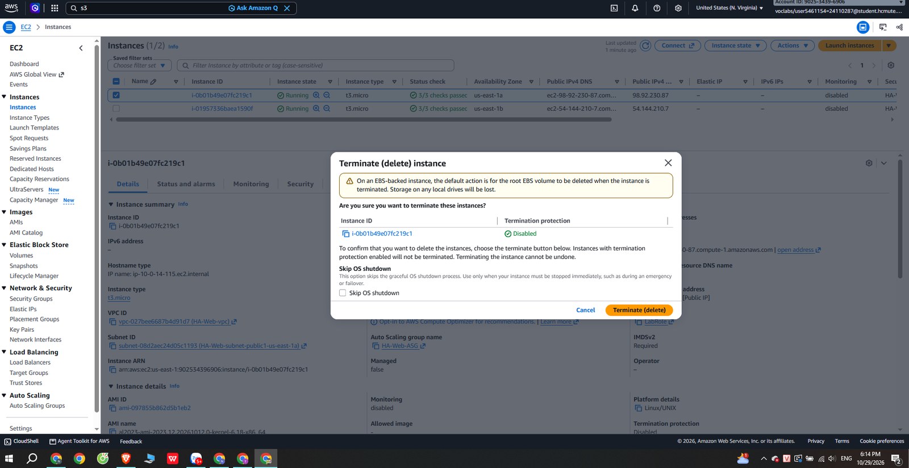

*Link ảnh: [hinh02a_su_co_az_1.png](https://github.com/tranvannghia240806-hub/baocaocloud_24110287_24110282/blob/main/docs/images/tuan4/hinh02a_su_co_az_1.png)*

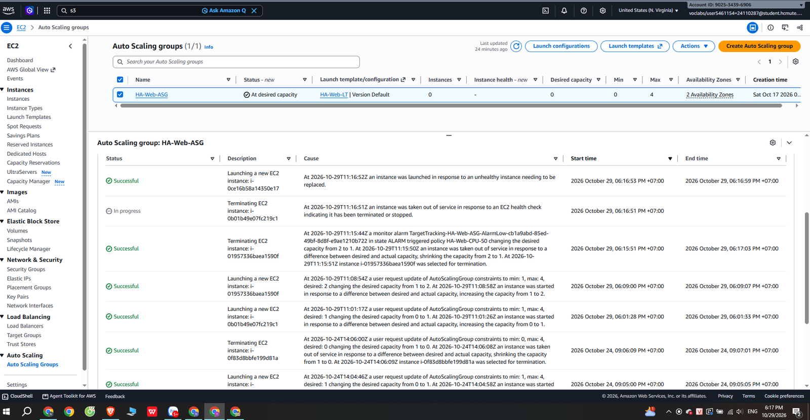

*Link ảnh: [hinh02a_su_co_az_2.png](https://github.com/tranvannghia240806-hub/baocaocloud_24110287_24110282/blob/main/docs/images/tuan4/hinh02a_su_co_az_2.png)*

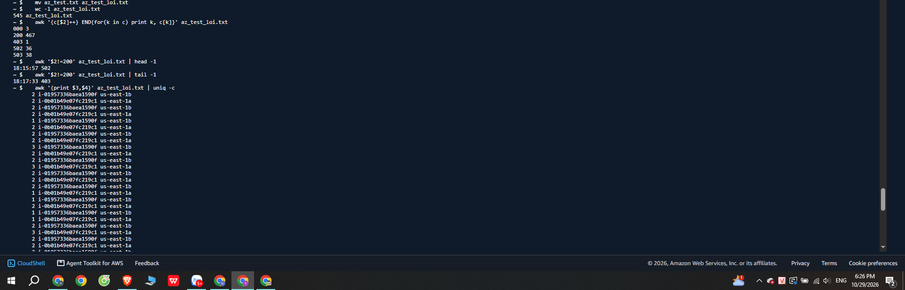

*Link ảnh: [hinh02a_su_co_az_3.png](https://github.com/tranvannghia240806-hub/baocaocloud_24110287_24110282/blob/main/docs/images/tuan4/hinh02a_su_co_az_3.png)*

*Hình 1A. Lần thử thứ nhất: terminate lúc 18:16:51, ASG Activity (AlarmLow scale-in lúc 18:15:51) và thống kê mã trả về*

Cách khắc phục cho lần thử thứ hai: đặt min = 2 và desired = 2, để AlarmLow không thể hạ số instance xuống dưới 2.

### 4.2.2. Lần thử thứ hai: kiểm thử hợp lệ

| **Thông số** | **Giá trị** |
|---|---|
| **Điều kiện đầu** | HA-Web-ASG min 2, desired 2, max 4; hai target Healthy, mỗi AZ một instance (hai ảnh chụp lúc 18:35) |
| **Cách theo dõi** | Vòng lặp curl mỗi giây trong CloudShell tới DNS của ALB, ghi giờ, mã HTTP, Instance ID và AZ đang trả lời vào az_test.txt (bắt đầu 18:37:43) |
| **Hành động** | Terminate instance ở us-east-1a trong EC2 Console |
| **ALB / ASG dùng** | HA-Web-ALB-1924642329.us-east-1.elb.amazonaws.com / HA-Web-ASG |

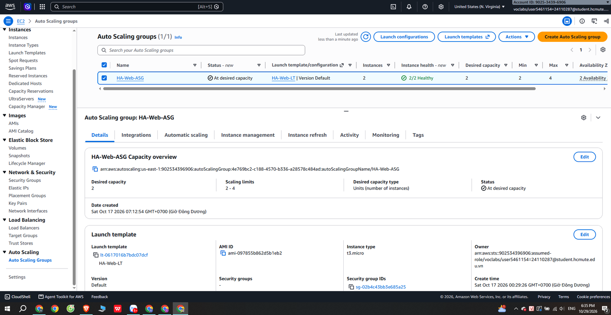

*Link ảnh: [hinh01_kiem_thu_az_1.png](https://github.com/tranvannghia240806-hub/baocaocloud_24110287_24110282/blob/main/docs/images/tuan4/hinh01_kiem_thu_az_1.png)*

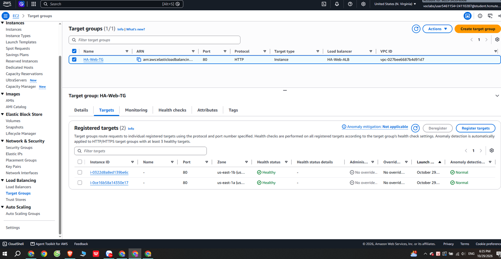

*Link ảnh: [hinh01_kiem_thu_az_2.png](https://github.com/tranvannghia240806-hub/baocaocloud_24110287_24110282/blob/main/docs/images/tuan4/hinh01_kiem_thu_az_2.png)*

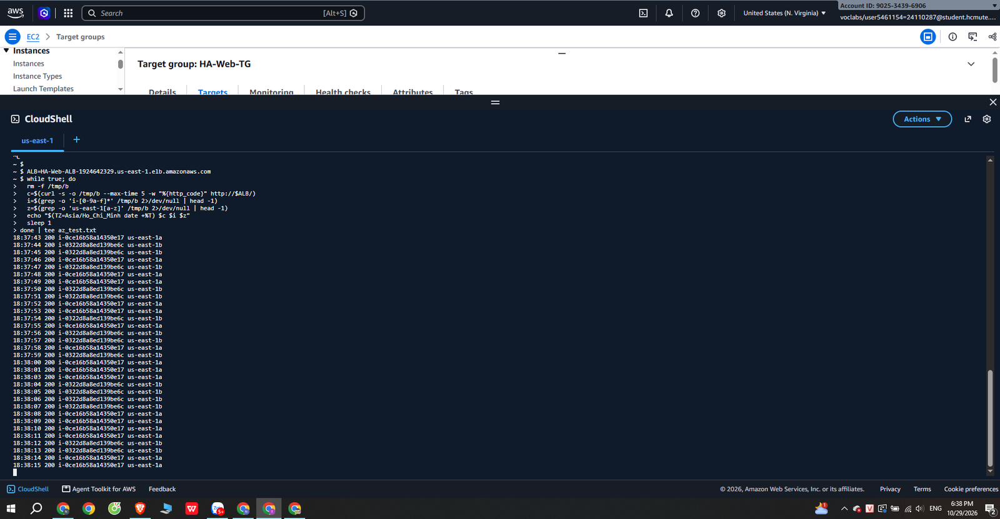

*Link ảnh: [hinh01_kiem_thu_az_3.png](https://github.com/tranvannghia240806-hub/baocaocloud_24110287_24110282/blob/main/docs/images/tuan4/hinh01_kiem_thu_az_3.png)*

*Hình 1. Chuẩn bị kiểm thử sự cố 1 AZ: ASG 2/2 Healthy, hai target ở hai AZ, vòng lặp curl đang chạy*

Trạng thái ban đầu (18:35): i-0322d8a8ed139be6c ở us-east-1b (khởi tạo 18:34) và i-0ce16b58a14350e17 ở us-east-1a (khởi tạo 18:16:53), cùng Healthy.

| **Mốc** | **Sự kiện** | **Giờ (+07:00)** |
|---|---|---|
| **Tkill** | Terminate instance ở us-east-1a (ID: i-0ce16b58a14350e17) | 18:39:30 |
|  | Dòng log đầu tiên có mã khác 200 | 18:39:34 (502) |
|  | Dòng log cuối cùng có mã khác 200 | 18:39:50 (000) |
|  | ASG ghi nhận instance bị terminate (Activity history, "EC2 health check indicating terminated") | Terminating bắt đầu 18:40:46, kết thúc 18:41:18 (76 giây sau Tkill) |
|  | ASG khởi tạo instance thay thế i-0b3a1ac7841e35d04 (us-east-1a) | Bắt đầu 18:40:48, kết thúc 18:40:53 |
|  | Instance thay thế Healthy trong target group | Ảnh Targets lúc 18:41 đã có i-0b3a1ac7841e35d04 Healthy; request đầu tiên được phục vụ lúc 18:41:49 |
|  | Request kể từ Tkill được phục vụ bởi instance nào (từ az_test.txt) | i-0322d8a8ed139be6c (us-east-1b) từ 18:39:37 đến 18:41:48 (trừ các dòng lỗi); từ 18:41:49 có thêm i-0b3a1ac7841e35d04 |

| **Chỉ số** | **Giá trị** |
|---|---|
| **Tổng số dòng trong az_test.txt / số mã 200** | 286 / 281 |
| **Số request khác 200 và mã của chúng** | 5: ba mã 502 (18:39:34, 18:39:35, 18:39:36) và hai mã 000 (18:39:44, 18:39:50); cửa sổ lỗi khoảng 16 giây |
| **Phân bố trước Tkill (us-east-1a / us-east-1b)** | 53 / 55 |
| **Phân bố từ 18:39:51 đến 18:41:48** | 115 dòng, toàn bộ từ us-east-1b |
| **Phân bố sau khi instance thay thế nhận request** | 28 / 28 |
| **Thời gian từ Tkill đến request đầu tiên được instance thay thế phục vụ** | khoảng 2 phút 19 giây (18:39:30 → 18:41:49); khoảng 61 giây tính từ lúc ASG khởi tạo (18:40:48) |

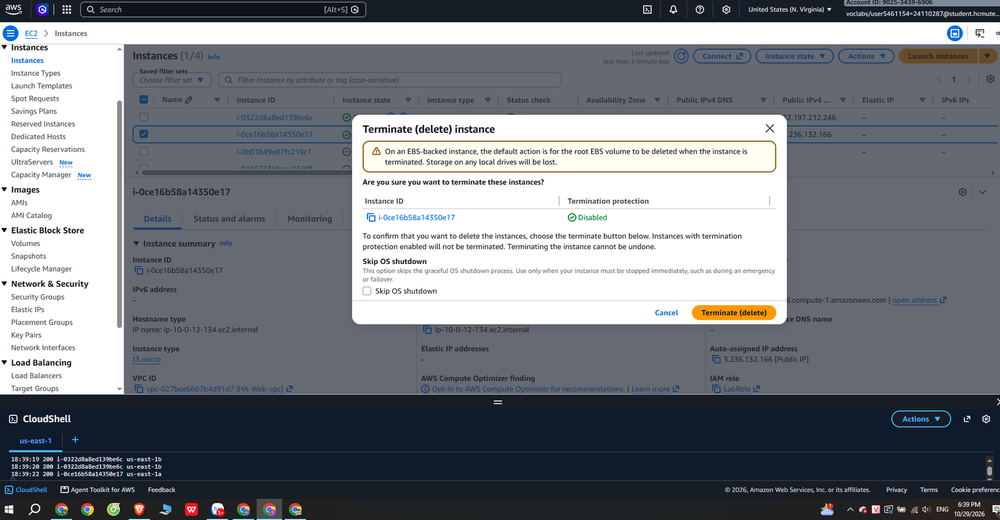

*Link ảnh: [hinh02_kiem_thu_az_1.png](https://github.com/tranvannghia240806-hub/baocaocloud_24110287_24110282/blob/main/docs/images/tuan4/hinh02_kiem_thu_az_1.png)*

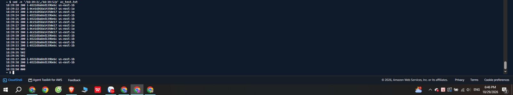

*Link ảnh: [hinh02_kiem_thu_az_2.png](https://github.com/tranvannghia240806-hub/baocaocloud_24110287_24110282/blob/main/docs/images/tuan4/hinh02_kiem_thu_az_2.png)*

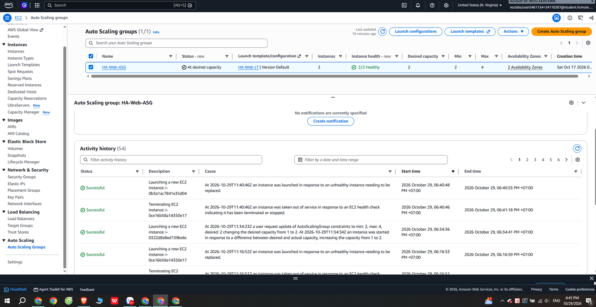

*Link ảnh: [hinh02_kiem_thu_az_3.png](https://github.com/tranvannghia240806-hub/baocaocloud_24110287_24110282/blob/main/docs/images/tuan4/hinh02_kiem_thu_az_3.png)*

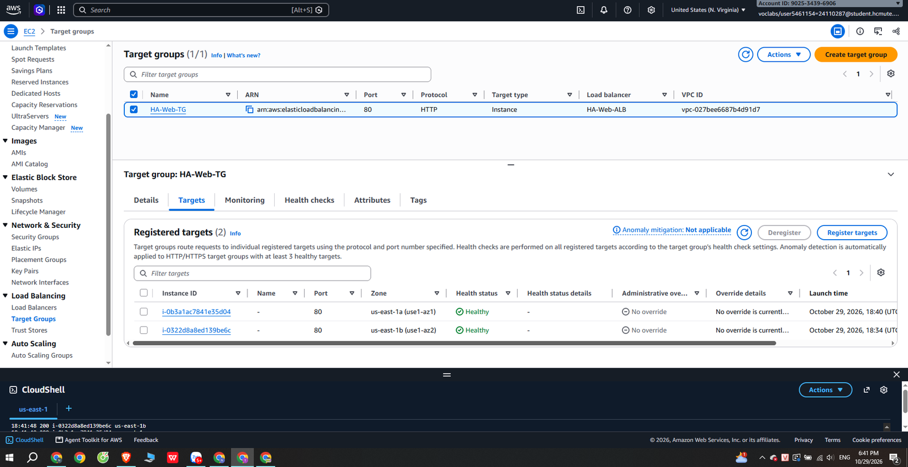

*Link ảnh: [hinh02_kiem_thu_az_4.png](https://github.com/tranvannghia240806-hub/baocaocloud_24110287_24110282/blob/main/docs/images/tuan4/hinh02_kiem_thu_az_4.png)*

*Hình 2. Mất instance ở một AZ: terminate (18:39), log curl (502 và 000), ASG Activity và Targets lúc 18:41*

Nhận xét theo số liệu: sau khi terminate instance ở us-east-1a, website lỗi khoảng 16 giây rồi trả mã 200 trở lại; instance ở us-east-1b phục vụ toàn bộ request cho đến khi instance thay thế ở us-east-1a nhận request lúc 18:41:49. Từ lúc ASG ghi nhận instance chết (18:40:46) đến lúc khởi tạo instance mới (18:40:48) chỉ cách 2 giây. Log ALB xác nhận ba mã 502 (18:39:34, 18:39:35, 18:39:36) và hai mã 460 (18:39:44, 18:39:50; tương ứng hai mã 000 của curl) đều gửi tới 10.0.12.134, là i-0ce16b58a14350e17, instance bị terminate lúc 18:39:30; năm request lỗi này là toàn bộ request khác 200 trong cửa sổ. Nhóm chưa suy ra nguyên nhân của ba mã 502 và hai mã 460. Kết quả chỉ chứng minh hệ thống chịu được việc mất instance duy nhất của một AZ; chưa chứng minh được khả năng chịu sự cố mạng hay hạ tầng của cả AZ.

## 4.2.3. Kiểm thử trực tiếp lần thứ ba (Ngày 4, 01/11/2026)

Nhóm làm lại kiểm thử mất một instance ở một AZ trên hệ thống dựng lại ở Ngày 4, quay trong video (mục 8). Kết quả này tách biệt với kiểm thử ngày 29/10 và không thay thế số liệu của ngày đó.

| **Chỉ tiêu** | **Giá trị** |
|---|---|
| **Nguồn dữ liệu** | docs/data/tuan4/az_demo_ngay4.txt (ghi giờ, mã HTTP và đoạn đầu nội dung trang mỗi giây) |
| **Cấu hình trước khi terminate** | ASG min 2 / desired 2 / max 4; i-078ef8260b9a6187c (us-east-1a) và i-09f11aad8320b6e70 (us-east-1b) |
| **Tổng số dòng** | 528: 523 mã 200 (99,05%), 3 mã 502 (0,57%), 2 mã 000, tức curl không nhận được mã HTTP (0,38%); 5 dòng bất thường (0,95%) |
| **Hai đợt ghi** | 14:54:39–14:55:59 (79 dòng) và 15:59:38–16:07:28 (449 dòng), cách nhau 1 giờ 3 phút 39 giây; không được xem 528 dòng là một luồng liên tục |
| **Request bất thường** | 16:03:17, 16:03:18, 16:03:20 (502); 16:03:23, 16:03:29 (000); trải trong 12 giây. Request 200 cuối cùng từ instance bị terminate: 16:03:13 |
| **Trong lúc thiếu instance ở 1a** | Từ 16:03:35 các request 200 do us-east-1b phục vụ |
| **Instance thay thế** | i-0d8dfa51b080ced94 (us-east-1a), mã 200 đầu tiên lúc 16:05:44 |

Khoảng cách từ request lỗi đầu tiên (16:03:17) đến request đầu tiên do instance mới phục vụ là 2 phút 27 giây. Đây không phải thời gian từ lúc terminate đến lúc Healthy: file curl không ghi thời điểm terminate và thời điểm Target Group chuyển Healthy, nên không suy ra thời gian AWS launch và health check từ file này.

Nhận xét: khi một instance bị terminate, ALB và instance còn lại duy trì được phần lớn lưu lượng; ASG tạo instance thay thế ở AZ ban đầu. Vì còn 5 request bất thường nên không khẳng định hệ thống không gián đoạn; đây là kiểm thử mất một instance, không phải mô phỏng sự cố cả AZ.

## 4.3. Tải lần 3 với đủ mốc T0–T9

Ở tuần 3, lần 1 bị gián đoạn (CloudShell dừng) và lần 2 không đo scale-in. Lần 3 chạy script ở chế độ nền để script tự ghi T0, tải 900 giây và theo dõi thêm 1800 giây để quan sát cả scale-in.

| **Thông số** | **Giá trị** |
|---|---|
| **Lệnh** | nohup ./load-test.sh $ALB 900 20 1800 > run_lan3.txt 2>&1 & (ALB = HA-Web-ALB-1924642329.us-east-1.elb.amazonaws.com; 20 worker) |
| **Điều kiện đầu** | HA-Web-ASG min 1 / desired 1 / max 4, một instance Healthy (ảnh lúc 18:54); không đặt tay desired trong suốt lần chạy |
| **Dữ liệu** | scaling_log_lan3.csv, scaling_log_lan3_tiep.csv, run_lan3.txt (docs/data/tuan4/) |
| **Kết quả request** | 17 974 request (khoảng 20 request/giây), toàn bộ mã 200; thời gian phản hồi trung bình 0,854 giây, p50 0,832, p95 0,941, p99 0,960, lớn nhất 1,875 giây (từ requests_20261029_185522.log, không commit lên Git) |

| **Mốc** | **Sự kiện** | **Lần 1** | **Lần 2** | **Lần 3** |
|---|---|---|---|---|
| **T0** | Bắt đầu tạo tải | 07:48:39 | 10:15:38 | 18:55:22 |
| **T1** | CPU trung bình vượt 50% | khoảng 07:51:08 | trong khoảng 10:15–10:18:35 | khoảng 18:57 (CSV: 23,54% lúc 18:56:04; 54,13% lúc 18:57:01) |
| **T2** | AlarmHigh chuyển sang ALARM | 07:54:55 | 10:19:55 | 18:59:55 |
| **T3** | ASG tăng desired (instance bắt đầu khởi tạo) | 07:54:59 | 10:20:05 | 19:00:02 |
| **T4** | Instance mới Healthy | khoảng 07:55:59 | khoảng 10:21:15 | khoảng 19:00:28–19:01:06 (CSV: in-service 2 lúc 19:00:28, healthy 2 lúc 19:01:06) |
| **T5** | Đủ 4 instance Healthy | khoảng 07:59:17 | khoảng 10:24:12 | khoảng 19:03:37–19:04:15 (CSV: in-service 4 lúc 19:03:37, healthy 4 lúc 19:04:15) |
| **T6** | Dừng tải | 07:58:39 | 10:30:39 | 19:10:22 |
| **T7** | AlarmLow chuyển sang ALARM | 08:16:02 | không đo | 19:26:19 |
| **T8** | Scale-in đầu tiên | 08:16:14 | không đo | 19:26:25 |
| **T9** | Về 1 instance | 08:18:47 | không đo | khoảng 19:29:19 |

| **Khoảng thời gian** | **Lần 1** | **Lần 2** | **Lần 3** |
|---|---|---|---|
| Từ bắt đầu tải đến AlarmHigh (T0 → T2) | 6 phút 16 giây | 4 phút 17 giây | 4 phút 33 giây |
| Từ ASG tăng desired đến Healthy (T3 → T4) | khoảng 1 phút | khoảng 1 phút 10 giây | không quá 1 phút 4 giây |
| Từ bắt đầu tải đến đủ 4 instance Healthy | khoảng 10 phút 38 giây | khoảng 8 phút 34 giây | 8 phút 15 giây đến 8 phút 53 giây |
| Từ dừng tải đến AlarmLow (T6 → T7) | 17 phút 23 giây | không đo | 15 phút 57 giây |
| Từ dừng tải đến về 1 instance (T6 → T9) | 20 phút 8 giây | không đo | 18 phút 57 giây |

Chi tiết lần 3 từ ASG Activity history và CloudWatch:

- Scale-out lần 1: AlarmHigh ALARM 18:59:55; ASG khởi tạo i-04dcc8276b5048261 lúc 19:00:02 (desired 1 → 2).
- Scale-out lần 2: AlarmHigh kích hoạt lại lúc 19:02:55; ASG khởi tạo i-09c103f491b7a44b1 và i-0eacdf149eb34ef87 lúc 19:03:03 (desired 2 → 4). Alarm HA-Web-ASG-AtMax chuyển In alarm lúc 19:04:52 và về OK lúc 19:28:52.
- CPU trung bình đạt đỉnh 83,26% lúc 19:03:56 (CSV). Sau khi dừng tải: 62,1% (19:11:07), 31,3% (19:12:00), 22,9% (19:12:54), 13,5% (19:14:58). AlarmHigh về OK lúc 19:11:55.
- Scale-in: AlarmLow (ngưỡng CPU < 37,5%, 15 datapoint) chuyển ALARM lúc 19:26:19; ASG terminate i-09c103f491b7a44b1 lúc 19:26:25 (4 → 3), i-04dcc8276b5048261 lúc 19:27:06 (3 → 2), i-0eacdf149eb34ef87 lúc 19:28:07 (2 → 1). Instance còn lại là i-0322d8a8ed139be6c (suy ra bằng phép loại trừ, chưa có ảnh chụp trực tiếp).

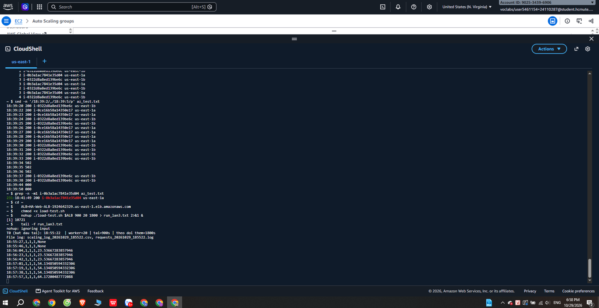

*Link ảnh: [hinh03_tai_lan3_1.png](https://github.com/tranvannghia240806-hub/baocaocloud_24110287_24110282/blob/main/docs/images/tuan4/hinh03_tai_lan3_1.png)*

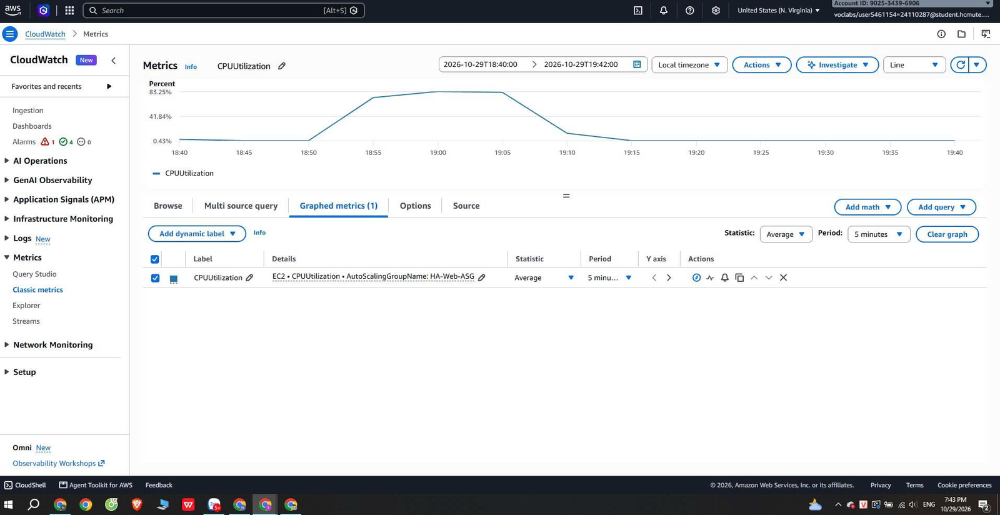

*Link ảnh: [hinh03_tai_lan3_2.png](https://github.com/tranvannghia240806-hub/baocaocloud_24110287_24110282/blob/main/docs/images/tuan4/hinh03_tai_lan3_2.png)*

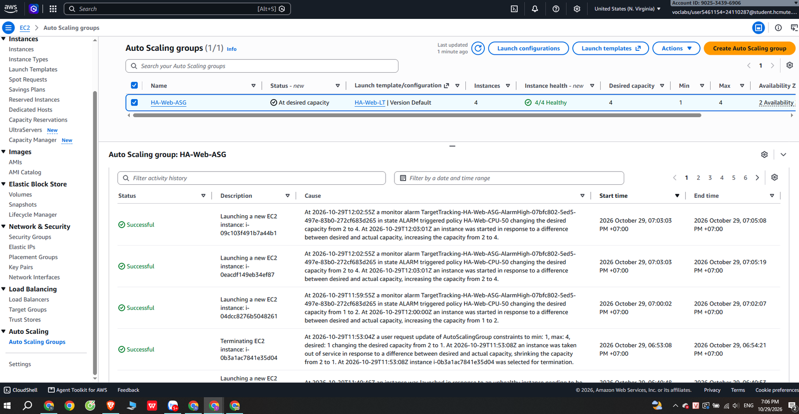

*Link ảnh: [hinh03_tai_lan3_3.png](https://github.com/tranvannghia240806-hub/baocaocloud_24110287_24110282/blob/main/docs/images/tuan4/hinh03_tai_lan3_3.png)*

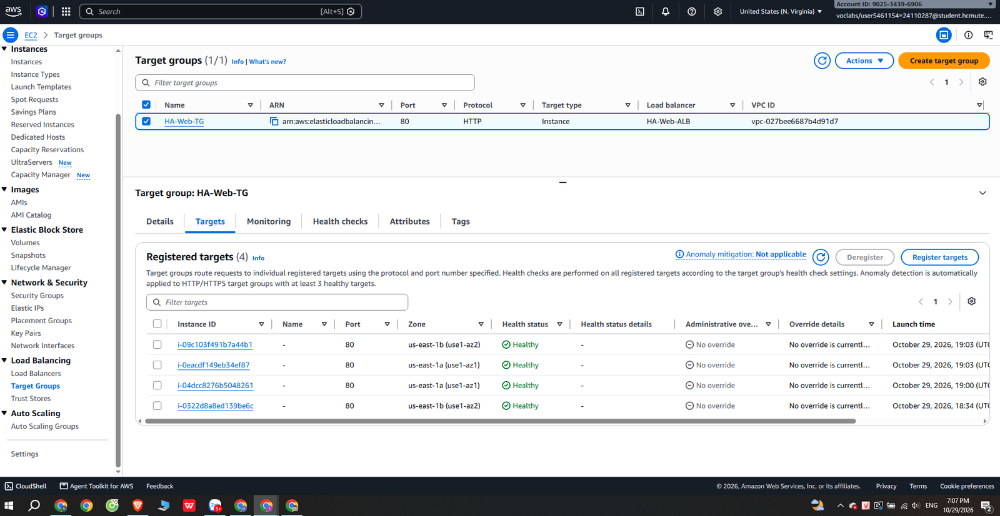

*Link ảnh: [hinh03_tai_lan3_4.png](https://github.com/tranvannghia240806-hub/baocaocloud_24110287_24110282/blob/main/docs/images/tuan4/hinh03_tai_lan3_4.png)*

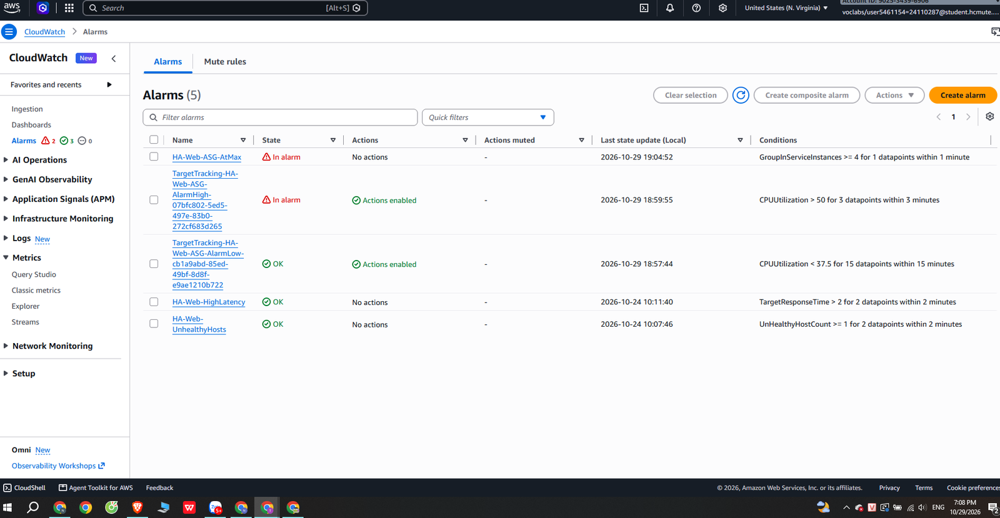

*Link ảnh: [hinh03_tai_lan3_5.png](https://github.com/tranvannghia240806-hub/baocaocloud_24110287_24110282/blob/main/docs/images/tuan4/hinh03_tai_lan3_5.png)*

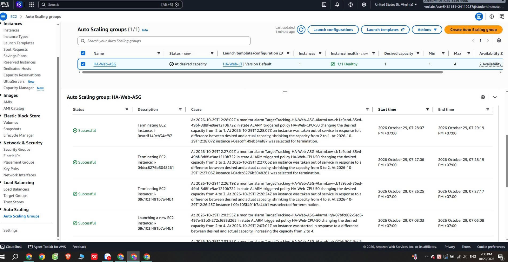

*Link ảnh: [hinh03_tai_lan3_6.png](https://github.com/tranvannghia240806-hub/baocaocloud_24110287_24110282/blob/main/docs/images/tuan4/hinh03_tai_lan3_6.png)*

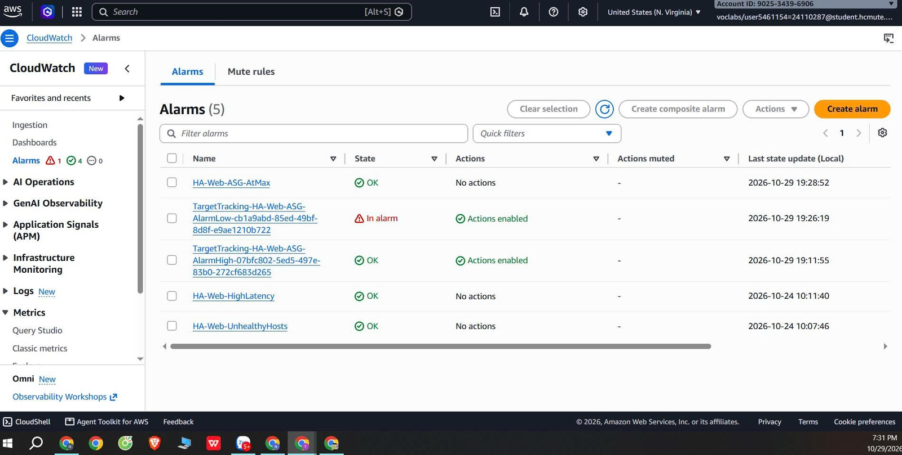

*Link ảnh: [hinh03_tai_lan3_7.png](https://github.com/tranvannghia240806-hub/baocaocloud_24110287_24110282/blob/main/docs/images/tuan4/hinh03_tai_lan3_7.png)*

*Hình 3. Tải lần 3: lệnh chạy và T0, biểu đồ CPU, scale-out, bốn target Healthy, alarm khi tải, scale-in và alarm sau tải*

So sánh ba lần chạy: thời gian từ bắt đầu tải đến AlarmHigh lần lượt 6 phút 16 giây, 4 phút 17 giây và 4 phút 33 giây; cả ba lần ASG đều tăng lên đúng 4 instance (giới hạn max); scale-in về 1 instance mất 20 phút 8 giây ở lần 1 và 18 phút 57 giây ở lần 3. Các mốc T1 chỉ xác định gần đúng: CPU trong CSV lấy từ CloudWatch với period 60 giây và biểu đồ CPU của ASG theo khung 5 phút (không bật detailed monitoring).

Nhận xét về warm-up: ở lần 3 instance mới Healthy không quá 1 phút 4 giây sau khi ASG khởi tạo, ngắn hơn warm-up 120 giây đã cấu hình, phù hợp với hai lần đo ở tuần 3 (khoảng 1 phút và 1 phút 10 giây). Cột End time trong Activity history (khoảng 125 giây sau lúc khởi tạo) là thời điểm hết warm-up, không phải lúc instance Healthy.

Hạn chế dữ liệu lần 3: script load-test.sh bị dừng lúc 19:15:16 khi CloudShell ngắt kết nối (scaling_log_lan3.csv gồm 18:55:27–19:15:16); script theo dõi tiếp chỉ bắt đầu lúc 19:39:38 (scaling_log_lan3_tiep.csv gồm 19:39:38–19:49:49, toàn bộ 1/1/1, CPU 0,41–0,50%). Khoảng 19:15:16–19:39:38, trùng toàn bộ quá trình scale-in, không có dòng CSV nào; các mốc T7–T9 vì vậy lấy từ ASG Activity history và CloudWatch Alarms. Dashboard HA-Web-Dashboard đã bị xóa ở Ngày 5 nên không còn ảnh dashboard của lần này; các mốc dựa vào Activity history và CloudWatch Alarms như nêu trên.

# 5. Phân tích ALB access log

Dữ liệu log ALB được đồng bộ từ S3 và phân tích bằng scripts/analyze-alb-logs.sh ở Ngày 2 (30/10/2026). Nhóm phân tích sáu cửa sổ: toàn bộ log, tải lần 1, tải lần 2, tải lần 3 và hai lần kiểm thử mất instance ở một AZ. Các số liệu dưới đây lấy trực tiếp từ kết quả script (lan1.txt, lan2.txt, lan3.txt, az_lan1_loi.txt, az_lan2.txt, tong_quan.txt, gộp trong phan_tich_log_tuan4.txt).

## 5.1. Dữ liệu và phương pháp

| **Thông số** | **Giá trị** |
|---|---|
| **Nguồn dữ liệu** | S3 bucket ha-web-alb-logs-902534396906, prefix alb; đồng bộ về CloudShell bằng aws s3 sync |
| **Khối lượng** | Đến hết tuần 3 (sau tải lần 1): 46 file .log.gz, 12 059 dòng; hiện tại: 106 file .log.gz (3,7 MB), 49 076 dòng, từ 2026-10-23T16:18:30Z đến 2026-10-29T12:52:39Z (23:18 ngày 23/10 đến 19:52 ngày 29/10 giờ Việt Nam) |
| **Công cụ** | scripts/analyze-alb-logs.sh (zcat và awk); giờ trong log là UTC, giờ Việt Nam bằng UTC + 7 |
| **Cửa sổ phân tích (UTC)** | Lần 1: 2026-10-24T00:48:39 – 01:00:00; lần 2: 2026-10-24T03:15:38 – 03:30:40; lần 3: 2026-10-29T11:55:22 – 12:11:22; kiểm thử AZ lần 1: 2026-10-29T11:12:00 – 11:23:00; kiểm thử AZ lần 2: 2026-10-29T11:37:00 – 11:43:00 |
| **Trường dùng** | Thời gian, target:port, target_processing_time, elb_status_code, target_status_code, request, user_agent |
| **Xác định AZ của target** | Theo dải subnet: 10.0.0.0/20 là us-east-1a, 10.0.16.0/20 là us-east-1b (cách xác định này khớp với các instance đã biết ID, xem 5.3) |
| **Lưu ý** | Không đưa file log thô lên Git vì chứa địa chỉ IP; chỉ lưu kết quả phân tích (phan_tich_log_tuan4.txt) |

## 5.2. Kết quả tổng quan

Toàn bộ log (49 076 dòng) có mã ALB trả về: 200 (48 905), 400 (14), 403 (1), 404 (20), 460 (5), 501 (2), 502 (44), 503 (85). Số mã 502 bằng 5 + 36 + 3 (lần 2, kiểm thử AZ lần 1, kiểm thử AZ lần 2) và số mã 503 bằng 47 + 38 (trước đợt tải ở tuần 3 và kiểm thử AZ lần 1), tức khớp với các cửa sổ phân tích bên dưới.

| **Nhóm request** | **Số lượng** | **Ghi chú** |
|---|---|---|
| **Tổng số dòng log phân tích** | 49 076 | 106 file .log.gz |
| **Trước đợt tải (ASG 0 instance, từ 23:18 ngày 23/10 đến 06:53 ngày 24/10)** | 47 mã 503 | Số liệu từ tuần 3; ALB có nhưng chưa có target |
| **Cửa sổ tải lần 1 (07:48:39–08:00:00 ngày 24/10)** | 11 998 request: 11 997 mã 200, 1 mã 400 | Dòng đầu 07:48:40, dòng cuối 07:59:11; trùng với số liệu tuần 3 |
| **Cửa sổ tải lần 2 (10:15:38–10:30:40 ngày 24/10)** | 18 025 request: 18 020 mã 200, 5 mã 502 | ab báo 18 006 request, 5 non-2xx (xem ghi chú bên dưới) |
| **Cửa sổ tải lần 3 (18:55:22–19:10:22 ngày 29/10)** | 17 974 request, toàn bộ mã 200 | Script ghi 17 974 request: khớp hoàn toàn |
| **Kiểm thử AZ lần 1, sự cố (18:12:52–18:22:28 ngày 29/10)** | 546 request: 468 mã 200, 36 mã 502, 38 mã 503, 3 mã 460, 1 mã 403 | Curl ghi 545 dòng (467 mã 200, 36 mã 502, 38 mã 503, 3 mã 000, 1 mã 403); dòng thứ 546 là một request từ trình duyệt Windows (mã 200) |
| **Kiểm thử AZ lần 2 (18:37–18:42 ngày 29/10)** | 291 request: 286 mã 200, 3 mã 502, 2 mã 460 | Curl ghi 286 dòng (281 mã 200, 3 mã 502, 2 mã 000); 5 request curl còn lại nằm trước 18:37:43 (phút 11:37 UTC có 22 request, vòng lặp chỉ có 17), không thuộc az_test.txt |
| **Request mã 400, 404, 501 (toàn bộ log)** | 36 (14 mã 400, 20 mã 404, 2 mã 501) | Chưa phân loại theo user-agent; trong cửa sổ tải lần 1 có 1 mã 400 không có user-agent |

Ba điểm đối chiếu:

- Mã 460 (client đóng kết nối trước khi ALB trả lời) trong hai lần kiểm thử AZ tương ứng đúng với mã 000 mà curl ghi: 3 và 2 dòng.
- Lần 2: log ghi 18 025 request, nhiều hơn 19 request so với 18 006 request hoàn thành mà ab báo. Tất cả 18 025 dòng có user-agent ApacheBench/2.3. Con số 19 gần với 20 kết nối đồng thời của ab (-c 20), phù hợp với giả thuyết ab dừng theo thời gian (-t 900) khi còn request đang xử lý, nhưng nhóm chưa kiểm chứng.
- Mã 403 duy nhất trong kiểm thử AZ lần 1 có target_status_code là 403, tức do instance trả về chứ không phải do ALB sinh ra.

## 5.3. Phân bố request theo target (cân bằng tải)

Instance của tuần 3 đã bị terminate nên không tra được Instance ID từ IP riêng; nhóm xác định AZ theo dải subnet. Với lần 3, Instance ID suy ra từ ảnh Targets lúc 19:07, từ AZ và từ IP đã gặp trong log kiểm thử AZ.

Lần 2 (ngày 24/10, ab, 18 025 request):

| **Target (IP)** | **Instance / AZ** | **Số request** | **Tỷ lệ** |
|---|---|---|---|
| 10.0.26.50 | Đã terminate / us-east-1b | 10 362 | 57,5% |
| 10.0.5.134 | Đã terminate / us-east-1a | 3 759 | 20,9% |
| 10.0.20.37 | Đã terminate / us-east-1b | 1 959 | 10,9% |
| 10.0.9.203 | Đã terminate / us-east-1a | 1 945 | 10,8% |
| "-" (không có target) | - | 0 | 0% |

Lần 3 (ngày 29/10, curl, 17 974 request):

| **Target (IP)** | **Instance / AZ** | **Số request** | **Tỷ lệ** |
|---|---|---|---|
| 10.0.19.246 | i-0322d8a8ed139be6c / us-east-1b | 10 472 | 58,3% |
| 10.0.2.206 | i-04dcc8276b5048261 / us-east-1a (suy ra theo thứ tự khởi tạo) | 3 736 | 20,8% |
| 10.0.16.110 | i-09c103f491b7a44b1 / us-east-1b | 1 919 | 10,7% |
| 10.0.14.195 | i-0eacdf149eb34ef87 / us-east-1a (suy ra theo thứ tự khởi tạo) | 1 847 | 10,3% |
| "-" (không có target) | - | 0 | 0% |

Nhận xét theo số liệu:

- Cả hai lần đều có bốn target, hai target mỗi AZ, khớp với số instance tối đa. Theo AZ: lần 2 có 5 704 request vào us-east-1a (31,6%) và 12 321 vào us-east-1b (68,4%); lần 3 có 5 583 (31,1%) và 12 391 (68,9%).
- Số request của từng target phản ánh thời gian instance đó tồn tại chứ không phải ALB chia lệch: instance chạy từ đầu nhận nhiều nhất (57,5% và 58,3%), instance khởi tạo sau nhận ít hơn. Ước tính thô ở lần 3 (khoảng 20 request/giây): hai instance mới nhất mỗi cái chạy khoảng 6 phút cùng bốn instance, tức khoảng 1 800 request, khớp với 1 919 và 1 847 trong log.
- Không có request nào ở trạng thái "-" (không có target) trong cả hai lần tải, tức ALB luôn có target Healthy để chuyển tiếp.
- Cách xác định AZ theo subnet khớp với các instance đã biết ID: 10.0.12.134 là i-0ce16b58a14350e17 (hostname ip-10-0-12-134 trên EC2 console, us-east-1a), 10.0.14.115 là i-0b01b49e07fc219c1 (ip-10-0-14-115, us-east-1a) và 10.0.19.246 là i-0322d8a8ed139be6c (us-east-1b).

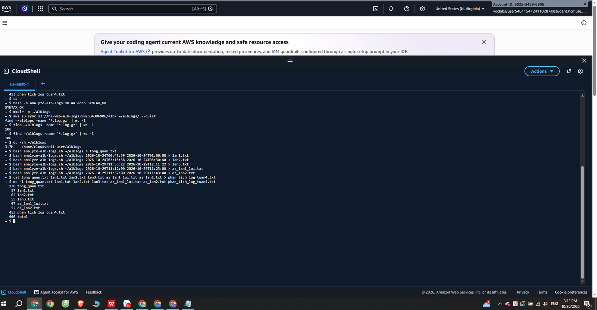

*Link ảnh: [hinh04_phan_tich_log_1.png](https://github.com/tranvannghia240806-hub/baocaocloud_24110287_24110282/blob/main/docs/images/tuan4/hinh04_phan_tich_log_1.png)*

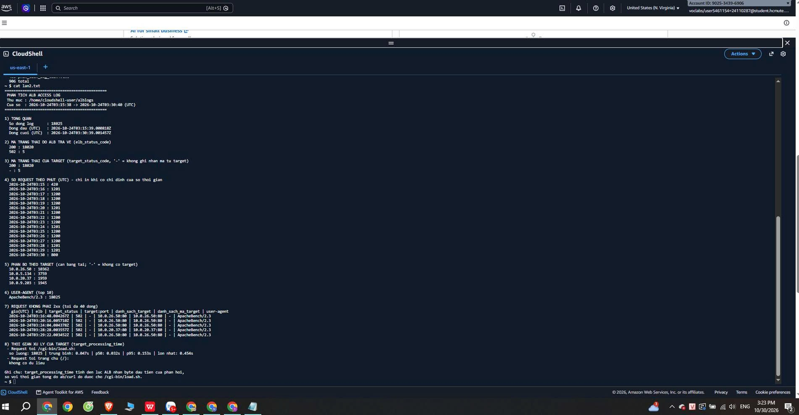

*Link ảnh: [hinh04_phan_tich_log_2.png](https://github.com/tranvannghia240806-hub/baocaocloud_24110287_24110282/blob/main/docs/images/tuan4/hinh04_phan_tich_log_2.png)*

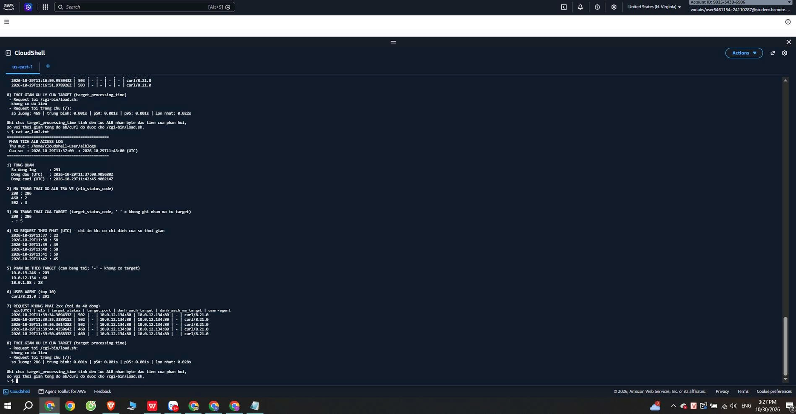

*Link ảnh: [hinh04_phan_tich_log_3.png](https://github.com/tranvannghia240806-hub/baocaocloud_24110287_24110282/blob/main/docs/images/tuan4/hinh04_phan_tich_log_3.png)*

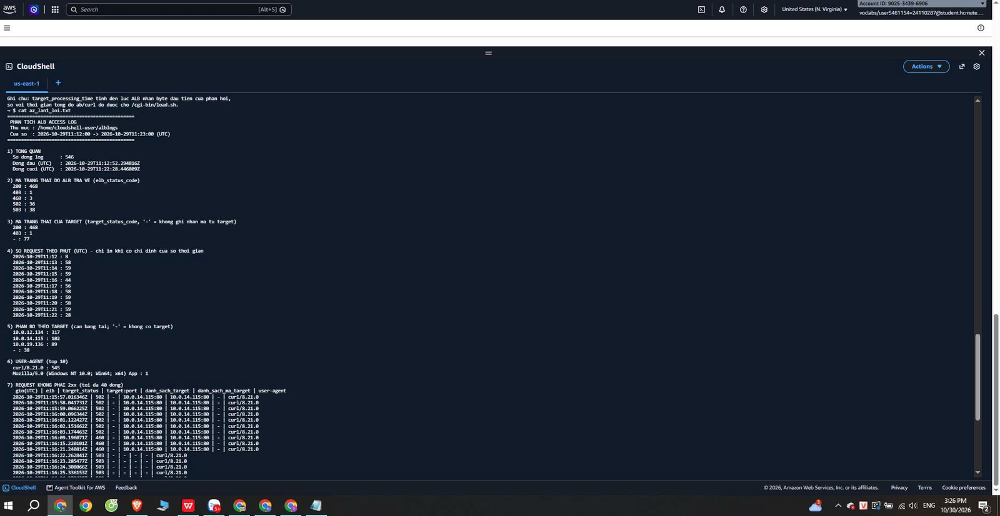

*Link ảnh: [hinh04_phan_tich_log_4.png](https://github.com/tranvannghia240806-hub/baocaocloud_24110287_24110282/blob/main/docs/images/tuan4/hinh04_phan_tich_log_4.png)*

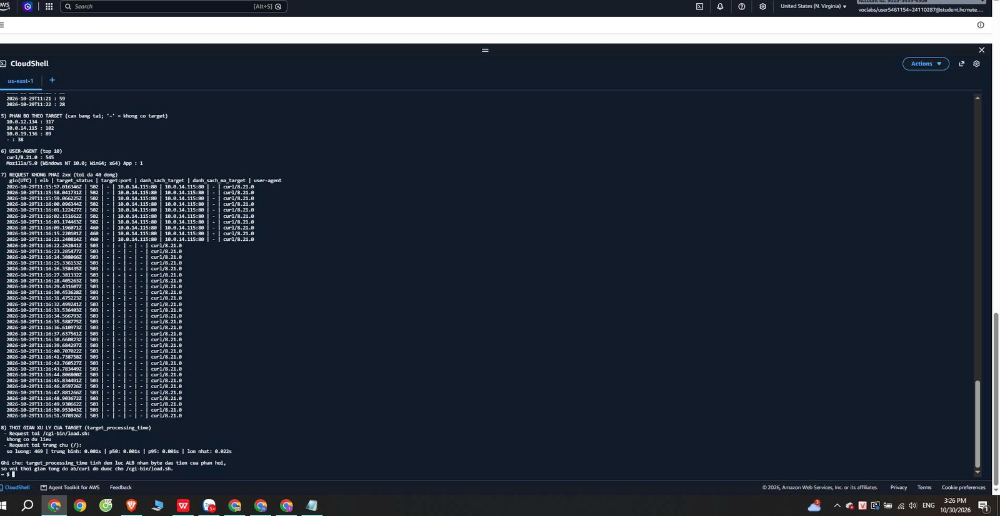

*Link ảnh: [hinh04_phan_tich_log_5.png](https://github.com/tranvannghia240806-hub/baocaocloud_24110287_24110282/blob/main/docs/images/tuan4/hinh04_phan_tich_log_5.png)*

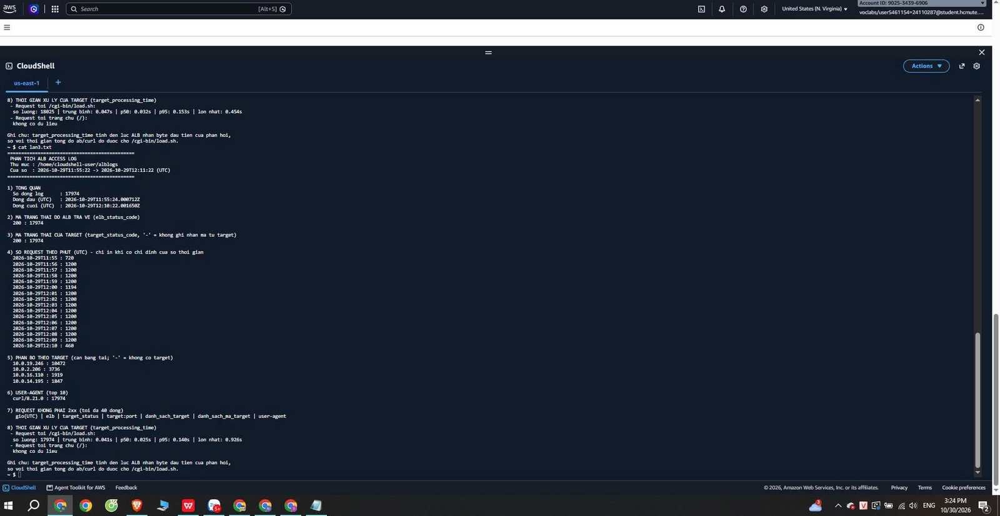

*Link ảnh: [hinh04_phan_tich_log_6.png](https://github.com/tranvannghia240806-hub/baocaocloud_24110287_24110282/blob/main/docs/images/tuan4/hinh04_phan_tich_log_6.png)*

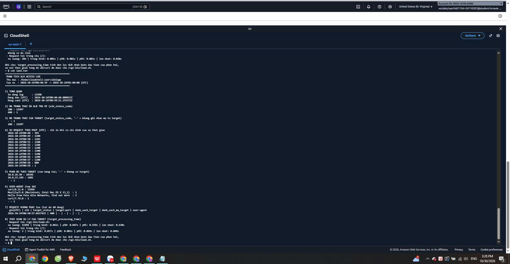

*Link ảnh: [hinh04_phan_tich_log_7.png](https://github.com/tranvannghia240806-hub/baocaocloud_24110287_24110282/blob/main/docs/images/tuan4/hinh04_phan_tich_log_7.png)*

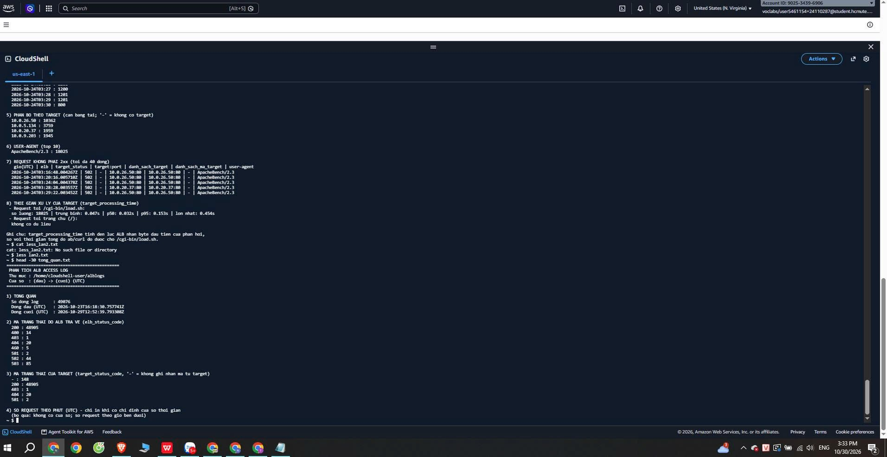

*Link ảnh: [hinh04_phan_tich_log_8.png](https://github.com/tranvannghia240806-hub/baocaocloud_24110287_24110282/blob/main/docs/images/tuan4/hinh04_phan_tich_log_8.png)*

*Hình 4. Kết quả phân tích ALB access log bằng analyze-alb-logs.sh: đồng bộ và chạy script, lần 2, kiểm thử AZ lần 2 và lần 1, lần 3, lần 1 và tổng quan toàn bộ log (30/10/2026)*

## 5.4. Đối chiếu số request của lần 1 (script 11 994 và log ALB 11 998)

Ở báo cáo tuần 3 nhóm chưa xác định nguồn của 4 request chênh lệch. Lần này phân loại các request trong cửa sổ 07:48:39–08:00:00 (00:48:39–01:00:00 UTC) theo user-agent.

| **User-agent** | **Số request trong cửa sổ** | **Ghi chú** |
|---|---|---|
| curl/8.21.0 (script load-test.sh) | 11 994 | Bằng đúng số request script ghi |
| Mozilla/5.0 (Macintosh; Intel Mac OS X 13_1) | 1 | User-agent ghi macOS, khác máy Windows của nhóm |
| "Hello from Palo Alto Networks, find out more about our scans" | 1 | Bộ quét từ Internet, tự giới thiệu trong user-agent |
| curl/7.74.0 | 1 | Khác phiên bản curl của CloudShell (8.21.0); nhóm chưa xác định nguồn |
| "-" (không có user-agent) | 1 | Chính là request mã 400 lúc 00:50:57Z (07:50:57), không có target |
| Tổng | 11 998 | Theo log ALB |

Kết luận: 11 994 request curl/8.21.0 trùng đúng số script ghi; 4 request chênh lệch đều có user-agent khác và không phải do script tạo ra. Ba trong số đó là request tới trang chủ (/) có ghi thời gian xử lý của target (mục 5.6), request còn lại là mã 400 không có user-agent. Nguồn của request curl/7.74.0 chưa xác định.

## 5.5. Phân tích 5 request lỗi 502 của lần 2

| **Giờ (+07:00)** | **Mã ALB / mã target** | **Vị trí so với sự kiện scale-out** | **Target** |
|---|---|---|---|
| 10:16:48 | 502 / "-" | Trước AlarmHigh (10:19:55) | 10.0.26.50 (us-east-1b) |
| 10:20:16 | 502 / "-" | Cách lúc ASG tăng desired 1 → 2 (10:20:05) 11 giây | 10.0.26.50 (us-east-1b) |
| 10:24:04 | 502 / "-" | Cách mốc đủ 4 instance Healthy (khoảng 10:24:12) 8 giây | 10.0.26.50 (us-east-1b) |
| 10:28:28 | 502 / "-" | Đã đủ 4 instance | 10.0.20.37 (us-east-1b) |
| 10:29:22 | 502 / "-" | Đã đủ 4 instance | 10.0.26.50 (us-east-1b) |

Quan sát: cả 5 lỗi đều ở us-east-1b; 4 trong 5 lỗi cùng target 10.0.26.50, là target nhận nhiều request nhất (57,5%), còn 1 lỗi ở 10.0.20.37. Không có lỗi nào ở hai target của us-east-1a. Cột mã target là "-" nên log không ghi nhận phản hồi nào từ instance. Vì 10.0.26.50 chạy từ đầu và nhận phần lớn request, nhóm chưa kết luận lỗi gắn với target hay với sự kiện scale-out; nguyên nhân chưa xác định.

## 5.6. Thời gian xử lý của target

| **Loại request** | **Số lượng** | **Trung bình** | **p50** | **p95** | **Lớn nhất** |
|---|---|---|---|---|---|
| /cgi-bin/load.sh (cửa sổ lần 2) | 18 025 | 47 ms | 32 ms | 153 ms | 454 ms |
| /cgi-bin/load.sh (cửa sổ lần 1) | 11 994 | 61 ms | 47 ms | 159 ms | 630 ms |
| /cgi-bin/load.sh (cửa sổ lần 3) | 17 974 | 41 ms | 25 ms | 140 ms | 926 ms |
| Trang chủ (/) (cửa sổ lần 1) | 3 | 17 ms | 1 ms | 49 ms | 49 ms |
| Trang chủ (/) (kiểm thử AZ lần 1 và lần 2) | 469 và 286 | 1 ms | 1 ms | 1 ms | 22 ms và 28 ms |
| ab đo cho /cgi-bin/load.sh (lần 2, để đối chiếu) | 18 006 | 1000,5 ms | 1000 ms | 1005 ms (95%) | 1166 ms |
| Script curl lần 3 (phía client, để đối chiếu) | 17 974 | 854 ms | 832 ms | 941 ms | 1875 ms |

Ở tuần 3 nhóm nghi TargetResponseTime (khoảng 85 ms trên dashboard) chỉ tính đến byte phản hồi đầu tiên, trong khi ab đo 1000 ms. Kết quả trên củng cố giả thuyết này: target_processing_time của /cgi-bin/load.sh chỉ 41–61 ms ở cả ba lần tải, trong khi thời gian phía client là 854–1000 ms; script load.sh (scripts/user-data.sh) chạy vòng lặp bận 1 giây trước khi in "ok". Nhóm chưa đo trực tiếp thời điểm byte đầu tiên được gửi nên chưa khẳng định cơ chế.

Các phát hiện chính của mục 5:

- Không có request nào bị lỗi trong hai lần tải lần 1 và lần 3 ngoài 1 mã 400 từ nguồn ngoài; lần 2 có 5 mã 502 (khoảng 0,03% trong 18 025 request).
- Kiểm thử mất instance ở một AZ lần 2: toàn bộ lỗi gửi tới đúng instance bị terminate. Lần 1 (sự cố): 7 mã 502 tới instance bị terminate và 29 mã 502 tới instance thay thế trong 39 giây đầu sau khi khởi tạo (mục 4.2).
- Bốn request chênh lệch của lần 1 đều từ user-agent khác script (mục 5.4).
- Số request đến từng target phản ánh thời gian tồn tại của instance (mục 5.3).

# 6. Tối ưu chi phí

## 6.1. Đơn giá tham khảo (us-east-1)

| **Hạng mục** | **Đơn giá tham khảo** | **Ghi chú** |
|---|---|---|
| **Application Load Balancer** | 0,0225 USD/giờ và 0,008 USD/LCU-giờ | Mỗi giờ lẻ tính tròn thành một giờ: ALB chạy 10 phút vẫn tính 1 giờ |
| **Public IPv4** | 0,005 USD/giờ/địa chỉ | Áp dụng cho địa chỉ ALB giữ (hai AZ nên hai địa chỉ) và public IPv4 của instance |
| **EC2 t3.micro (Linux)** | 0,0104 USD/giờ | Giá niêm yết khi dòng T3 ra mắt, nhóm cần đối chiếu giá hiện hành |
| **Phí tín dụng CPU vượt mức (T3 Unlimited)** | 0,05 USD/vCPU-giờ | t3.micro được dùng tín dụng vượt mức đến mức tối đa kiếm được trong 24 giờ mà không bị tính phí |
| **EBS gp3, S3 Standard** | EBS 0,08 USD/GB-tháng; S3 0,023 USD/GB-tháng (giá nhóm đặt trong cost-estimate.py, chưa đối chiếu lại với trang giá AWS) | Dung lượng nhỏ (8 GB mỗi instance, log khoảng 0,001 GB) nên ảnh hưởng không đáng kể |

Nguồn: trang giá Elastic Load Balancing, trang Amazon EC2 T3 và tài liệu "Unlimited mode for burstable instances" của AWS, tra cứu ngày 27/10/2026. Đơn giá có thể thay đổi nên chỉ dùng để ước tính; số liệu thật là credit hiển thị trên trang Learner Lab.

## 6.2. Chi phí ước tính và credit đã dùng

Số giờ lấy từ Activity history của ASG (instance) và từ các mốc tạo, xóa ALB tra trong CloudTrail (sự kiện CreateLoadBalancer và DeleteLoadBalancer, quy đổi sang giờ Việt Nam); tính bằng scripts/cost-estimate.py. Phí tín dụng CPU vượt mức lấy từ metric CPUSurplusCreditsCharged của CloudWatch (Hình 5 ảnh 5). Kết quả của script lưu tại docs/data/tuan4/chi_phi_tuan4.txt (từ 19/10) và chi_phi_tuan4_chi_tuan4.txt (chỉ tuần 4).

| **Hạng mục** | **Khoảng thời gian** | **Thời lượng tính phí** | **Ước tính (USD)** |
|---|---|---|---|
| ALB qua đêm (tuần 3) | 22:37 ngày 23/10 – 10:56 ngày 24/10 | 12 giờ 19 phút, tính 13 giờ | 0,4225 |
| ALB tối 24/10 (Ngày 4 tuần 3) | 19:40 – 20:22 | 42 phút, tính 1 giờ | 0,0325 |
| ALB do CloudFormation tạo (24/10) | 20:59 – 21:09 | 10 phút, tính 1 giờ | 0,0325 |
| ALB tuần 4, Ngày 1 (29/10) | 17:54 – 19:58 | 2 giờ 04 phút, tính 3 giờ | 0,0975 |
| EC2 t3.micro | Theo Activity history (từ 19/10) | 10,27 instance-giờ (tuần 4: 3,62) | 0,1069 |
| Public IPv4 của instance | | 10,27 instance-giờ | 0,0514 |
| EBS 8 GB mỗi instance | | 10,27 instance-giờ | 0,0090 |
| S3 | | 0,001 GB | 0,0000 |
| Tín dụng CPU vượt mức (T3 Unlimited), 4 instance của tải lần 3 | 29/10, 18:50 – 20:00 | 33,53 tín dụng (vCPU-phút) | 0,0279 |
| Hai instance thử scheduled scaling (31/10), chưa gồm trong tổng bên dưới | 11:22:55 – 11:32:10 và 11:42:18 – khoảng 11:46 | khoảng 0,23 instance-giờ (giả định EC2 + IPv4 + EBS khoảng 0,0163 USD/giờ) | khoảng 0,004 |
| **Tổng ước tính từ 19/10** | | | **0,7802** |
| **Trong đó chỉ tuần 4 (từ 29/10)** | | ALB 3 giờ, EC2 3,62 giờ, tín dụng CPU | **0,1844** |

Đây là ước tính từ các mốc thời gian và đơn giá niêm yết, không phải hóa đơn AWS: chưa tính LCU của ALB (đặt bằng 0 vì lưu lượng nhỏ), CloudWatch, truyền dữ liệu và S3 requests. Số liệu thật là Used trên trang Learner Lab. Mỗi dòng ALB đã gồm đơn giá ALB (0,0225 USD/giờ) và hai địa chỉ IPv4 của ALB (0,01 USD/giờ). Tổng ALB và IPv4 của ALB là 0,585 trên 0,7802, khoảng 75 phần trăm; riêng tuần 4 là 0,0975 trên 0,1844, khoảng 53 phần trăm. Hai dòng tổng đã cộng phí tín dụng CPU (0,0279); các số 0,7523 và 0,1565 trong hai file chi_phi_tuan4*.txt là kết quả của script, chưa gồm khoản này.

| **Thời điểm** | **Credit đã dùng trên trang Learner Lab (USD)** |
|---|---|
| 11:02 ngày 24/10 (cuối tuần 3) | 0,6 / 50 |
| Đầu Ngày 1 tuần 4 (17:39 ngày 29/10) | 1,2 / 50 |
| 11:49 ngày 31/10 (sau Ngày 3 tuần 4) | 1,4 / 50 |
| 11:49 ngày 31/10 là dòng trên; 14:32 ngày 01/11 (trước phiên ALB Ngày 4) | 1,5 / 50 |
| 17:56 ngày 01/11 (sau khi xóa ALB và dọn dẹp) | 1,5 / 50 |

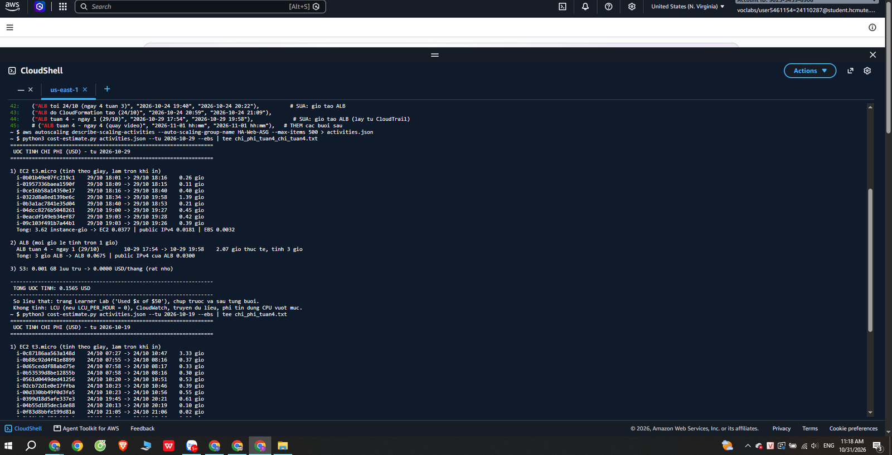

*Link ảnh: [hinh05_chi_phi_1.png](https://github.com/tranvannghia240806-hub/baocaocloud_24110287_24110282/blob/main/docs/images/tuan4/hinh05_chi_phi_1.png)*

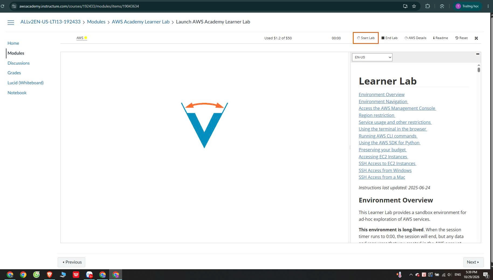

*Link ảnh: [hinh05_chi_phi_2.png](https://github.com/tranvannghia240806-hub/baocaocloud_24110287_24110282/blob/main/docs/images/tuan4/hinh05_chi_phi_2.png)*

*Link ảnh: [hinh05_chi_phi_3.png](https://github.com/tranvannghia240806-hub/baocaocloud_24110287_24110282/blob/main/docs/images/tuan4/hinh05_chi_phi_3.png)*

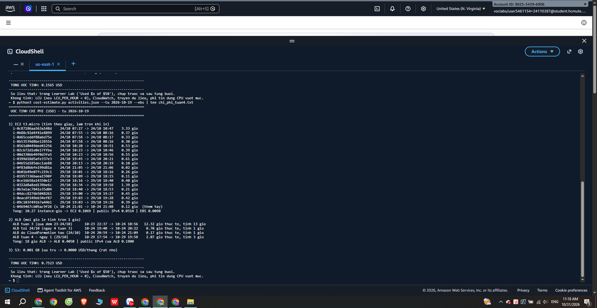

*Link ảnh: [hinh05_chi_phi_4.png](https://github.com/tranvannghia240806-hub/baocaocloud_24110287_24110282/blob/main/docs/images/tuan4/hinh05_chi_phi_4.png)*

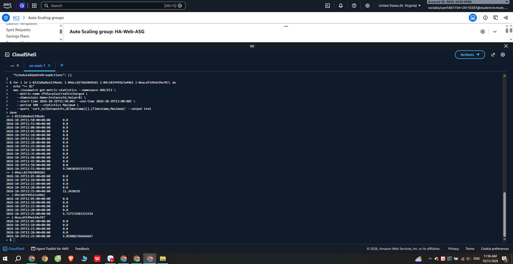

*Link ảnh: [hinh05_chi_phi_5.png](https://github.com/tranvannghia240806-hub/baocaocloud_24110287_24110282/blob/main/docs/images/tuan4/hinh05_chi_phi_5.png)*

*Hình 5. Ảnh 1: ước tính chi phí chỉ tuần 4 (cost-estimate.py, --tu 2026-10-29). Ảnh 2: Used $1.2 of $50 lúc 17:39 ngày 29/10. Ảnh 3: Used $1.4 of $50 lúc 11:49 ngày 31/10. Ảnh 4: ước tính từ 19/10 (0,7523 USD, chưa gồm tín dụng CPU). Ảnh 5: metric CPUSurplusCreditsCharged của bốn instance tải lần 3.*

So sánh với số liệu thật: từ 17:39 ngày 29/10 đến 11:49 ngày 31/10, Used tăng từ 1,2 lên 1,4 USD (khoảng 0,2 USD). Cùng khoảng thời gian, ước tính của script là 0,1565 USD cho tuần 4, cộng 0,0279 USD phí tín dụng CPU và khoảng 0,004 USD cho hai instance của thử nghiệm scheduled scaling ngày 31/10 (tổng khoảng 0,19 USD). Hai số cùng bậc độ lớn. Trang Learner Lab chỉ hiển thị một chữ số thập phân nên mức tăng thực nằm trong khoảng 0,1 đến 0,3 USD, nên không dùng chênh lệch này để kết luận độ chính xác của mô hình ước tính. Phần chênh (nếu có) có thể đến từ các khoản không tính (CloudWatch, truyền dữ liệu, S3 requests) và từ việc trang Learner Lab cập nhật trễ.

Về tín dụng CPU: bốn instance của tải lần 3 đều có CPUSurplusCreditsCharged bằng 0 trong phần lớn thời gian chạy, rồi xuất hiện một mốc lớn hơn 0 ở khung 5 phút cuối cùng của từng instance (12:55 UTC với i-0322d8a8ed139be6c, 12:25 UTC với ba instance còn lại): lần lượt 9,50; 11,24; 6,73 và 6,06 tín dụng, tổng 33,53 tín dụng (1 tín dụng bằng 1 vCPU-phút). Theo đơn giá 0,05 USD/vCPU-giờ, phí là 33,53 x 0,05 / 60 = khoảng 0,028 USD. Chỉ kiểm tra các instance của tải lần 3 (tải CPU cao); các instance của buổi kiểm thử AZ có CPU thấp nên chưa kiểm tra.

Nhận xét: chi phí chủ yếu đến từ ALB, không phải EC2. Theo Activity history, ASG không có instance nào từ 22:37 ngày 23/10 đến khi instance đầu tiên của ngày 24/10 được tạo lúc 07:27, nghĩa là khoảng 8 giờ 50 phút ALB chạy mà không có instance phía sau, tương đương khoảng 0,29 USD (khoảng 37 phần trăm tổng ước tính 0,7802 USD). Đây là lý do cần xóa ALB ngay khi kiểm thử xong.

## 6.3. Biện pháp tối ưu chi phí

| **Biện pháp** | **Tác dụng** | **Trạng thái** |
|---|---|---|
| Xóa ALB cuối mỗi buổi | ALB tính phí theo giờ dù không có request; tuần 3 có lần ALB chạy qua đêm 12 giờ 19 phút, phần lớn thời gian ASG chưa có instance (instance đầu tiên của ngày 24/10 chạy lúc 07:27) | Đã áp dụng từ tuần 2; Ngày 1 tuần 4: đặt ASG 0/0/4 và xóa ALB lúc 19:58 |
| Gộp nhiều bài kiểm thử vào một lần dựng ALB | Giảm số giờ ALB tính tròn | Đã áp dụng (Ngày 1–3 tuần 3 trong một buổi; Ngày 1 tuần 4 gộp kiểm thử AZ và tải lần 3) |
| Giới hạn max 4 và target CPU 50% | Tránh instance dư; số instance tối đa thực tế là 4 | Đã áp dụng |
| Scheduled scaling đưa ASG về 0 ngoài giờ | Tự động dừng instance khi không dùng | Đã thử một lần (mục 6.4); chưa áp dụng lịch lặp lại |
| S3 lifecycle xóa log sau một số ngày | Giữ dung lượng log ở mức thấp | Đề xuất, chưa áp dụng |
| Không bật detailed monitoring | Tiết kiệm phí metric; đánh đổi là dữ liệu CPU của ASG theo khung 5 phút nên T1 không chốt được đến phút | Hiện instance để Monitoring disabled |
| Giảm cỡ instance, Spot, Savings Plans | Giảm đơn giá EC2 | Đề xuất, chưa thử (giới hạn của Learner Lab) |

## 6.4. Thử nghiệm scheduled scaling

Thử nghiệm ngày 31/10, không dùng ALB. Hai scheduled action tạo bằng AWS CLI (put-scheduled-update-group-action), thực hiện một lần.

| **Thông số** | **Giá trị** |
|---|---|
| **Điều kiện đầu** | HA-Web-ASG 1/1/4 (instance i-03ce0a9c4d3dbacd0, bật lúc 11:22:55) |
| **Scheduled action 1** | Sched-Down: desired 0, min 0, max 4, hẹn lúc 11:32 |
| **Scheduled action 2** | Sched-Up: desired 1, min 1, max 4, hẹn lúc 11:42 |
| **Kết quả Down** | ASG thực hiện lúc 11:32:10 (trễ khoảng 10 giây); terminate i-03ce0a9c4d3dbacd0 xong lúc 11:33:23 (73 giây). Cause: "the scheduled action Sched-Down executed" |
| **Kết quả Up** | ASG thực hiện lúc 11:42:18 (trễ khoảng 18 giây); launch i-013d33c25daf490e8, hoàn tất bước launch lúc 11:42:24. Cause: "the scheduled action Sched-Up executed" |
| **Sau thử nghiệm** | Hai action là loại chạy một lần nên AWS tự xóa sau khi chạy; describe-scheduled-actions trả về danh sách rỗng. ASG đưa về 0/0/4 lúc khoảng 11:46 |

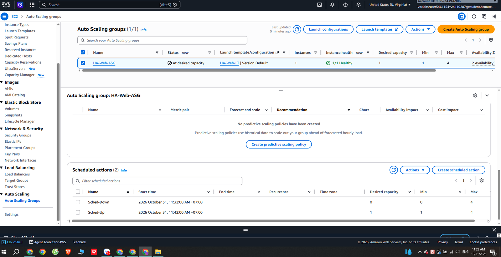

*Link ảnh: [hinh06_scheduled_scaling_1.png](https://github.com/tranvannghia240806-hub/baocaocloud_24110287_24110282/blob/main/docs/images/tuan4/hinh06_scheduled_scaling_1.png)*

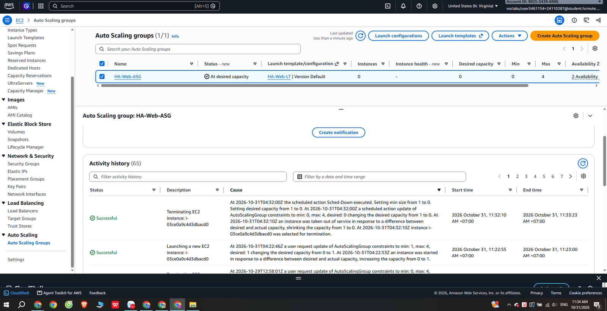

*Link ảnh: [hinh06_scheduled_scaling_2.png](https://github.com/tranvannghia240806-hub/baocaocloud_24110287_24110282/blob/main/docs/images/tuan4/hinh06_scheduled_scaling_2.png)*

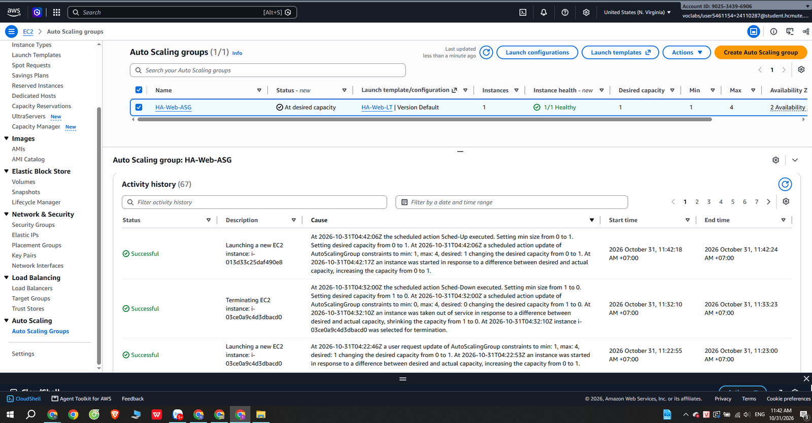

*Link ảnh: [hinh06_scheduled_scaling_3.png](https://github.com/tranvannghia240806-hub/baocaocloud_24110287_24110282/blob/main/docs/images/tuan4/hinh06_scheduled_scaling_3.png)*

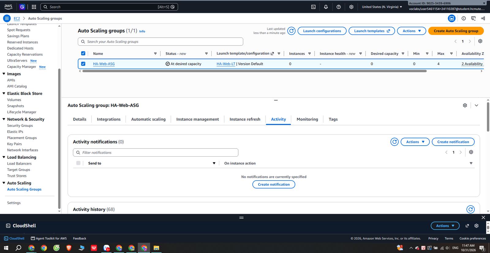

*Link ảnh: [hinh06_scheduled_scaling_4.png](https://github.com/tranvannghia240806-hub/baocaocloud_24110287_24110282/blob/main/docs/images/tuan4/hinh06_scheduled_scaling_4.png)*

*Hình 6. Ảnh 1: hai scheduled action trước giờ chạy. Ảnh 2: Sched-Down terminate instance (ASG 0/0/0/4). Ảnh 3: Sched-Up launch instance mới. Ảnh 4: ASG về 0/0/4 sau thử nghiệm.*

Nhận xét: ASG thực hiện action chậm hơn giờ hẹn khoảng 10 đến 18 giây, đủ chính xác cho việc dừng và bật theo giờ. Các mốc này là lúc ASG thực thi action; với Sched-Up mới xác nhận bước launch hoàn tất lúc 11:42:24, chưa ghi lại thời điểm instance InService và Healthy. Trong khoảng 10 phút (11:32 – 11:42) ASG không có instance nào, không phát sinh phí EC2. Với việc dùng thật, nên đặt lịch lặp lại (tham số recurrence) đưa ASG về 0 ngoài giờ học và bật lại đầu giờ. Lưu ý: scheduled scaling chỉ dừng instance, ALB vẫn tính phí theo giờ nên vẫn phải xóa ALB khi không dùng. Sau thử nghiệm ASG được để ở 0/0/4 (trạng thái tiết kiệm chi phí), khác cấu hình triển khai chính là min 1, max 4.

## 6.5. Minh chứng bổ sung cho số liệu chi phí

**Mốc tạo và xóa ALB (CloudTrail Event history, us-east-1, giờ Việt Nam).** Các mốc dùng trong bảng 6.2 được đối chiếu với CloudTrail:

| **Đợt ALB** | **CreateLoadBalancer** | **DeleteLoadBalancer** | **Ghi chú** |
|---|---|---|---|
| 17/10 | 17/10 07:05:11 | 17/10 17:40:23 | Ngoài phạm vi ước tính từ 19/10 |
| ALB qua đêm | 23/10 22:37:10 | 24/10 10:56:40 | Tính 13 giờ |
| ALB tối 24/10 | 24/10 19:40:56 | 24/10 20:22:02 | Tính 1 giờ |
| ALB CloudFormation | 24/10 20:59:23 | 24/10 21:09:43 | Tính 1 giờ |
| ALB ngày 29/10 | 29/10 17:54:43 | 29/10 19:58:33 | Tính 3 giờ |

**Dung lượng S3.** Lệnh aws s3 ls --recursive --summarize trả về 107 object (106 file .log.gz và một file ELBAccessLogTestFile), tổng 3.443.615 byte, tức khoảng 0,0034 GB. Giá trị này lớn hơn 0,001 GB đặt trong script lúc chạy ước tính, nhưng phí lưu trữ chỉ khoảng 0,0034 x 0,023 = 0,00008 USD/tháng, không làm đổi các tổng ở mức làm tròn 0,01 USD. Bản scripts/cost-estimate.py trong bộ nộp đã đặt S3_GB_STORED = 0,003443615 và điền đủ các mốc ALB ở trên; hai file chi_phi_tuan4*.txt là kết quả của lần chạy trước khi đổi giá trị S3.

**LCU của ALB.** Nhóm xuất metric ConsumedLCUs của CloudWatch (statistic Sum, chu kỳ 1 giờ) cho các ALB trong giai đoạn 23/10 đến 29/10: tổng các giá trị là 0,5695 (ALB qua đêm 0,3454; ALB 29/10 0,2220; ALB tối 24/10 0,0021; HA-Web-CFN-ALB 0,00007). Nếu coi toàn bộ số này là LCU-giờ thì phí LCU tối đa là 0,5695 x 0,008 = khoảng 0,0046 USD, dưới 1 phần trăm tổng ước tính. Nhóm chưa đối chiếu cách AWS tổng hợp LCU để tính hóa đơn nên khoản này chỉ dùng để đánh giá mức độ, không cộng vào tổng 0,7802 USD. Hai file CSV nằm tại docs/data/tuan4/.

**EBS.** Trang EC2, Volumes lúc 12:25 ngày 31/10 báo "You currently have no volumes in this region": không còn volume nào sau dọn dẹp. Launch Template HA-Web-LT (phiên bản 1) có Volumes (0), nghĩa là dùng cấu hình ổ mặc định của AMI. Hai ảnh này chưa cho biết loại ổ và dung lượng trong quá khứ, nên phí EBS (8 GB gp3 mỗi instance, 0,0090 USD) vẫn là giả định; khoản này nhỏ nên không ảnh hưởng đến kết luận.

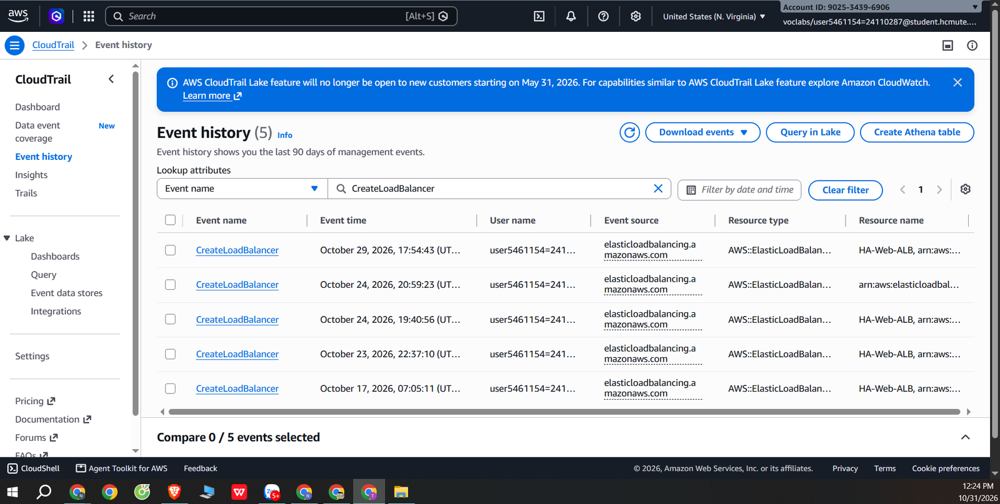

*Link ảnh: [hinh05_chi_phi_6.png](https://github.com/tranvannghia240806-hub/baocaocloud_24110287_24110282/blob/main/docs/images/tuan4/hinh05_chi_phi_6.png)*

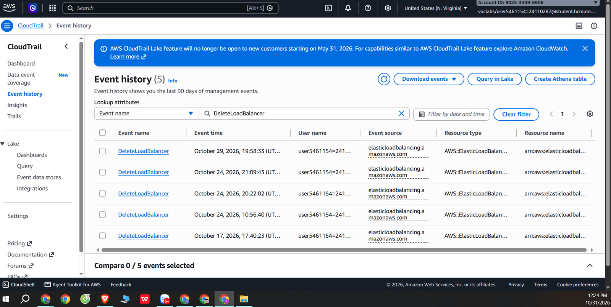

*Link ảnh: [hinh05_chi_phi_7.png](https://github.com/tranvannghia240806-hub/baocaocloud_24110287_24110282/blob/main/docs/images/tuan4/hinh05_chi_phi_7.png)*

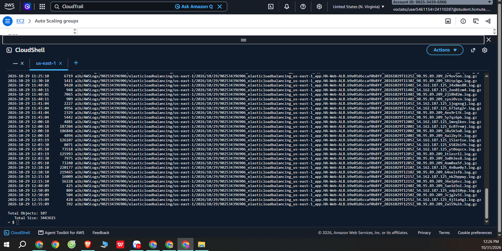

*Link ảnh: [hinh05_chi_phi_8.png](https://github.com/tranvannghia240806-hub/baocaocloud_24110287_24110282/blob/main/docs/images/tuan4/hinh05_chi_phi_8.png)*

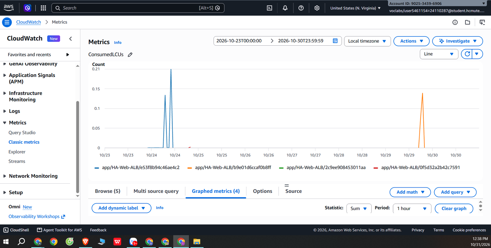

*Link ảnh: [hinh05_chi_phi_9.png](https://github.com/tranvannghia240806-hub/baocaocloud_24110287_24110282/blob/main/docs/images/tuan4/hinh05_chi_phi_9.png)*

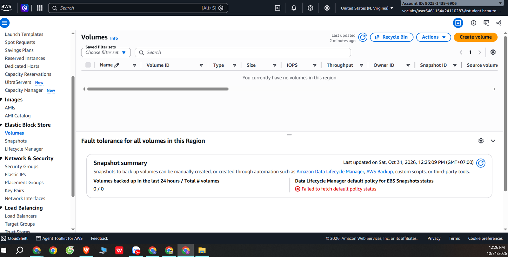

*Link ảnh: [hinh05_chi_phi_10.png](https://github.com/tranvannghia240806-hub/baocaocloud_24110287_24110282/blob/main/docs/images/tuan4/hinh05_chi_phi_10.png)*

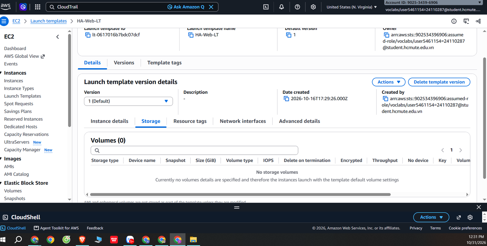

*Link ảnh: [hinh05_chi_phi_11.png](https://github.com/tranvannghia240806-hub/baocaocloud_24110287_24110282/blob/main/docs/images/tuan4/hinh05_chi_phi_11.png)*

*Hình 5 (tiếp). Ảnh 6: CloudTrail, sự kiện CreateLoadBalancer. Ảnh 7: CloudTrail, sự kiện DeleteLoadBalancer. Ảnh 8: S3, tổng 107 object và 3.443.615 byte. Ảnh 9: CloudWatch, metric ConsumedLCUs. Ảnh 10: EC2 Volumes trống. Ảnh 11: Launch Template HA-Web-LT, tab Storage (31/10/2026).*

## 6.6. Chi phí phiên ALB Ngày 4 (01/11/2026) và giới hạn

| **Hạng mục** | **Giá trị** |
|---|---|
| **ALB** | app/HA-Web-ALB/56ed5fc812158181 |
| **CreateLoadBalancer** | 01/11/2026 14:38:08 (CloudTrail, giờ Việt Nam) |
| **DeleteLoadBalancer** | 01/11/2026 17:11:08 |
| **Thời lượng thực tế** | 2 giờ 33 phút (2,55 giờ) |
| **Tính theo giờ làm tròn (cách của bảng 6.2)** | 3 giờ x (0,0225 + 2 x 0,005) = 0,0975 USD |
| **Tính theo thời lượng thực** | 2,55 x 0,0325 = 0,0829 USD |
| **Used trên Learner Lab** | 1,5 lúc 14:32 và 1,5 lúc 17:56 ngày 01/11 (trước đó 1,4 lúc 11:49 ngày 31/10) |

Hai cách tính ALB khác nhau do làm tròn giờ; bảng 6.2 dùng cách làm tròn nên khoản 0,0975 USD là con số cùng chuẩn với các dòng ALB trước. Cộng 0,0975 USD vào 0,7802 USD thì ALB và IPv4 của ALB đến hết Ngày 4 là 0,6825 USD và tổng ước tính tối thiểu khoảng 0,88 USD. Số này vẫn chưa gồm EC2, phí tín dụng CPU, LCU và CloudWatch của phiên Ngày 4 (nhóm chưa tổng hợp lại Activity của phiên này), và không phải hóa đơn AWS. Số Used hiển thị không đổi giữa hai ảnh nhưng chỉ có một chữ số thập phân và cập nhật trễ, nên không suy ra phiên Ngày 4 có chi phí bằng 0.

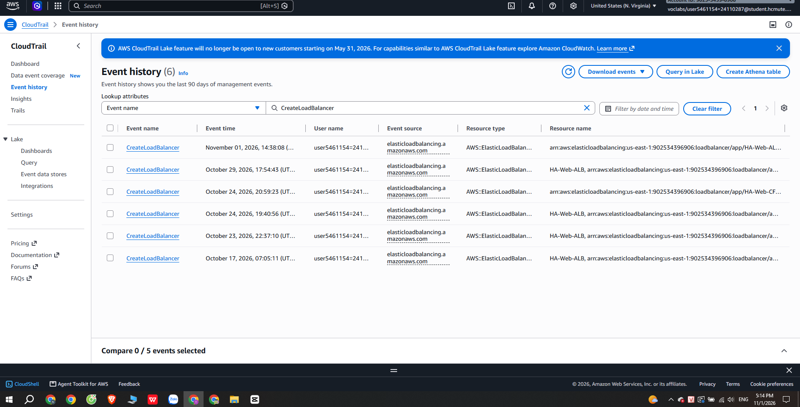

*Link ảnh: [hinh08_cloudtrail_create_ngay4.png](https://github.com/tranvannghia240806-hub/baocaocloud_24110287_24110282/blob/main/docs/images/tuan4/hinh08_cloudtrail_create_ngay4.png)*

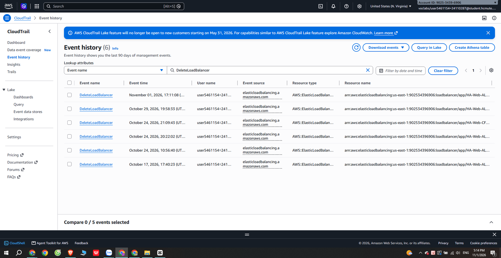

*Link ảnh: [hinh08_cloudtrail_delete_ngay4.png](https://github.com/tranvannghia240806-hub/baocaocloud_24110287_24110282/blob/main/docs/images/tuan4/hinh08_cloudtrail_delete_ngay4.png)*

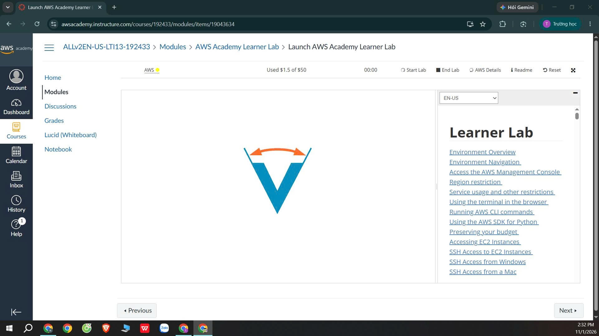

*Link ảnh: [hinh05_chi_phi_13.png](https://github.com/tranvannghia240806-hub/baocaocloud_24110287_24110282/blob/main/docs/images/tuan4/hinh05_chi_phi_13.png)*

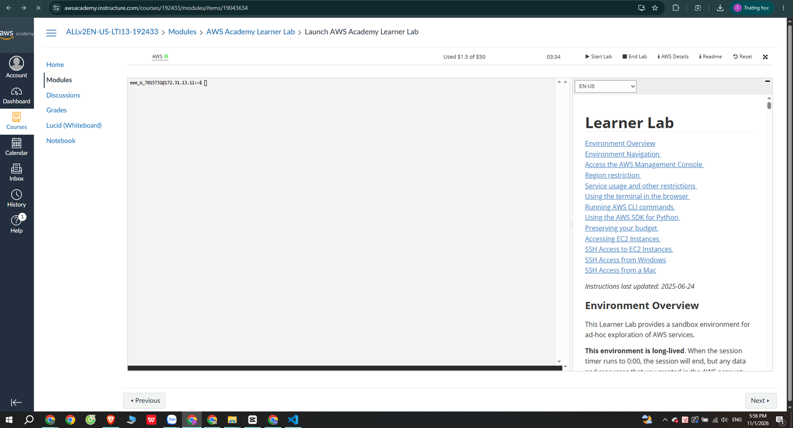

*Link ảnh: [hinh05_chi_phi_12.png](https://github.com/tranvannghia240806-hub/baocaocloud_24110287_24110282/blob/main/docs/images/tuan4/hinh05_chi_phi_12.png)*

*Hình 5 (tiếp). Ảnh 12: CloudTrail, CreateLoadBalancer 14:38:08 ngày 01/11. Ảnh 13: CloudTrail, DeleteLoadBalancer 17:11:08. Ảnh 14: Learner Lab Used $1.5 of $50 lúc 14:32. Ảnh 15: Used $1.5 of $50 lúc 17:56.*

# 7. Dọn dẹp tài nguyên

Thứ tự xóa đi từ tài nguyên tính phí theo giờ đến tài nguyên cấu hình. Launch Template không còn cần thiết vì user data và template CloudFormation đã lưu trên Git và có thể dựng lại.

Cuối Ngày 1 (29/10), sau khi kết thúc các bài kiểm thử có dùng ALB, nhóm đặt HA-Web-ASG về min 0 / desired 0 / max 4 và xóa HA-Web-ALB lúc 19:58 (thông báo "Successfully deleted load balancer" cho ALB HA-Web-ALB). Các tài nguyên còn lại được giữ để dùng ở Ngày 2–4 và dọn dẹp tổng thể ở Ngày 5. Chưa bấm Reset Lab.

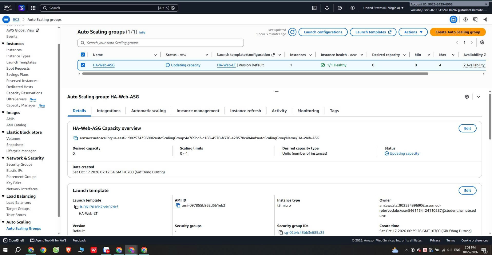

*Link ảnh: [hinh07_don_dep_ngay1_1.png](https://github.com/tranvannghia240806-hub/baocaocloud_24110287_24110282/blob/main/docs/images/tuan4/hinh07_don_dep_ngay1_1.png)*

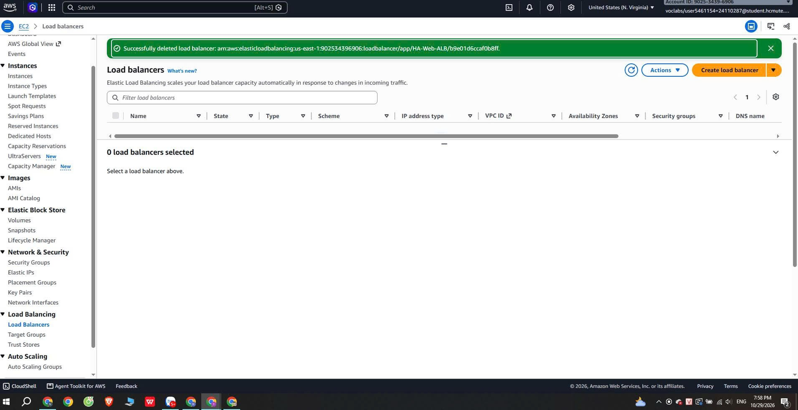

*Link ảnh: [hinh07_don_dep_ngay1_2.png](https://github.com/tranvannghia240806-hub/baocaocloud_24110287_24110282/blob/main/docs/images/tuan4/hinh07_don_dep_ngay1_2.png)*

*Hình 7A. Cuối Ngày 1: ASG min 0 / desired 0 / max 4 và xóa HA-Web-ALB (19:58)*

Dọn dẹp tổng thể (Ngày 4 và Ngày 5, 01/11/2026):

| **#** | **Tài nguyên** | **Hành động** | **Giờ** | **Kết quả** |
|---|---|---|---|---|
| 1 | Stack CloudFormation HA-Web-CFN-Stack | Xóa stack | 21:07–21:10 ngày 24/10 | DELETE_COMPLETE; có trong danh sách Deleted (mục 14.2) |
| 2 | ALB HA-Web-ALB | Delete load balancer | 19:58 ngày 29/10; 17:11:08 ngày 01/11 | Không còn ALB trong EC2, Load Balancers |
| 3 | Scheduled actions | Tự xóa sau khi chạy | 31/10 | describe-scheduled-actions trả về danh sách rỗng |
| 4 | ASG HA-Web-ASG (kèm instance) | Delete Auto Scaling group | 01/11 (Ngày 5) | Auto Scaling Groups (0) |
| 5 | Launch Template HA-Web-LT | Delete template | 01/11 | Danh sách trống |
| 6 | Target Group HA-Web-TG | Delete | 01/11 | Danh sách trống |
| 7 | Alarm CloudWatch (3 alarm bổ sung; 2 alarm Target Tracking tự mất theo ASG) | Delete alarms | 01/11 | Alarms (0) |
| 8 | Dashboard HA-Web-Dashboard | Delete dashboard | 01/11 | Custom Dashboards (0) |
| 9 | S3 bucket ha-web-alb-logs-902534396906 | Empty rồi Delete bucket | 01/11 | Đã xóa; trước khi xóa có 135 object, 3.509.560 byte (mục 14.1) |
| 10 | EBS volumes, Elastic IP, snapshots, network interfaces | Kiểm tra không còn | 01/11 | Volumes và Elastic IP trống, snapshots (CLI) trống; EC2 chỉ còn hai instance ở trạng thái Terminated (lịch sử hiển thị) |
| 11 | VPC HA-Web-vpc, subnet, Internet Gateway, route table, Security Group (không tính phí) | Giữ lại | – | Không có ảnh xóa; không ghi nhận là đã xóa |

Ngày 4 (01/11/2026), sau khi quay video và kiểm thử AZ, nhóm đặt HA-Web-ASG về min 0 / desired 0 / max 4. Ảnh đầu cho thấy ASG còn 2 instance và đang cập nhật capacity; ảnh sau khi hoàn tất xác nhận Instances = 0, trạng thái At desired capacity. Nhóm xóa HA-Web-ALB lúc 17:11:08 và danh sách Load Balancers ở us-east-1 không còn ALB.

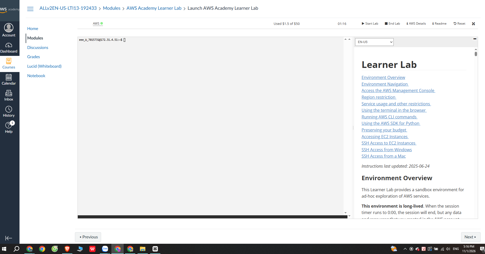

*Link ảnh: [hinh07_don_dep_ngay4_1.png](https://github.com/tranvannghia240806-hub/baocaocloud_24110287_24110282/blob/main/docs/images/tuan4/hinh07_don_dep_ngay4_1.png)*

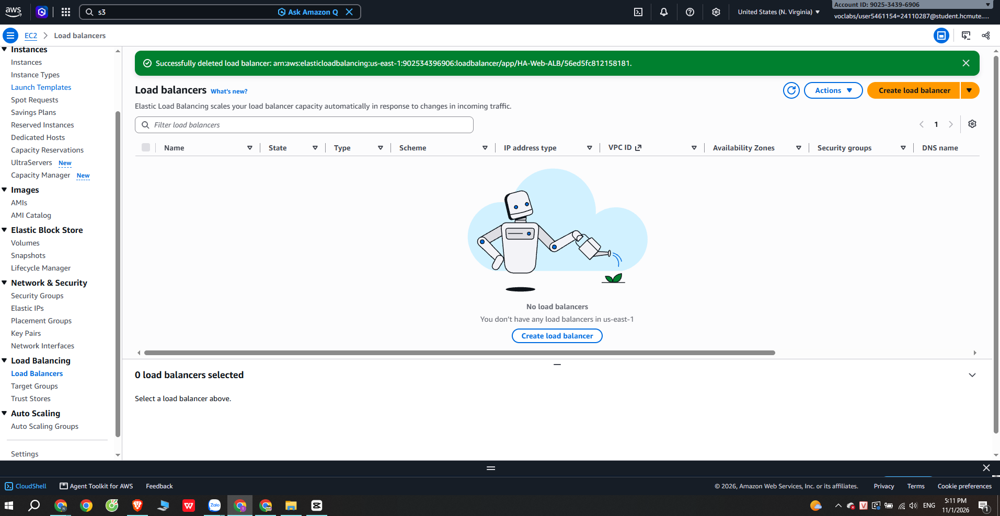

*Link ảnh: [hinh07_don_dep_ngay4_2.png](https://github.com/tranvannghia240806-hub/baocaocloud_24110287_24110282/blob/main/docs/images/tuan4/hinh07_don_dep_ngay4_2.png)*

*Hình 7B. Ngày 4: ASG min 0 / desired 0 / max 4, Instances 0; thông báo xóa HA-Web-ALB và danh sách ALB trống*

Ngày 5, nhóm rà soát toàn bộ tài nguyên dự án ở us-east-1:

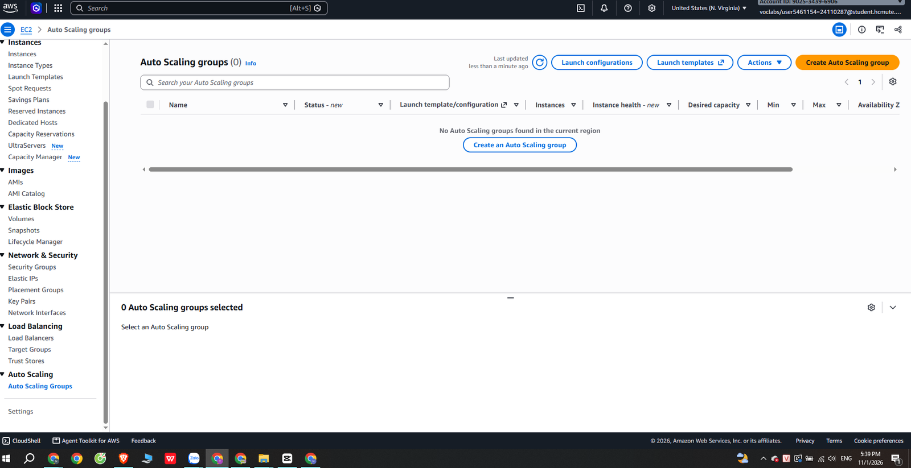

*Link ảnh: [hinh07_don_dep_1.png](https://github.com/tranvannghia240806-hub/baocaocloud_24110287_24110282/blob/main/docs/images/tuan4/hinh07_don_dep_1.png)*

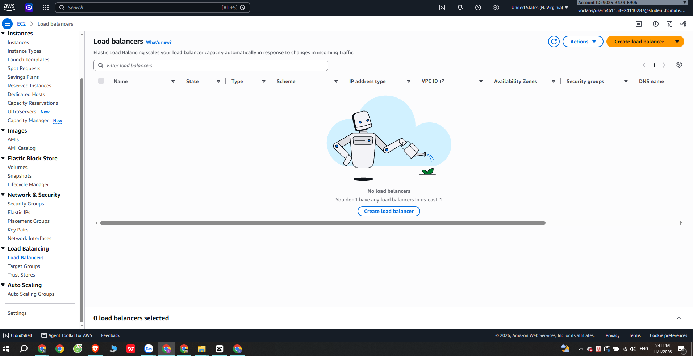

*Link ảnh: [hinh07_don_dep_2.png](https://github.com/tranvannghia240806-hub/baocaocloud_24110287_24110282/blob/main/docs/images/tuan4/hinh07_don_dep_2.png)*

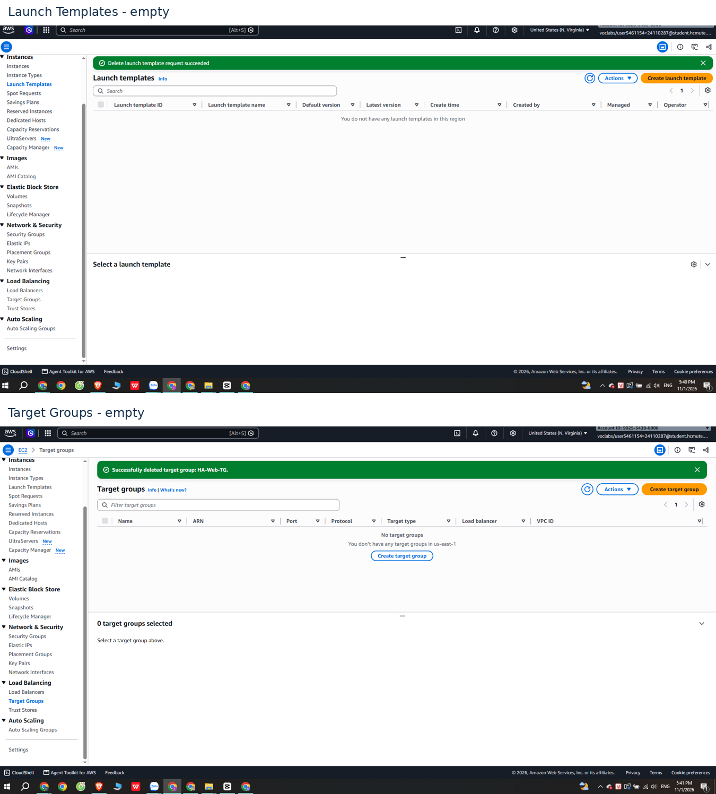

*Link ảnh: [hinh07_don_dep_3.png](https://github.com/tranvannghia240806-hub/baocaocloud_24110287_24110282/blob/main/docs/images/tuan4/hinh07_don_dep_3.png)*

*Link ảnh: [hinh07_don_dep_4.png](https://github.com/tranvannghia240806-hub/baocaocloud_24110287_24110282/blob/main/docs/images/tuan4/hinh07_don_dep_4.png)*

*Link ảnh: [hinh07_don_dep_6.png](https://github.com/tranvannghia240806-hub/baocaocloud_24110287_24110282/blob/main/docs/images/tuan4/hinh07_don_dep_6.png)*

*Hình 7C. Ngày 5: ảnh 1, không còn Auto Scaling Group; ảnh 2, không còn ALB; ảnh 3, Launch Template và Target Group đã xóa; ảnh 4, EC2 chỉ còn Terminated, Volumes và Elastic IP trống; ảnh 5, Alarms (0) và Dashboards (0)*

Việc rà soát chỉ gồm các tài nguyên chính liệt kê ở bảng; không phải kiểm toán mọi dịch vụ có thể phát sinh phí. Chưa bấm Reset Lab.

# 8. Video demo

| **Thông số** | **Giá trị** |
|---|---|
| **Thời lượng** | 09:45 (không quá 10 phút) |
| **Link** | [https://youtu.be/SzbixCAcb0s](https://youtu.be/SzbixCAcb0s), YouTube chế độ Không công khai, đã mở được bằng tab ẩn danh |
| **Công cụ quay và dựng** | Dựng và xuất bằng CapCut PC |
| **Đoạn quay trực tiếp và đoạn phát lại** | Kết quả scale-out và scale-in là kết quả đã đo ngày 29/10, không phải chạy trực tiếp; website qua hai AZ và kiểm thử AZ được quay ngày 01/11 (mục 4.2.3) |
| **Có thuyết minh** | Có, của cả hai thành viên |

| **Mốc thời gian** | **Nội dung** | **Ghi chú** |
|---|---|---|
| 0:00–1:00 | Giới thiệu đề tài, sơ đồ kiến trúc, cấu hình ASG và Target Tracking | Sơ đồ architecture.png và thông số ASG, Target Tracking |
| 1:00–2:30 | Hệ thống đang chạy: website qua ALB, hai instance ở hai AZ | Thao tác trực tiếp trên AWS |
| 2:30–4:30 | CPU tăng, alarm, scale-out và scale-in | Phát lại kết quả đo ngày 29/10 |
| 4:30–6:00 | Mất instance ở một AZ và phục hồi | Quay trực tiếp ngày 01/11 |
| 6:00–7:00 | CloudFormation: template và stack | Template và minh chứng tuần 3 |
| 7:00–8:00 | ALB access log trên S3 và kết quả phân tích | Minh chứng S3 và thống kê 49 076 bản ghi (Ngày 2) |
| 8:00–9:00 | Chi phí ước tính, biện pháp tối ưu và dọn dẹp | Ước tính khoảng 0,78 USD đến Ngày 3; chưa gồm đầy đủ LCU, CloudWatch |
| 9:00–9:45 | Kết luận, hạn chế và hướng phát triển | Kết thúc trước 10 phút |

*Link ảnh: [hinh08_demo_1.png](https://github.com/tranvannghia240806-hub/baocaocloud_24110287_24110282/blob/main/docs/images/tuan4/hinh08_demo_1.png)*

*Link ảnh: [hinh08_demo_2.png](https://github.com/tranvannghia240806-hub/baocaocloud_24110287_24110282/blob/main/docs/images/tuan4/hinh08_demo_2.png)*

*Hình 8. Ảnh 1: trang YouTube Studio với tiêu đề, thời lượng 09:45 và chế độ Không công khai. Ảnh 2: video phát trong cửa sổ ẩn danh*

Kết quả kiểm thử AZ quay trong video được trình bày ở mục 4.2.3; chi phí phiên ALB Ngày 4 ở mục 6.6.

# 9. Đối chiếu yêu cầu của đề tài

| **Yêu cầu của giảng viên** | **Kết quả** | **Nơi xem** |
|---|---|---|
| Launch Template, ASG min 1 – max 4, t3.micro | Đạt: HA-Web-LT, HA-Web-ASG 1–4 | Báo cáo tuần 2, mục 3 của báo cáo này |
| ALB có health check | Đạt: HA-Web-TG health check "/" mỗi 10 giây | Báo cáo tuần 2 |
| Kịch bản tải bằng ab/hey/locust | Đạt: script load-test.sh và ab (ba lần tải) | Tuần 3 mục 4–5; mục 4.3 |
| Biểu đồ CloudWatch minh họa scale-out và scale-in | Đạt | Tuần 3 Hình 5, 6, 8; Hình 3 của báo cáo này |
| Cấu hình Target Tracking và thời gian warm-up | Đạt: CPU 50%, warm-up 120 giây; instance mới Healthy không quá 1 phút 4 giây sau khi khởi tạo (lần 3) | Mục 4.3 |
| Dịch vụ EC2, Auto Scaling, ELB, CloudWatch; ASG max 4 | Đạt (thêm S3 và CloudFormation) | Mục 3 |
| Dùng LabRole, gắn tag Project/Owner, không tạo IAM | Đạt | Báo cáo tuần 1–3 |
| Báo cáo chi phí và tối ưu chi phí | Đạt một phần: có ước tính theo mốc CloudTrail, đối chiếu với Used, thử scheduled scaling và chi phí phiên ALB Ngày 4; tổng là ước tính, chưa gồm đầy đủ LCU, CloudWatch và EC2 của Ngày 4 | Mục 6 |
| Dọn dẹp tài nguyên | Đạt: ASG, ALB, Launch Template, Target Group, alarm, dashboard và S3 bucket đã xóa; Volumes và Elastic IP trống; giữ lại VPC và các tài nguyên mạng không tính phí | Mục 7, 14 |
| Mã nguồn, template trên Git; báo cáo và sơ đồ | Đạt | Repo GitHub |
| Video demo không quá 10 phút | Đạt: 09:45, YouTube Unlisted, đã kiểm tra phát trong tab ẩn danh | Mục 8 |

# 10. Kết luận và hướng phát triển

Kết luận:

- Hệ thống đáp ứng mục tiêu sẵn sàng cao: ALB phân phối request tới hai AZ, ASG tự thay thế instance bị mất và tăng giảm số instance theo CPU trong giới hạn 1 đến 4.
- Các lần đo cho thấy từ lúc ASG tăng desired đến lúc instance mới Healthy khoảng 1 phút, ngắn hơn warm-up 120 giây đã cấu hình, và scale-in hoàn tất khoảng 19 đến 20 phút sau khi dừng tải (lần 1: 20 phút 8 giây; lần 3: 18 phút 57 giây).
- Khi terminate instance duy nhất của một AZ, website lỗi khoảng 16 giây (5 request, toàn bộ gửi tới instance bị terminate theo log ALB) và được phục vụ tiếp bởi AZ còn lại; ASG tạo instance thay thế sau 2 giây kể từ lúc ghi nhận instance chết.
- Phân tích 49 076 dòng log ALB cho thấy số request của script khớp log ở lần 1 và lần 3; 4 request chênh lệch của lần 1 đến từ user-agent khác script; thời gian xử lý của target (41–61 ms) rất nhỏ so với thời gian client đo (854–1000 ms).
- Chi phí chủ yếu đến từ ALB chứ không phải EC2 (ALB và IPv4 của ALB chiếm khoảng 75% ước tính 0,7802 USD đến Ngày 3); ASG về 0 instance không xóa ALB nên cần xóa ALB ngay sau mỗi buổi kiểm thử. Ước tính là con số có giới hạn (chưa gồm đầy đủ LCU, CloudWatch và EC2 của phiên Ngày 4), không phải hóa đơn.
- Kiểm thử AZ trực tiếp ngày 01/11 cho kết quả cùng hướng ngày 29/10: 5 request bất thường trên 528 dòng (3 mã 502 và 2 mã 000, trải trong 12 giây), instance thay thế phục vụ từ 16:05:44; vì còn request lỗi nên không khẳng định không gián đoạn.
- Toàn bộ số liệu là số đo thật trên Learner Lab; các mốc không xác định được (T1 theo khung 5 phút, nguyên nhân các lỗi 502, chênh lệch số request, khoảng trống CSV lần 3) đã được ghi rõ.

Hạn chế:

- Chưa triển khai HTTPS vì cần tên miền và chứng chỉ ACM; chưa có WAF.
- Kịch bản tải kết thúc theo đồng hồ chứ không theo thời gian CPU, nên không đo được suy giảm chất lượng phục vụ khi quá tải; TargetResponseTime không phản ánh đúng thời gian xử lý của /cgi-bin/load.sh.
- Dữ liệu CPU của ASG theo khung 5 phút (instance không bật detailed monitoring) nên mốc T1 chỉ xác định theo khung này.
- Sự cố 1 AZ được mô phỏng bằng terminate instance, không mô phỏng được mất mạng cả AZ trong Learner Lab.
- CSV của lần tải thứ 3 thiếu đoạn 19:15:16–19:39:38 (CloudShell ngắt kết nối), trùng quá trình scale-in.

Hướng phát triển:

- Triển khai HTTPS (ACM và tên miền) và AWS WAF.
- Đưa Launch Template vào template CloudFormation để dựng lại toàn bộ hệ thống bằng một stack.
- Dùng Target Tracking theo số request trên mỗi target (ALBRequestCountPerTarget) kết hợp CPU; dùng scheduled hoặc predictive scaling cho tải có quy luật.
- Bật detailed monitoring khi cần đo chính xác thời gian phản ứng; xem xét Spot hoặc Savings Plans nếu chạy dài hạn.

# 11. Ghi chú sử dụng AI

| **Phần công việc** | **Mức độ hỗ trợ của AI** |
|---|---|
| **Script analyze-alb-logs.sh và cost-estimate.py** | Dùng Claude soạn; nhóm đọc, chạy thử trên dữ liệu thật của mình và giải thích được từng phần |
| **Kế hoạch kiểm thử, kịch bản demo, các bước thực hiện** | AI gợi ý; nhóm tự thực hiện trên AWS Learner Lab và chụp minh chứng |
| **Phân tích số liệu (log ALB, CSV, ảnh console)** | AI hỗ trợ tính toán và gợi ý lệnh kiểm tra; nhóm chạy lệnh và đối chiếu với console |
| **Khung báo cáo tuần 4** | AI soạn khung theo mẫu các tuần trước; nhóm điền số liệu đo thật và nhận xét |

Ngoài ra nhóm dùng ChatGPT để hỗ trợ đối chiếu số liệu, hướng dẫn quy trình AWS và Git, soạn và rà báo cáo; nhóm tự chạy lệnh, quay video và kiểm chứng kết quả.

Mọi tài nguyên đều do nhóm triển khai và chạy thật trên AWS Learner Lab; số liệu trong báo cáo là số liệu đo thực tế.

# 12. Khó khăn và vấn đề gặp phải

- **Lần thử AZ đầu bị chính sách scaling xen vào (Ngày 1).** Nguyên nhân: đặt desired = 2 nhưng min = 1, nên AlarmLow của Target Tracking đưa desired về 1 sau khoảng 6 phút; nhóm phát hiện khi xem ASG Activity thấy "Terminating" i-01957336baea1590f lúc 18:15:51 cùng lúc nhóm terminate i-0b01b49e07fc219c1. Xử lý: đặt min = 2, desired = 2 rồi làm lại (mục 4.2.2); giữ dữ liệu lần đầu làm bằng chứng. Sau kiểm thử, đặt lại min = 1 / desired = 1 trước khi chạy tải lần 3.
- **CloudShell ngắt kết nối khi chờ scale-in (Ngày 1).** Nguyên nhân: CloudShell tự ngắt khi không hoạt động, tiến trình nohup load-test.sh bị dừng lúc 19:15:16. Xử lý: không chạy lại tải; chạy script theo dõi tiếp (monitor-tiep.sh) từ 19:39:38 và lấy các mốc scale-in từ ASG Activity history và CloudWatch Alarms. Đã kiểm tra thời gian sửa file trong CloudShell: đoạn 19:15:16–19:39:38 chưa từng được ghi.

*Link ảnh: [hinh12_kho_khan_1.png](https://github.com/tranvannghia240806-hub/baocaocloud_24110287_24110282/blob/main/docs/images/tuan4/hinh12_kho_khan_1.png)*

*Link ảnh: [hinh12_kho_khan_2.png](https://github.com/tranvannghia240806-hub/baocaocloud_24110287_24110282/blob/main/docs/images/tuan4/hinh12_kho_khan_2.png)*

*Hình 9. CloudShell sau khi ngắt kết nối: load-test.sh dừng lúc 19:15:16 và script theo dõi tiếp chạy lại từ 19:39:38*

- **Danh sách lỗi của script bị cắt ở 40 dòng (Ngày 2).** Phần 7 của analyze-alb-logs.sh chỉ in tối đa 40 request không phải 2xx, nên với kiểm thử AZ lần 1 (78 request khác 2xx) danh sách bị cắt. Xử lý: dùng lệnh zcat và awk bổ sung để đếm theo target và mã trạng thái.
- **Thiếu giờ tạo ALB khi ước tính chi phí (Ngày 3).** Nguyên nhân: giờ tạo ALB không có trong Activity history của ASG (ASG không cần ALB) nên script ban đầu để trống hai mốc. Xử lý: tra CloudTrail (CreateLoadBalancer, DeleteLoadBalancer), điền ALB_INTERVALS và chạy lại script.
- **Số Used của Learner Lab cập nhật trễ và chỉ có một chữ số thập phân (Ngày 3 đến Ngày 5).** Hệ quả: không dùng chênh lệch Used để kết luận chi phí của từng phiên. Xử lý: ghi số hiển thị kèm giờ chụp và nêu rõ giới hạn.
- **File log curl của kiểm thử AZ Ngày 4 gồm hai đợt ghi (Ngày 4).** Nguyên nhân: script được chạy hai lần, cách nhau 1 giờ 3 phút 39 giây. Xử lý: báo cáo từng đợt riêng và không suy ra thời gian terminate đến Healthy từ file này (mục 4.2.3).
- **Stack của AWS Academy báo DELETE_FAILED khi thử xóa (Ngày 5).** Chi tiết ở mục 14.2; stack này không thuộc dự án HA-Web.

# 13. Tài liệu tham khảo

- AWS, Elastic Load Balancing pricing (Application Load Balancer).
- AWS, Amazon EC2 T3 instances và User Guide "Unlimited mode for burstable instances".
- AWS, Amazon EC2 Auto Scaling User Guide: Target tracking scaling policies, Scheduled scaling.
- AWS, Elastic Load Balancing User Guide: Access logs for your Application Load Balancer.

# 14. Tổng kết Ngày 5 (01/11/2026)

Phạm vi kiểm tra: us-east-1. Các số liệu tải và ALB access log của những ngày trước giữ nguyên theo thời điểm thực nghiệm; không xem log sau Ngày 4 là đã được phân tích lại.

## 14.1. S3 logs và đối chiếu thời điểm thu thập

| **Thời điểm** | **Object** | **Tổng dung lượng (byte)** |
|---|---|---|
| Thống kê Ngày 3 | 107 | 3.443.615 |
| Kiểm tra trước khi xóa bucket, Ngày 5 | 135 | 3.509.560 |
| Chênh lệch | +28 | +65.945 |

Bộ phân tích ngày 30/10 có 106 file .log.gz và 49 076 bản ghi, thuộc mốc phân tích cũ, không phải tổng số dòng của 135 object cuối cùng. Bucket đã xóa; bảng ghi đầu ra aws s3 ls --recursive --summarize trước khi xóa. Chưa có bản sao độc lập của toàn bộ 135 object thô nên không khẳng định đã sao lưu đầy đủ.

## 14.2. CloudFormation: stack dự án và stack AWS Academy

Stack HA-Web-CFN-Stack của bài thử CloudFormation đã DELETE_COMPLETE từ 24/10/2026. Một stack khác có mô tả "associate Learner Lab template (academy)" (tạo ngày 10/10/2026) được nhóm thử xóa ở Ngày 5; lần đầu trả DELETE_FAILED với các tài nguyên LabEksClusterRole, LabEksNodeRole, Custom1 và InvokeRCFJ. Ảnh kiểm tra sau đó cho thấy DELETE_COMPLETE lúc 18:03:11 ngày 01/11/2026 (UTC+07) và bộ lọc Active ghi Stacks (0).

Đây là stack gắn với hạ tầng AWS Academy, không phải stack triển khai HA-Web, nên không tính là thành tích dọn dẹp của nhóm. DELETE_COMPLETE chỉ xác nhận CloudFormation đã kết thúc việc xóa stack, không chứng minh mọi tài nguyên phụ thuộc đã bị xóa. Nếu Learner Lab có lỗi về IAM hoặc custom resource, cần báo giảng viên. Bucket cf-templates-sfjmwmkni325-us-east-1 vẫn được giữ lại vì chưa xác minh thuộc phạm vi dọn dẹp của nhóm.

*Link ảnh: [hinh07_cloudformation_ngay5_1.png](https://github.com/tranvannghia240806-hub/baocaocloud_24110287_24110282/blob/main/docs/images/tuan4/hinh07_cloudformation_ngay5_1.png)*

*Link ảnh: [hinh07_cloudformation_ngay5_2.png](https://github.com/tranvannghia240806-hub/baocaocloud_24110287_24110282/blob/main/docs/images/tuan4/hinh07_cloudformation_ngay5_2.png)*

*Hình 14. Ảnh 1: CloudFormation Active, Stacks (0). Ảnh 2: danh sách Deleted có hai stack ở trạng thái DELETE_COMPLETE*

## 14.3. Dữ liệu và hồ sơ nộp

- Video demo: https://youtu.be/SzbixCAcb0s (09:45, Unlisted, đã kiểm tra tab ẩn danh).
- Kiểm thử AZ Ngày 4: 528 dòng curl (523 mã 200, 3 mã 502, 2 mã 000), hai đợt ghi; log curl này tách biệt với 49 076 bản ghi ALB đã phân tích ở Ngày 2 và với 17 974 request của tải lần 3 (docs/data/tuan4/requests_20261029_185522.log).
- Dữ liệu và ảnh nằm tại docs/data/tuan4/ và docs/images/tuan4/. Không đưa log ALB thô (có địa chỉ IP) lên Git.

## 14.4. Kết luận Ngày 5

Các thành phần vận hành chính của HA-Web đã được gỡ bỏ, không còn tài nguyên đang chạy ở us-east-1 theo ảnh Console và kết quả CLI. Hạn chế: phạm vi chi phí chưa gồm mọi dịch vụ, chưa phân tích lại toàn bộ log thô sau phiên 01/11, và kiểm thử AZ không cho phép kết luận mức sẵn sàng tuyệt đối.

# Checklist tuần 4

- [x] Kiểm thử mất instance ở một AZ và ghi log từng giây.
- [x] Chạy tải lần 3 với đủ mốc T0–T9.
- [x] Phân tích ALB access log bằng script.
- [x] Ước tính chi phí bằng script và so với credit Learner Lab.
- [x] Thử scheduled scaling và xóa scheduled action sau khi thử.
- [x] Quay video demo (09:45) và kiểm tra link bằng tab ẩn danh.
- [x] Dọn dẹp toàn bộ tài nguyên và chụp ảnh xác nhận.
- [x] Chạy git grep tìm khóa truy cập trước khi push.
- [x] Commit script, dữ liệu, báo cáo lên Git với commit message rõ nội dung.
- [x] Nộp báo cáo trên hệ thống projects-fit.
